<a id="top"></a>

<div align="center">

# Assignment 1: Hodgkin-Huxley Neuron Model

**Action potential generation, refractoriness, C-F conversion and cable propagation, simulated in Delphi 13**

[](#build-and-run)
[](Program/Unit1.pas)
[](#numerical-methods)
[](https://github.com/ZinniXX004/Biocybernetics/actions/workflows/a1-model-regression.yml)
[](Report/)

[Overview](#overview) ·
[Problems](#problems-and-where-they-are-answered) ·
[Screenshots](#screenshots) ·
[Equations](#theory-and-equations) ·
[Numerics](#numerical-methods) ·
[Results](#results) ·
[Verification](#verification-and-ci) ·
[Build](#build-and-run) ·
[Usage](#using-the-program) ·
[References](#references)

<picture>
  <source media="(prefers-color-scheme: dark)" srcset="docs/img/results-dark.png">
  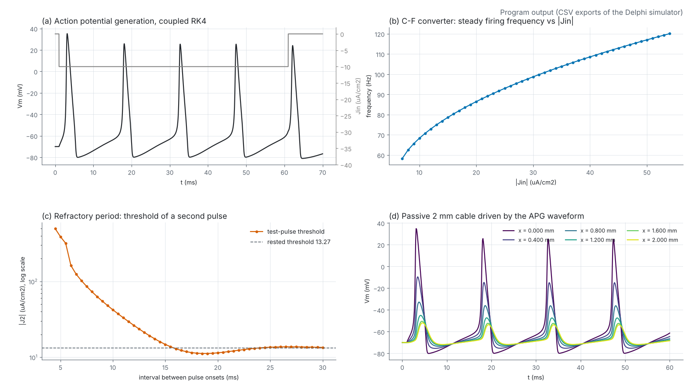
</picture>

<sub>All four panels are plotted from the CSV files exported by the program (<a href="Data/">Data/</a>).</sub>

</div>

## Overview

|              |                                                                               |
| ------------ | ----------------------------------------------------------------------------- |
| **Course**   | Biocybernetics (EB234701), Class Q, Department of Biomedical Engineering, ITS |
| **Student**  | Jeremia Christ Immanuel Manalu (5023231017)                                   |
| **Lecturer** | Dr. Achmad Arifin, S.T., M.Eng.                                               |
| **Program**  | `HHSimulator`, UI v4.3: six tabs, six derivation windows, CSV and PNG export  |
| **Model**    | Hodgkin and Huxley (1952), squid giant axon, original sign convention         |
| **Status**   | Submitted on MyITS Classroom; the program and the report are maintained here  |

The simulator integrates the four Hodgkin-Huxley equations with a coupled fourth-order Runge-Kutta scheme (and, for comparison, the lecturer's sequential RK4), and solves the cable equation of the axon with an explicit central-forward difference scheme or with Crank-Nicolson. Every equation that the program uses can be opened from the main window in a separate derivation sheet, where it is highlighted in yellow.

<p align="right"><sub><a href="#top">Back to top</a></sub></p>

## Problems and where they are answered

| #   | Problem                                                                                                                                                                            | Program                          | Report                                 |
| --- | ---------------------------------------------------------------------------------------------------------------------------------------------------------------------------------- | -------------------------------- | -------------------------------------- |
| 1   | Simulate action potential generation (APG) with RK4; explain how the output is aligned to Vm; show the refractory period; show how the Jin level programs the inter-pulse interval | Tabs 1 to 4, sheets 1 to 3 and 6 | Sections 2.2.2, 2.3.1 to 2.3.4         |
| 2   | Derive the integration of the action potential propagation (APP) PDE with central and forward differences                                                                          | Sheet 5 ("FD derivation")        | Section 2.2.3 (highlighted derivation) |
| 3   | Simulate the propagation numerically and explain how the model exhibits propagation                                                                                                | Tab 5, sheet 4                   | Sections 2.2.4, 2.3.5                  |
| 4   | Review the HH model in two scientific papers and its impact on medical and biological technology                                                                                   |                                  | Section 2.2.5                          |

<p align="right"><sub><a href="#top">Back to top</a></sub></p>

## Screenshots

<table>
  <tr>
    <td width="50%"><a href="docs/img/ui-tab1-apg.png">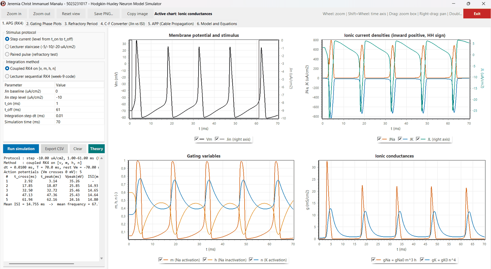</a><br><sub><b>Tab 1. APG (RK4)</b>: Vm and Jin, ionic currents, gates and conductances for a step of -10 uA/cm2</sub></td>
    <td width="50%"><a href="docs/img/ui-tab2-phase.png">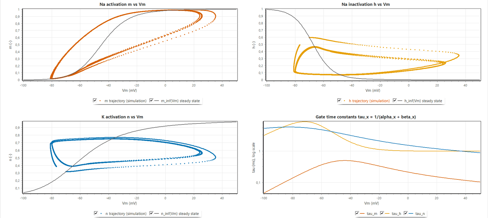</a><br><sub><b>Tab 2. Gating phase plots</b>: m, h and n against Vm over their steady states, and the time constants</sub></td>
  </tr>
  <tr>
    <td><a href="docs/img/ui-tab3-refractory.png">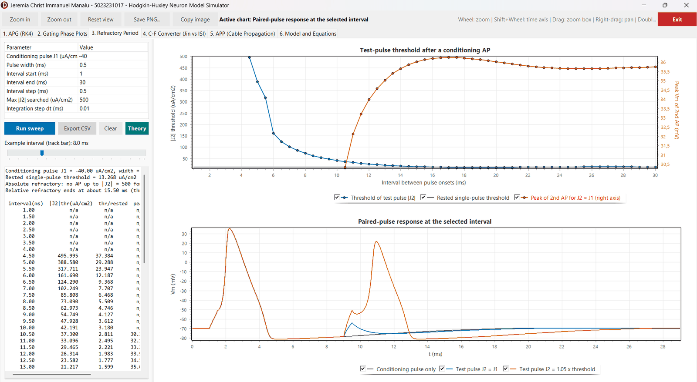</a><br><sub><b>Tab 3. Refractory period</b>: threshold of a test pulse against the interval after a conditioning action potential</sub></td>
    <td><a href="docs/img/ui-tab4-cf.png">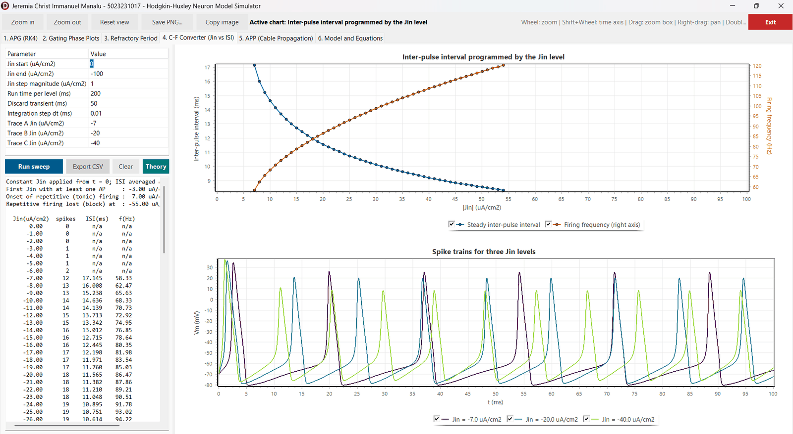</a><br><sub><b>Tab 4. C-F converter</b>: steady inter-pulse interval and frequency against |Jin|, with example spike trains</sub></td>
  </tr>
  <tr>
    <td><a href="docs/img/ui-tab5-lecturer.png">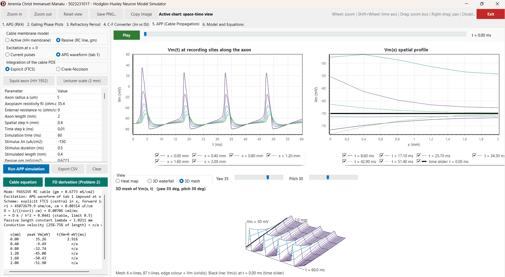</a><br><sub><b>Tab 5. APP, lecturer preset</b>: passive 2 mm cable driven by the APG waveform, four attenuated waves, 3D mesh</sub></td>
    <td><a href="docs/img/ui-sheet-window.png">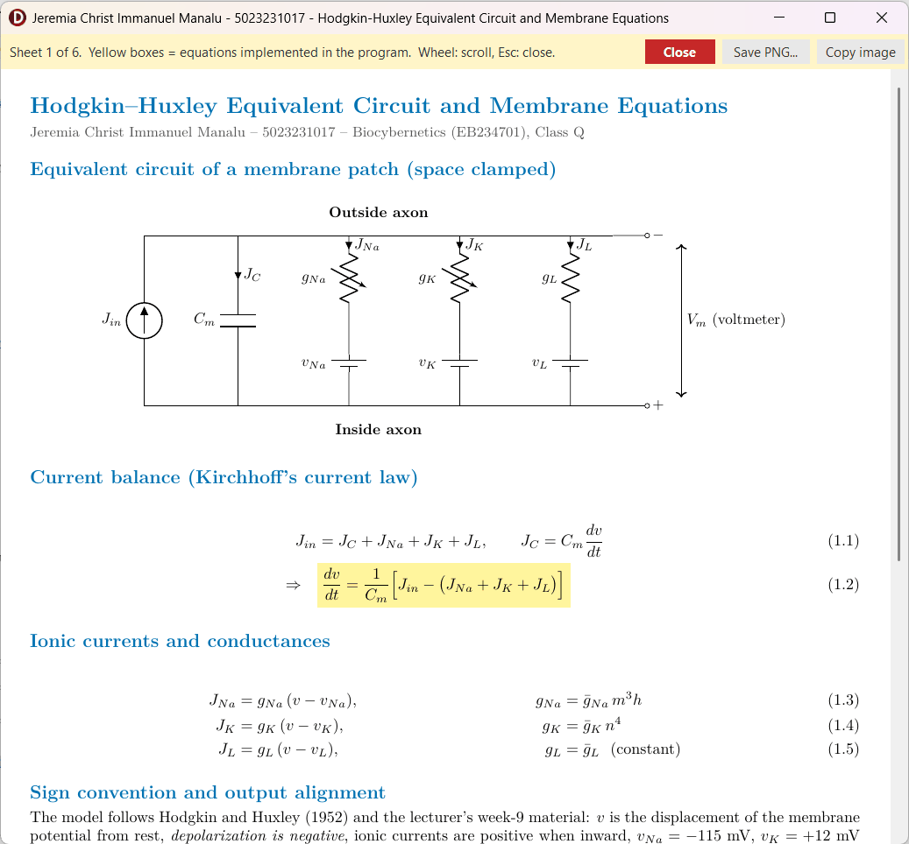</a><br><sub><b>Derivation window</b>: sheet 1, equations used by the program boxed in yellow</sub></td>
  </tr>
</table>

<details>
<summary><b>Tab 5 with the squid-axon preset and its space-time views</b></summary>
<br>

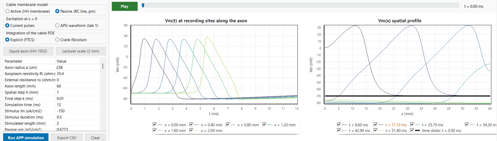

| 3D waterfall                                              | 3D mesh                                         |
| --------------------------------------------------------- | ----------------------------------------------- |
| 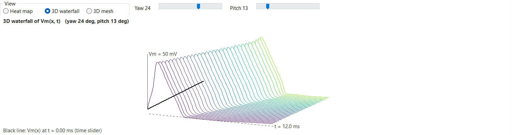 | 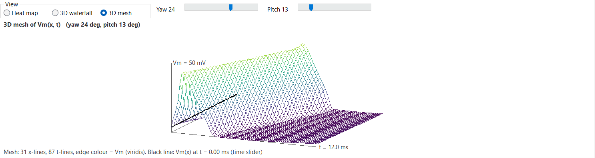 |

</details>

<p align="right"><sub><a href="#top">Back to top</a></sub></p>

## Theory and equations

The model keeps the convention of the 1952 paper: `v` is the displacement of the membrane potential from rest and depolarization is negative. Units: mV, ms, mS/cm², µA/cm², µF/cm².

<table>
  <tr>
    <td width="50%">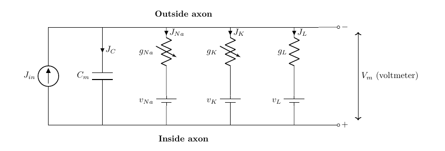<br><sub>Equivalent circuit of a space-clamped membrane patch (report Figure 1.1)</sub></td>
    <td width="50%">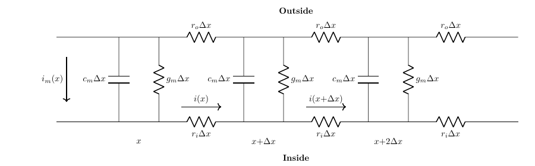<br><sub>Discretized axon as an RC transmission line (report Figure 1.3)</sub></td>
  </tr>
</table>

**Membrane equation** (Kirchhoff's current law on the patch)

```math
C_m\frac{dv}{dt} = J_{in} - \left[\bar g_{Na}\,m^{3}h\,(v-V_{Na}) + \bar g_{K}\,n^{4}\,(v-V_{K}) + \bar g_{L}\,(v-V_{L})\right]
```

**Gating kinetics** with the temperature factor $\phi = 3^{(T-6.3)/10}$

```math
\frac{dx}{dt} = \phi\left[\alpha_x(v)\,(1-x) - \beta_x(v)\,x\right],\qquad x\in\{m,h,n\}
```

```math
\begin{aligned}
\alpha_m &= \frac{0.1\,(v+25)}{e^{(v+25)/10}-1}, & \beta_m &= 4\,e^{v/18},\\
\alpha_h &= 0.07\,e^{v/20}, & \beta_h &= \frac{1}{e^{(v+30)/10}+1},\\
\alpha_n &= \frac{0.01\,(v+10)}{e^{(v+10)/10}-1}, & \beta_n &= 0.125\,e^{v/80}.
\end{aligned}
```

The removable singularities of $\alpha_m$ at $v=-25$ and $\alpha_n$ at $v=-10$ are evaluated through $\operatorname{ExpRatio}(z) = z/(e^{z}-1)$ with a series near $z=0$, so the program never divides by zero.

**Output alignment** (Problem 1): the program reports the membrane voltage on the physiological scale

```math
V_m = -(v + 70)\ \text{mV}.
```

**Cable equation of the axon** (Problems 2 and 3)

```math
\frac{\partial v}{\partial t} = D\,\frac{\partial^{2} v}{\partial x^{2}} + \frac{J_{in}-J_{ion}}{C_m},
\qquad D = \frac{1}{(r_o+r_i)\,c_m},\quad r_i = \frac{R_i}{\pi a^{2}},\quad c_m = 2\pi a\,C_m
```

In the program $D$ carries a factor 1000 so that it is in cm²/ms. This is the coefficient $[(r_o+r_i)C_m]^{-1}$ of the lecture slide, with $C_m$ per unit length.

<details>
<summary><b>Constants used by the program</b></summary>
<br>

| Quantity                                  | Value                                                                    |
| ----------------------------------------- | ------------------------------------------------------------------------ |
| $\bar g_{Na}$, $\bar g_{K}$, $\bar g_{L}$ | 120, 36, 0.3 mS/cm²                                                      |
| $V_{Na}$, $V_{K}$, $V_{L}$                | -115, +12, -10.613 mV                                                    |
| $C_m$                                     | 1 µF/cm² (= 0.001 mF/cm², the lecturer's value)                          |
| Time step                                 | 0.01 ms (the "10 sec" on the slide means 10 µs, see ISS-001)             |
| Temperature                               | 6.3 °C ($\phi = 1$) unless changed in tab 6                              |
| Squid cable                               | a = 238 µm, Ri = 35.4 Ω·cm, ro = 0, 60 mm, h = 1 mm                      |
| Lecturer cable                            | a = 5 µm, 2 mm, h = 0.4 mm, k = 10 µs, 60 ms, passive gm = 0.6773 mS/cm² |

</details>

<details>
<summary><b>The six derivation sheets of the program</b> (yellow boxes = equations implemented)</summary>
<br>

| Sheet                                      | Content                                                     | Opened from                   |
| ------------------------------------------ | ----------------------------------------------------------- | ----------------------------- |
| [1](Program/Resources/sheet1_membrane.png) | HH equivalent circuit and membrane equations                | Tab 6                         |
| [2](Program/Resources/sheet2_gating.png)   | Gating kinetics and rate constants                          | Tab 6, tab 2 "Theory"         |
| [3](Program/Resources/sheet3_rk4.png)      | RK4 integration of the HH equations (APG)                   | Tab 6, tab 1 "Theory"         |
| [4](Program/Resources/sheet4_cable.png)    | Cable equation derivation                                   | Tab 6, tab 5 "Cable equation" |
| [5](Program/Resources/sheet5_fd.png)       | Central and forward differences, Crank-Nicolson (Problem 2) | Tab 6, tab 5 "FD derivation"  |
| [6](Program/Resources/sheet6_analysis.png) | Spike, inter-pulse interval, refractory threshold, velocity | Tab 6, tabs 3 and 4 "Theory"  |

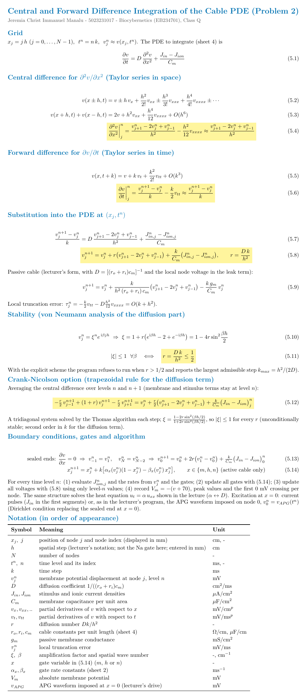

The LaTeX sources of the sheets are in [Program/Resources/tex](Program/Resources/tex/).

</details>

<p align="right"><sub><a href="#top">Back to top</a></sub></p>

## Numerical methods

**Coupled RK4** on the state $\mathbf y = [v, m, h, n]^{T}$ with step $\Delta t$:

```math
\mathbf y_{n+1} = \mathbf y_n + \frac{\Delta t}{6}\left(\mathbf k_1 + 2\mathbf k_2 + 2\mathbf k_3 + \mathbf k_4\right),\qquad
\mathbf k_1 = \mathbf f(t_n,\mathbf y_n),\ \ \mathbf k_2 = \mathbf f\!\left(t_n+\tfrac{\Delta t}{2},\mathbf y_n+\tfrac{\Delta t}{2}\mathbf k_1\right),\ \dots
```

The lecturer's week-9 code advances $v$ with RK4 while the gates are held, then each gate separately (a splitting scheme). It is available as "Lecturer sequential RK4" and differs from the coupled scheme by at most 0.01 ms in the inter-spike interval.

**Explicit FTCS** (central difference in $x$, forward difference in $t$), with $h$ the spatial step, $k$ the time step and $r = Dk/h^{2}$:

```math
v_j^{n+1} = v_j^{n} + r\left(v_{j-1}^{n} - 2v_j^{n} + v_{j+1}^{n}\right) + k\,\frac{J_{in,j}^{n} - J_{ion,j}^{n}}{C_m},
\qquad r \le \tfrac12 \ \text{for stability}
```

**Crank-Nicolson** (trapezoidal rule for the diffusion term, membrane term explicit), solved each step with the Thomas algorithm:

```math
-\tfrac r2\,v_{j-1}^{n+1} + (1+r)\,v_j^{n+1} - \tfrac r2\,v_{j+1}^{n+1}
= v_j^{n} + \tfrac r2\left(v_{j-1}^{n} - 2v_j^{n} + v_{j+1}^{n}\right) + k\,\frac{J_{in,j}^{n} - J_{ion,j}^{n}}{C_m}
```

Its amplification factor $\xi = \dfrac{1-2r\sin^{2}(\theta/2)}{1+2r\sin^{2}(\theta/2)}$ satisfies $|\xi|\le 1$ for every $r$, so the step limit of FTCS disappears.

**Boundary conditions**: sealed ends through ghost nodes ($v_{-1}=v_1$, $v_N=v_{N-2}$); with the "APG waveform" excitation the first node follows the tab 1 result, $v_0^{n} = v_{APG}(t^{n})$, which is the lecturer's method.

<p align="right"><sub><a href="#top">Back to top</a></sub></p>

## Results

<details open>
<summary><b>Action potential generation</b> (coupled RK4, step current from t = 1 ms, 100 ms)</summary>
<br>

| Jin (µA/cm²) | APs                          | Last ISI (ms) | First peak Vm (mV) |
| -----------: | ---------------------------- | ------------: | -----------------: |
|           -2 | 0                            |               |                    |
|           -3 | 1                            |               |              32.51 |
|           -5 | 1                            |               |              34.05 |
|           -7 | 6                            |         17.14 |              34.69 |
|          -10 | 7                            |         14.64 |              35.26 |
|          -20 | 9                            |         11.56 |              36.30 |
|          -40 | 11                           |          9.21 |              37.49 |
|         -100 | 1, then depolarization block |               |              40.00 |

The lecturer staircase (-5, -10, -20 µA/cm²) produces action potentials at 3.23, 28.36 and 40.01 ms.

</details>

<details>
<summary><b>Refractory period</b> (J1 = -40 µA/cm², 0.5 ms; rested threshold 13.27 µA/cm²)</summary>
<br>

| Interval (ms)                  | 2          | 4          | 6     | 8    | 10   | 12   | 15   | 20   | 30   |
| ------------------------------ | ---------- | ---------- | ----- | ---- | ---- | ---- | ---- | ---- | ---- |
| Test threshold \|J2\| (µA/cm²) | none ≤ 500 | none ≤ 500 | 161.7 | 73.1 | 42.2 | 26.3 | 14.8 | 11.4 | 13.5 |

Absolute refractory period up to about 4 ms, relative refractory period up to about 15 ms, and a supernormal phase (threshold below the rested value) between about 16 and 25 ms.

</details>

<details>
<summary><b>Propagation</b> (tab 5)</summary>
<br>

| Case                                                     | Result                                                                    |
| -------------------------------------------------------- | ------------------------------------------------------------------------- |
| Squid axon, active, FTCS, h = 1 mm, 6.3 °C               | 12.04 m/s, peak 33.0 mV along the axon                                    |
| Same, h = 0.5 mm, k = 2.5 µs (FTCS)                      | 12.25 m/s                                                                 |
| Same, h = 0.5 mm, k = 10 µs (r = 1.345)                  | FTCS refused; Crank-Nicolson 12.12 m/s                                    |
| Squid axon, 18.5 °C                                      | 18.2 m/s (HH 1952: 18.8 m/s calculated, 21.2 m/s measured)                |
| Train of three current pulses, 15 ms apart               | three propagating APs at 12.04 m/s                                        |
| Lecturer preset: passive, APG drive, FTCS (r = 0.044)    | peaks 35.3, -9.5, -32.7, -45.0, -50.4, -51.9 mV at 0 to 2 mm; λ = 1.02 mm |
| Same with Crank-Nicolson                                 | same peaks within 0.1 mV                                                  |
| Active 2 mm cable, APG drive, h = 0.1 mm, Crank-Nicolson | every wave regenerated, 1.95 m/s                                          |

The APG waveform fires at 2.91, 17.84, 32.49 and 47.12 ms, so the space-time views show four ridges: successive action potentials in time on one axon, not four axons.

</details>

<p align="right"><sub><a href="#top">Back to top</a></sub></p>

## Verification and CI

The numerical core [`HHModel.pas`](Program/HHModel.pas) contains no VCL code, so it is compiled on every push with Free Pascal and checked twice by the workflow [`a1-model-regression.yml`](../.github/workflows/a1-model-regression.yml):

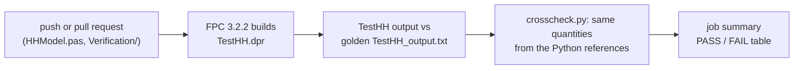

| File                                                                        | Role                                                                                                    |
| --------------------------------------------------------------------------- | ------------------------------------------------------------------------------------------------------- |
| [`TestHH.dpr`](Program/Verification/TestHH.dpr)                             | Console harness: APG, refractory sweep, C-F curve, cable (FTCS, Crank-Nicolson, pulse train, APG drive) |
| [`TestHH_output.txt`](Program/Verification/TestHH_output.txt)               | Golden output; any change in the numerical results fails CI                                             |
| [`hh_reference_apg.py`](Program/Verification/hh_reference_apg.py)           | Independent Python RK4 of the membrane model                                                            |
| [`hh_reference_app.py`](Program/Verification/hh_reference_app.py)           | Independent Python FTCS cable                                                                           |
| [`cable_drive_reference.py`](Program/Verification/cable_drive_reference.py) | Python cable driven by the APG waveform, FTCS and Crank-Nicolson                                        |
| [`crosscheck.py`](Program/Verification/crosscheck.py)                       | Compares the harness with the Python references within stated tolerances                                |

The VCL front end needs Windows and RAD Studio, so it is built locally only.

<p align="right"><sub><a href="#top">Back to top</a></sub></p>

## Architecture

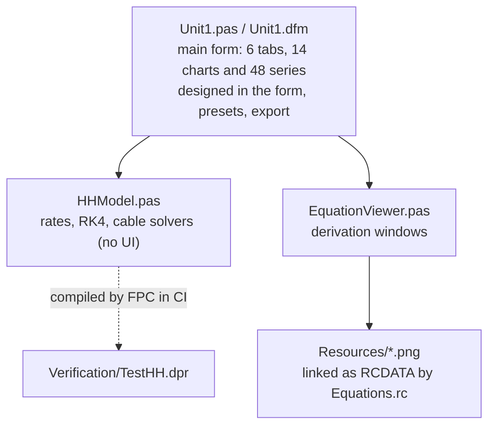

```
Assignment 1_HH Model/
├── Program/
│   ├── Project1.dpr / .dproj   Delphi 13 VCL project
│   ├── HHModel.pas             numerical core
│   ├── Unit1.pas / Unit1.dfm   main form (charts, series, tables designed in the .dfm)
│   ├── EquationViewer.pas      sheet windows
│   ├── Equations.rc            resource script for the sheet images
│   ├── Resources/              rendered equations and sheets (+ tex/ sources)
│   └── Verification/           FPC harness, golden output, Python references
├── Data/                       CSV exports of the program
├── Report/                     Word report, PDF, build scripts (source/)
└── docs/img/                   images of this README (docs/make_readme_assets.py)
```

<p align="right"><sub><a href="#top">Back to top</a></sub></p>

## Build and run

1. Open [`Program/Project1.dproj`](Program/Project1.dproj) in RAD Studio Delphi 13 Florence (Community Edition is enough).
2. Check that `HHModel.pas` and `EquationViewer.pas` are listed in the Project Manager; if not, use _Project > Add to Project..._.
3. Build and run for Win32 or Win64. No third-party packages are needed (TeeChart Standard ships with Delphi).

To repeat the CI checks on any machine with Free Pascal and Python:

```bash
cd "Assignment 1_HH Model/Program/Verification"
fpc -O2 -Fu.. -FU. -FE. TestHH.dpr
./TestHH > actual.txt && diff -u --strip-trailing-cr TestHH_output.txt actual.txt
python crosscheck.py actual.txt
```

<p align="right"><sub><a href="#top">Back to top</a></sub></p>

## Using the program

| Tab                           | Shows                                                                      | Typical use                                                                     |
| ----------------------------- | -------------------------------------------------------------------------- | ------------------------------------------------------------------------------- |
| 1. APG (RK4)                  | Vm, Jin, JNa/JK/JL, m/h/n, gNa/gK against time                             | Step -10 µA/cm²: repetitive firing. Lecturer staircase. Paired pulse            |
| 2. Gating Phase Plots         | m, h, n against Vm over x∞(Vm); τx(Vm)                                     | Gate loops explained by the lag behind x∞                                       |
| 3. Refractory Period          | Test-pulse threshold against interval                                      | Absolute and relative refractory period, supernormal phase                      |
| 4. C-F Converter (Jin vs ISI) | Steady ISI and frequency against \|Jin\|                                   | How the input level programs the inter-pulse interval                           |
| 5. APP (Cable)                | Vm(t) at sites, Vm(x) snapshots, heat map, 3D waterfall, 3D mesh, velocity | Active or passive cable; current pulses or APG waveform; FTCS or Crank-Nicolson |
| 6. Model and Equations        | Constants, rendered equations, the six sheets                              | Parameter variation; derivations                                                |

<details>
<summary><b>Chart interaction and keyboard</b></summary>
<br>

| Feature               | How                                                                                                  |
| --------------------- | ---------------------------------------------------------------------------------------------------- |
| Select a chart        | Move the mouse over it; the toolbar shows "Active chart"                                             |
| Zoom                  | Mouse wheel at the cursor (Shift + wheel: time axis only), drag a box right-down, or Zoom in/out     |
| Pan                   | Right-drag                                                                                           |
| Reset                 | Double-click, drag left-up, or Reset view                                                            |
| Hide or show a series | Click its legend check box                                                                           |
| Read values           | Cursor coordinates in the right panel of the status bar                                              |
| Export                | Save PNG... or Copy image (chart under the mouse, including the space-time view); Export CSV per tab |
| Clear                 | Every tab has a Clear button (results removed, parameters kept)                                      |
| APG time axes         | The four APG charts zoom and pan together                                                            |
| APP animation         | Play/Pause and the time slider move the bold Vm(x) profile, the Vm(t) cursor and the heat-map cursor |
| APP 3D view           | Yaw (-90 to 90 deg) and Pitch (0 to 80 deg) track bars                                               |
| Keyboard              | F5 runs the active tab, F1 opens its sheet, Esc stops the animation, Alt+F4 or Exit closes           |
| Errors                | Unexpected exceptions are written to `HHSimulator_error.log` next to the executable                  |

Colours follow the Okabe-Ito palette (colour-blind safe): sodium vermillion, potassium blue, leak green, stimulus grey, Vm black; ordered series and the heat map use viridis.

</details>

<p align="right"><sub><a href="#top">Back to top</a></sub></p>

## Known limitations

Open points and design decisions are tracked in the repository [issue log](../ISSUES.md), in particular ISS-012 (FTCS step limit), ISS-013 (sealed-end peak), ISS-022 (UI limitations), ISS-029 (lecturer cable parameters) and ISS-031 (ABE and C-F tabs of the lecturer's simulator). Every change is recorded in the [changelog](../CHANGELOG.md).

## References

[1] A. L. Hodgkin and A. F. Huxley, "A quantitative description of membrane current and its application to conduction and excitation in nerve," _J. Physiol._, vol. 117, no. 4, pp. 500-544, 1952, doi: [10.1113/jphysiol.1952.sp004764](https://doi.org/10.1113/jphysiol.1952.sp004764).

[2] A. Arifin, "Hodgkin-Huxley Neuron Model" and "Hodgkin-Huxley Neuron Model Simulation," lecture notes, Biocybernetics, Dept. Biomedical Engineering, ITS, 2026.

[3] B. Amini, A. Bidani, J. B. Zwischenberger, and J. W. Clark Jr., "A model of the pacemaking neuron of the respiratory central pattern generator," _IEEE Trans. Neural Syst. Rehabil. Eng._, vol. 13, no. 2, pp. 120-124, 2005, doi: [10.1109/TNSRE.2005.847379](https://doi.org/10.1109/TNSRE.2005.847379).

[4] S. Haghiri, A. Naderi, B. Ghanbari, and A. Ahmadi, "High speed and low digital resources implementation of Hodgkin-Huxley neuronal model using base-2 functions," _IEEE Trans. Circuits Syst. I, Reg. Papers_, vol. 68, no. 1, pp. 275-287, Jan. 2021, doi: [10.1109/TCSI.2020.3026076](https://doi.org/10.1109/TCSI.2020.3026076).

<p align="right"><sub><a href="#top">Back to top</a></sub></p>
