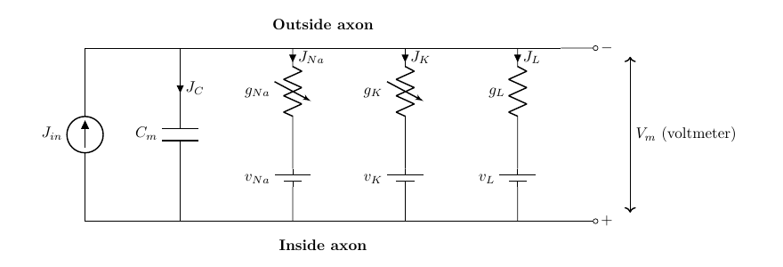
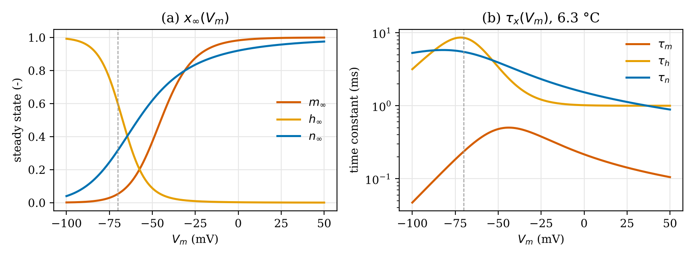
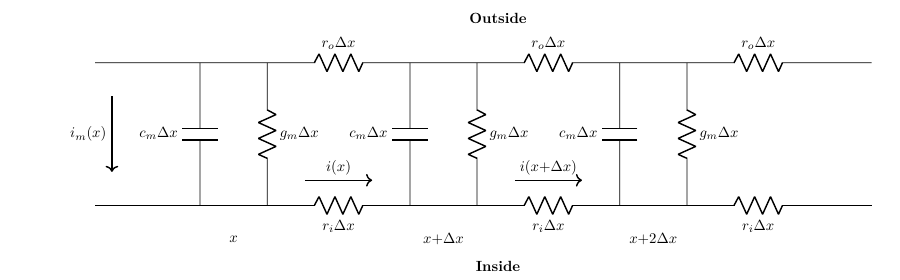
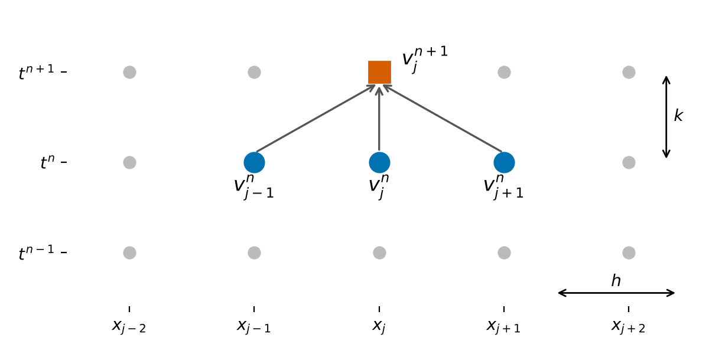

# CHAPTER I. FUNDAMENTAL THEORY

## 1.1 The Hodgkin-Huxley Membrane and Its Equivalent Circuit

Hodgkin and Huxley described the excitable membrane of the squid giant axon as an electrical circuit in which the lipid bilayer acts as a capacitor and every ionic pathway acts as a conductance in series with a battery that represents the Nernst potential of that ion [1]. The circuit used in this assignment follows the week-9 lecture material [2] and is shown in Figure 1.1. The capacitive current $J_C$ charges the membrane capacitance $C_m$, while the sodium, potassium and leakage currents $J_{Na}$, $J_K$ and $J_L$ flow through the conductances $g_{Na}$, $g_K$ and $g_L$. A stimulus current density $J_{in}$ is injected across the membrane. Because the patch is space clamped, the voltage is uniform over the membrane and Kirchhoff's current law applied to the single node of the circuit gives the current balance of Eq. (1.1), from which the voltage equation (1.2) follows directly.

::: {custom-style="Figure"}
{width=15cm}
:::

::: {custom-style="Caption Text"}
**Figure 1.1.** Equivalent circuit of a space-clamped membrane patch in the lecturer's notation (rendered by the author after [1], [2]).
:::

$$J_{in}=C_m\frac{dv}{dt}+J_{Na}+J_K+J_L \qquad\qquad (1.1)$$

::: {custom-style="Highlighted Equation"}
$$\frac{dv}{dt}=\frac{1}{C_m}\Big[J_{in}-\left(J_{Na}+J_K+J_L\right)\Big] \qquad\qquad (1.2)$$
:::

The ionic currents obey Ohm's law with a driving force equal to the difference between the membrane voltage and the reversal potential of each ion. Sodium and potassium conductances are not constant; Hodgkin and Huxley expressed them as a maximal conductance multiplied by powers of dimensionless gating variables $m$, $h$ and $n$, whereas the leakage conductance is constant [1]:

::: {custom-style="Highlighted Equation"}
$$J_{Na}=\bar g_{Na}\,m^3h\,(v-v_{Na}),\qquad J_K=\bar g_K\,n^4\,(v-v_K),\qquad J_L=\bar g_L\,(v-v_L) \qquad\qquad (1.3)$$
:::

A point that must be handled carefully is the sign convention. The original paper and the lecture material [1], [2] define $v$ as the displacement of the membrane potential from rest with depolarization taken as negative, so that $v_{Na}=-115$ mV, $v_K=+12$ mV and $v_L=-10.613$ mV, and an inward (cathodal) stimulus is a negative $J_{in}$. Modern textbooks use the opposite sign and absolute potentials. The two descriptions are related by a reflection and a shift, and the program reports the physiological membrane voltage through the alignment of Eq. (1.4) with a resting potential of $-70$ mV. With this alignment the resting state $v=0$ appears as $V_m=-70$ mV and an action potential appears as a positive excursion that peaks near $+35$ mV. The constants used throughout the work are those of the 1952 paper: $\bar g_{Na}=120$, $\bar g_K=36$ and $\bar g_L=0.3$ mS/cm², $C_m=1$ µF/cm², at the reference temperature of 6.3 °C.

::: {custom-style="Highlighted Equation"}
$$V_m=-\left(v+70\right)\ \text{mV} \qquad\qquad (1.4)$$
:::

## 1.2 Gating Kinetics and Rate Constants

Each gating variable represents the fraction of independent molecular gates that are in the permissive state and obeys first-order kinetics with voltage-dependent opening and closing rates $\alpha_x(v)$ and $\beta_x(v)$ [1]. Eq. (1.5) can be written equivalently as a relaxation toward the steady state $x_\infty$ with the time constant $\tau_x$ of Eq. (1.6), which is the form used to interpret the phase plots in Chapter II.

::: {custom-style="Highlighted Equation"}
$$\frac{dx}{dt}=\alpha_x(1-x)-\beta_x x=-x\left(\alpha_x+\beta_x\right)+\alpha_x,\qquad x\in\{m,h,n\} \qquad\qquad (1.5)$$
:::

$$x_\infty=\frac{\alpha_x}{\alpha_x+\beta_x},\qquad \tau_x=\frac{1}{\alpha_x+\beta_x} \qquad\qquad (1.6)$$

The empirical rate functions fitted by Hodgkin and Huxley to their voltage-clamp data are listed in Eq. (1.7) to (1.9) in the lecturer's sign convention, with $v$ in mV and the rates in ms⁻¹ [1], [2]. Two of them, $\alpha_m$ and $\alpha_n$, are of the form $a(v+b)/(e^{c(v+b)}-1)$ and become an indeterminate $0/0$ at $v=-25$ mV and $v=-10$ mV respectively. These are removable singularities whose limits follow from L'Hôpital's rule, $\alpha_m(-25)=1$ and $\alpha_n(-10)=0.1$ ms⁻¹. The program evaluates both through the function $x/(e^x-1)$ of Eq. (1.10), which is replaced by its second-order Taylor series when $|x|<10^{-4}$, instead of adding an arbitrary small number to the denominator.

::: {custom-style="Highlighted Equation"}
$$\alpha_m=\frac{0.1\,(v+25)}{e^{0.1v+2.5}-1},\qquad \beta_m=4\,e^{v/18} \qquad\qquad (1.7)$$
:::

::: {custom-style="Highlighted Equation"}
$$\alpha_h=0.07\,e^{v/20},\qquad \beta_h=\frac{1}{e^{0.1v+3}+1} \qquad\qquad (1.8)$$
:::

::: {custom-style="Highlighted Equation"}
$$\alpha_n=\frac{0.01\,(v+10)}{e^{0.1v+1}-1},\qquad \beta_n=0.125\,e^{v/80} \qquad\qquad (1.9)$$
:::

$$\frac{x}{e^x-1}\approx 1-\frac{x}{2}+\frac{x^2}{12}\quad\text{for } |x|<10^{-4} \qquad\qquad (1.10)$$

Temperature changes all rate constants by the same factor, written as $\phi=3^{(T-6.3)/10}$ with $T$ in °C, which corresponds to a $Q_{10}$ of 3 [1]. Figure 1.2 shows the resulting steady states and time constants against the aligned membrane voltage. The sodium activation $m$ is fast (its time constant is below 0.5 ms everywhere), whereas the sodium inactivation $h$ and the potassium activation $n$ are slower by roughly an order of magnitude. This separation of time scales is the mechanism of the action potential: on depolarization $m$ follows the voltage almost instantly and opens the sodium conductance, which depolarizes the membrane further, while the delayed closure of $h$ and opening of $n$ terminate the spike and produce the after-hyperpolarization and the refractory period.

::: {custom-style="Figure"}
{width=15.5cm}
:::

::: {custom-style="Caption Text"}
**Figure 1.2.** (a) Steady-state values and (b) time constants of the gating variables computed from Eq. (1.6) to (1.9) at 6.3 °C; the dashed line marks the resting potential (plotted by the author from the rate functions of [1]).
:::

## 1.3 Fourth-Order Runge-Kutta Integration

The space-clamped model is a system of four coupled nonlinear ordinary differential equations for the state vector $\mathbf{Y}=[v,m,h,n]^T$, whose right-hand side $\mathbf{F}(t,\mathbf{Y})$ is formed by Eq. (1.2) and three copies of Eq. (1.5). The lecture material [3] integrates it with the classical fourth-order Runge-Kutta (RK4) method [4], which evaluates four slope estimates per step and combines them with Simpson-like weights:

$$\mathbf{K}_1=\mathbf{F}(t_k,\mathbf{Y}_k),\qquad \mathbf{K}_2=\mathbf{F}\left(t_k+\tfrac{\Delta t}{2},\ \mathbf{Y}_k+\tfrac{\Delta t}{2}\mathbf{K}_1\right) \qquad\qquad (1.11)$$

$$\mathbf{K}_3=\mathbf{F}\left(t_k+\tfrac{\Delta t}{2},\ \mathbf{Y}_k+\tfrac{\Delta t}{2}\mathbf{K}_2\right),\qquad \mathbf{K}_4=\mathbf{F}\left(t_k+\Delta t,\ \mathbf{Y}_k+\Delta t\,\mathbf{K}_3\right) \qquad\qquad (1.12)$$

::: {custom-style="Highlighted Equation"}
$$\mathbf{Y}_{k+1}=\mathbf{Y}_k+\frac{\Delta t}{6}\left(\mathbf{K}_1+2\mathbf{K}_2+2\mathbf{K}_3+\mathbf{K}_4\right) \qquad\qquad (1.13)$$
:::

The local truncation error of RK4 is of order $\Delta t^5$ and the global error of order $\Delta t^4$ [4]. With the step of 0.01 ms used here (the slide prints "10 sec", which can only be 10 µs because the lecturer's code works in milliseconds), the scheme resolves the sodium upstroke, whose time scale is about 0.1 ms, with ample margin. The lecturer's source code [3] applies RK4 in a slightly different way: the rate constants are frozen at $v_k$, each gate is advanced by its own scalar RK4 step, and the voltage is then advanced with the new gate values held constant. This is an operator-splitting scheme that is first order in the coupling between voltage and gates. Both variants are implemented in the program so that the results can be compared directly with the lecturer's program.

## 1.4 The Cable Equation of Action Potential Propagation

To describe propagation, the axon is divided into segments of length $\Delta x$ that are connected by the internal (axoplasmic) and external resistances per unit length $r_i$ and $r_o$, as in the transmission-line model of the lecture [2] shown in Figure 1.3 [5]. Every membrane element is either a passive RC element ($c_m$, $g_m$) or, in the active cable, the complete Hodgkin-Huxley circuit of Figure 1.1.

::: {custom-style="Figure"}
{width=15cm}
:::

::: {custom-style="Caption Text"}
**Figure 1.3.** Discretized axon as an RC transmission line (rendered by the author after [2], [5]).
:::

Ohm's law along the axis and Kirchhoff's current law at a node give, in the limit $\Delta x\to0$, the pair of equations (1.14) and (1.15), where $i$ is the axial current and $i_m$ the membrane current per unit length. Differentiating (1.14) with respect to $x$ and substituting (1.15) eliminates the axial current and yields the cable equation (1.16). Its derivation is repeated step by step as part of Problem 2 in Chapter II.

$$\frac{\partial v}{\partial x}=-\left(r_o+r_i\right)i \qquad\qquad (1.14)$$

$$\frac{\partial i}{\partial x}=-i_m=-\left(c_m\frac{\partial v}{\partial t}+i_{ion}\right) \qquad\qquad (1.15)$$

::: {custom-style="Highlighted Equation"}
$$\frac{\partial v}{\partial t}=D\,\frac{\partial^2 v}{\partial x^2}+\frac{J_{in}-J_{ion}}{C_m},\qquad D=\frac{1}{\left(r_o+r_i\right)c_m} \qquad\qquad (1.16)$$
:::

For a cylindrical axon of radius $a$ and axoplasm resistivity $R_i$, the per-length quantities are $r_i=R_i/(\pi a^2)$, $c_m=2\pi a\,C_m$ and $i_{ion}=2\pi a\,J_{ion}$, so that $i_{ion}/c_m=J_{ion}/C_m$ [5]. In the passive cable $J_{ion}=g_m v$ and a steady input decays along the axon with the length constant $\lambda=\left[2\pi a\,g_m\left(r_o+r_i\right)\right]^{-1/2}$; such a cable cannot regenerate a signal. In the active cable $J_{ion}=J_{Na}+J_K+J_L$, so the depolarization that diffuses from an excited region into its neighbour opens the sodium conductance there and regenerates the full action potential. This is why an action potential travels at constant amplitude and constant velocity, and Hodgkin and Huxley showed that the velocity scales with $\sqrt{a}$ and computed 18.8 m/s for their squid axon at 18.5 °C, against 21.2 m/s measured [1]. Note that the slide prints the coefficient of the second derivative as $(r_o+r_i)C_m^{-1}$; the derivation gives $\left[(r_o+r_i)c_m\right]^{-1}$, which is also what the lecturer's source code computes.

## 1.5 Finite Difference Approximation and Stability

The cable equation is a parabolic partial differential equation of the diffusion type, the same type as the heat equation $u_t=\alpha u_{xx}$ used in the lecture to introduce its numerical solution [3]. On a grid $x_j=jh$, $t^n=nk$ with $v_j^n\approx v(x_j,t^n)$, the second spatial derivative is replaced by a central difference and the time derivative by a forward difference [4], [6]. The resulting explicit scheme, known as forward-time central-space (FTCS), computes every new value $v_j^{n+1}$ from three known values of the previous time level, as illustrated by the stencil in Figure 1.4.

::: {custom-style="Figure"}
{width=11cm}
:::

::: {custom-style="Caption Text"}
**Figure 1.4.** Stencil of the explicit forward-time central-space scheme: the new value (square) is computed from three values of the previous time level (circles).
:::

The central difference has a truncation error of order $h^2$ and the forward difference of order $k$, so the scheme is consistent with an error of $O(k+h^2)$. Because it is explicit, it is only conditionally stable. A von Neumann analysis of the diffusion part shows that the amplification factor of a Fourier mode is $\xi=1-4r\sin^2(\beta h/2)$ with the diffusion number $r=Dk/h^2$, and $|\xi|\le1$ for every wave number only if $r\le1/2$ [6]. The full derivation of the scheme and of this condition is given as the answer of Problem 2. The program checks the condition before every run and refuses to integrate when it is violated, reporting the largest admissible time step $k_{max}=h^2/(2D)$.

## 1.6 Refractory Period and Repetitive Firing

After an action potential the membrane cannot respond to a second stimulus for a short time and then responds only to a stronger one. During the absolute refractory period the sodium inactivation $h$ is still small and the potassium activation $n$ is still large, so no stimulus, however strong, can make the inward sodium current exceed the outward currents. During the relative refractory period $h$ recovers and $n$ decays with the time constants of Figure 1.2(b), and the threshold falls back toward its resting value [1]. Operationally, the refractory period is measured with a paired-pulse protocol: a conditioning pulse elicits an action potential and the smallest amplitude of a test pulse that still elicits a second action potential is determined as a function of the interval between the two pulses. A sustained depolarizing current, on the other hand, makes the membrane fire repetitively. After each spike the current recharges the membrane toward threshold, and the larger the current, the faster the threshold is reached once the refractoriness has decayed. The input level therefore programs the inter-pulse interval and hence the firing frequency, up to the point where the membrane remains depolarized, sodium inactivation stays high and firing stops (depolarization block). These two behaviours are the subject of Problem 1 and are quantified in Section 2.3.
