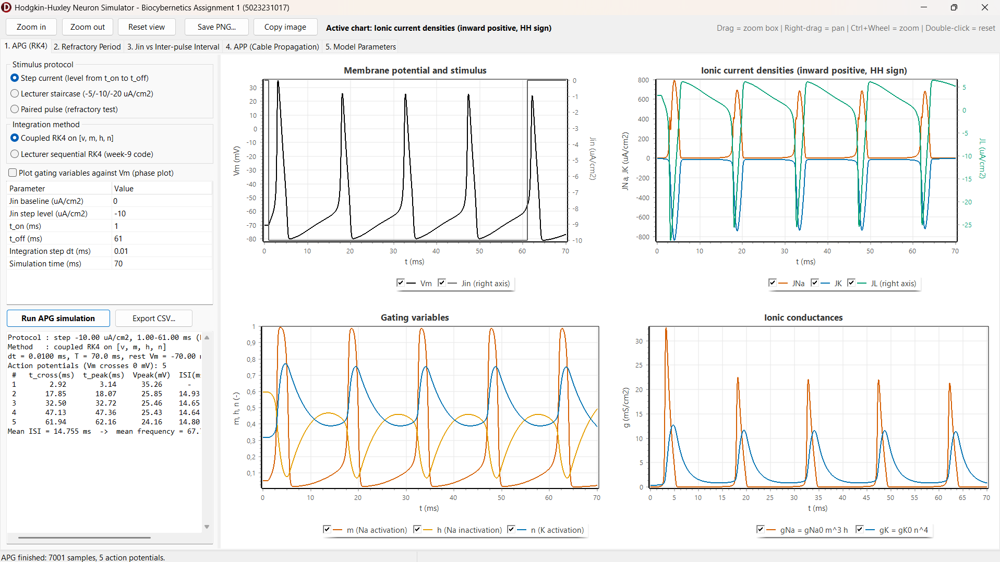
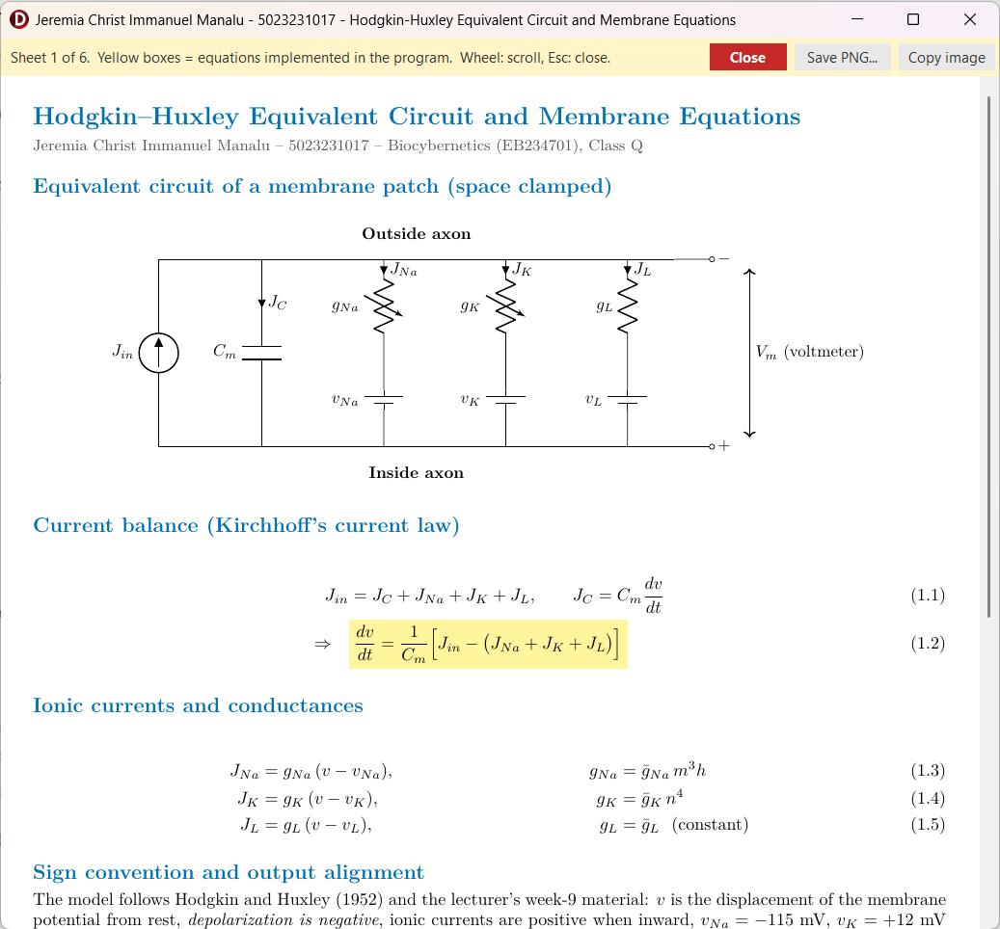

## 2.2 Answer and Code Explanation

### 2.2.1 Program Architecture

The program was developed in RAD Studio Delphi 13 Florence (VCL, Object Pascal) and is organized in three units. `HHModel.pas` is the numerical core and contains no user-interface code: it defines the model parameters and state records, the rate constants, both RK4 integrators, the stimulus protocols, the spike detector, the refractory and inter-pulse analyses and the cable solver. `Unit1.pas` with its form file `Unit1.dfm` is the main window; it reads the parameters from editable tables, calls the routines of `HHModel.pas` and draws the results with TeeChart. `EquationViewer.pas` opens every mathematical sheet (equivalent circuit, gating kinetics, RK4, cable equation, finite difference derivation and analysis definitions) in its own window with the caption "Jeremia Christ Immanuel Manalu - 5023231017 - <sheet title>"; on these sheets, as in this report, the equations that are implemented in the code are highlighted in yellow. Keeping the numerics separate from the form made it possible to compile and regression-test `HHModel.pas` with Free Pascal against an independent Python implementation before it was used in the GUI.

The main window has six tabs: (1) APG with RK4, (2) gating phase plots, (3) refractory period, (4) Jin versus inter-pulse interval, (5) APP with the cable equation and (6) model parameters and equations. Figure 2.1 shows the first tab and Figure 2.2 one of the derivation windows that are opened from the main form. All routines listed below are complete and are presented in the order of the problems in Section 2.1 and, within each problem, in the order in which they appear in the source files.

::: {custom-style="Figure"}
{width=16cm}
:::

::: {custom-style="Caption Text"}
**Figure 2.1.** Main window of the simulator, tab "1. APG (RK4)", after a step-current run.
:::

::: {custom-style="Figure"}
{width=12cm}
:::

::: {custom-style="Caption Text"}
**Figure 2.2.** Sheet window opened from the main form (sheet 1, equivalent circuit and membrane equations); yellow boxes mark equations implemented in the program.
:::

### 2.2.2 Problem 1: Action Potential Generation with RK4

**a. Model constants, rate constants and right-hand side.** The routines below implement Eq. (1.2) to (1.10). `DefaultHHParams` returns the constants of the 1952 paper in the lecturer's sign convention. `TemperatureFactor` computes $\phi=3^{(T-6.3)/10}$, which multiplies every rate constant. `ExpRatio` evaluates $x/(e^x-1)$ with the Taylor series near the removable singularity, and `ComputeRates` uses it to write $\alpha_m$ and $\alpha_n$ exactly: since $0.1(v+25)=0.1v+2.5$, the numerator of $\alpha_m$ equals the exponent of its denominator, so $\alpha_m=\mathrm{ExpRatio}(0.1v+2.5)$; likewise $0.01(v+10)=0.1\,(0.1v+1)$ gives $\alpha_n=0.1\,\mathrm{ExpRatio}(0.1v+1)$. `SteadyState` returns $x_\infty$ from Eq. (1.6) and is used as the initial condition, so every run starts from the true resting state. `IonicCurrents` implements Eq. (1.3), and `RestingConductance` returns the chord conductance $\bar g_{Na}m_\infty^3h_\infty+\bar g_Kn_\infty^4+\bar g_L$ of the resting membrane, 0.6773 mS/cm², which is used as $g_m$ of the passive cable in Problem 3 so that the passive and active cables have the same resting properties. `Derivatives` assembles $\mathbf{F}(t,\mathbf{Y})$ from Eq. (1.2) and (1.5).

@@CODE HHModel DefaultHHParams@@

@@CODE HHModel TemperatureFactor@@

@@CODE HHModel ExpRatio@@

@@CODE HHModel ComputeRates@@

@@CODE HHModel SteadyState@@

@@CODE HHModel IonicCurrents@@

@@CODE HHModel RestingConductance@@

@@CODE HHModel Derivatives@@

**b. Fourth-order Runge-Kutta integration.** `StepCoupledRK4` is a direct transcription of Eq. (1.11) to (1.13) for the vector $\mathbf{Y}=[v,m,h,n]^T$; `AddScaled` forms the intermediate states $\mathbf{Y}_k+c\,\mathbf{K}$. The stimulus is evaluated at $t_k$, $t_k+\Delta t/2$ and $t_k+\Delta t$, which is required for fourth-order accuracy when $J_{in}$ changes in time. `StepLecturerRK4` reproduces the week-9 code [3]: the rates are computed once at $v_k$, `GateRK4` advances each gate with a scalar RK4 step of $dx/dt=\alpha(1-x)-\beta x$, and the voltage is advanced by a scalar RK4 step in which the new gate values are held constant. Writing the gate step for frozen $\alpha$ and $\beta$ makes clear why this is a splitting scheme: the exact solution of the frozen gate equation is $x_{k+1}=x_\infty+(x_k-x_\infty)e^{-\Delta t/\tau_x}$, which RK4 reproduces to $O(\Delta t^5)$, but the voltage dependence of $\alpha$ and $\beta$ within the step is neglected, which introduces a first-order coupling error. With $\Delta t=0.01$ ms the two methods differ by at most 0.01 ms in spike times in all tested cases.

@@CODE HHModel AddScaled@@

@@CODE HHModel StepCoupledRK4@@

@@CODE HHModel GateRK4@@

@@CODE HHModel StepLecturerRK4@@

**c. Alignment of the program output to the membrane voltage.** The integrator works with the displacement $v$ of the lecturer's convention, in which rest is $v=0$ and depolarization is negative. The physiological membrane voltage is obtained by reflecting the sign and adding the resting potential. If $V$ denotes the modern (depolarization-positive) displacement, the two conventions are related by $V=-v$, and the absolute membrane voltage is the resting potential plus this displacement:

$$V_m=V_{rest}+V=V_{rest}-v \qquad\qquad (2.1)$$

::: {custom-style="Highlighted Equation"}
$$V_m=-70-v=-\left(v+70\right)\ \text{mV},\qquad v=0\Rightarrow V_m=-70\ \text{mV},\qquad v=-105\Rightarrow V_m=+35\ \text{mV} \qquad\qquad (2.2)$$
:::

The same reflection explains the stimulus sign: a depolarizing (inward) current must make $v$ more negative, so it enters Eq. (1.2) as a negative $J_{in}$. `AbsoluteVm` implements Eq. (2.2); it is the only place where the alignment is made, and every chart, table and CSV export uses its result, while the reversal potentials remain in the lecturer's convention ($v_{Na}=-115$ mV corresponds to $V_m=+45$ mV and $v_K=+12$ mV to $V_m=-82$ mV).

@@CODE HHModel AbsoluteVm@@

**d. Stimulus protocols, APG run and spike detection.** `StimulusAt` returns $J_{in}(t)$ for the three protocols of tab 1: a step from $t_{on}$ to $t_{off}$, the lecturer's staircase ($-5$, $-10$ and $-20$ µA/cm² on $[0,25)$, $[25,38)$ and $[38,50)$ ms) and the paired pulse used for refractoriness. `AdvanceState` selects the integrator and `CheckStepArguments` rejects non-positive or excessive step counts. `SimulateAPG` starts from the resting steady state, stores $t$, $J_{in}$, $v$, $V_m$, the three ionic currents, the gates and the conductances $g_{Na}=\bar g_{Na}m^3h$ and $g_K=\bar g_Kn^4$ at every step, and feeds $V_m$ to the spike detector. An action potential is defined by an upward crossing of $V_m=0$ mV; `TSpikeDetector.Feed` records the crossing time, follows the peak until the downward crossing and then stores the spike, and `TSpikeDetector.Finish` also counts a spike that is still above 0 mV when the run ends.

@@CODE HHModel AppendValue@@

@@CODE HHModel TSpikeDetector.Reset@@

@@CODE HHModel TSpikeDetector.Feed@@

@@CODE HHModel TSpikeDetector.Finish@@

@@CODE HHModel DefaultStimulus@@

@@CODE HHModel StimulusAt@@

@@CODE HHModel AdvanceState@@

@@CODE HHModel CheckStepArguments@@

@@CODE HHModel SimulateAPG@@

@@CODE HHModel SimulateSpikesOnly@@

On the form, `btnRunAPGClick` reads the protocol and the parameters, validates them, runs `SimulateAPG` and calls the plotting and report routines. `PlotAPG` draws $V_m$ with $J_{in}$ on a right axis, the three ionic currents ($J_L$ on its own right axis because it is two orders of magnitude smaller than $J_{Na}$ and $J_K$), the gates and the conductances; the four time axes are synchronized when zooming. `PlotPhase` draws the trajectories of $m$, $h$ and $n$ against $V_m$ as dots at a constant time stride over the steady-state curves $x_\infty(V_m)$, together with $\tau_x(V_m)$ on a logarithmic axis, which makes the lag of each gate behind its steady state visible. `ReportAPG` lists the spike times, peaks and inter-spike intervals in the result memo.

@@CODE Unit1 TForm1.btnRunAPGClick@@

@@CODE Unit1 TForm1.PlotAPG@@

@@CODE Unit1 TForm1.PlotPhase@@

@@CODE Unit1 TForm1.ReportAPG@@

**e. Refractory period.** The refractory period is measured with the paired-pulse protocol of Section 1.6. `PairedStimulus` builds a conditioning pulse $J_1$ of width $w$ at $t_{on}=1$ ms and a test pulse $J_2$ at $t_{on}+\Delta T$. `SecondSpikeOccurs` integrates the model and reports whether a spike crosses 0 mV after the onset of the test pulse. `SinglePulseThreshold` determines the rested threshold $J_{th,0}$ and `SecondPulseThreshold` the test threshold $J_{th}(\Delta T)$ by bisection on $[0,|J_2|_{max}]$. Bisection is valid because the response is monotone in the amplitude: if an amplitude elicits a spike, every larger one does as well. After 16 halvings the threshold is bracketed to $|J_2|_{max}/2^{16}$, about 0.008 µA/cm² for $|J_2|_{max}=500$ µA/cm². The definitions used for the two phases of refractoriness are

::: {custom-style="Highlighted Equation"}
$$J_{th}(\Delta T)=\min\left\{|J_2|:\ \text{a second AP occurs}\right\},\qquad \text{absolute: } J_{th}(\Delta T)>|J_2|_{max},\qquad \text{relative: } J_{th,0}<J_{th}(\Delta T) \qquad\qquad (2.3)$$
:::

and the relative refractory period is taken to end when $J_{th}(\Delta T)\le1.05\,J_{th,0}$. On the form, `btnRunRefClick` sweeps the interval, plots $J_{th}(\Delta T)$ with the rested threshold as a reference and the peak of the second action potential on a right axis, and derives both phase durations; `RunRefExample` simulates the paired-pulse response for the interval selected with the track bar.

@@CODE HHModel PairedStimulus@@

@@CODE HHModel SecondSpikeOccurs@@

@@CODE HHModel SinglePulseThreshold@@

@@CODE HHModel SecondPulseThreshold@@

@@CODE Unit1 TForm1.btnRunRefClick@@

@@CODE Unit1 TForm1.RunRefExample@@

**f. How the Jin level programs the inter-pulse interval.** `SteadyFiring` applies a constant $J_{in}$ from $t=0$, discards the spikes of the initial transient and computes the mean steady inter-spike interval from the peak times $t_{p,i}$; the firing frequency follows from the interval in milliseconds:

::: {custom-style="Highlighted Equation"}
$$\mathrm{ISI}_i=t_{p,i}-t_{p,i-1},\qquad \overline{\mathrm{ISI}}=\frac{1}{N_s}\sum_{t_{p,i-1}\ge t_{dis}}\mathrm{ISI}_i,\qquad f=\frac{1000}{\overline{\mathrm{ISI}}}\ \text{Hz} \qquad\qquad (2.4)$$
:::

The mechanism can be read from Eq. (1.2). Between two spikes the membrane is charged by $J_{in}-J_{ion}$ through $C_m$, so the time needed to climb back to threshold scales roughly with $C_m\Delta V_{th}/|J_{in}-J_{ion}|$: a larger $|J_{in}|$ shortens the interval, while the refractoriness of Section 1.6 sets a lower bound below which no shortening is possible. `btnRunISIClick` sweeps $J_{in}$, plots $\overline{\mathrm{ISI}}$ and $f$ against $|J_{in}|$ and draws three example spike trains.

@@CODE HHModel SteadyFiring@@

@@CODE Unit1 TForm1.btnRunISIClick@@
