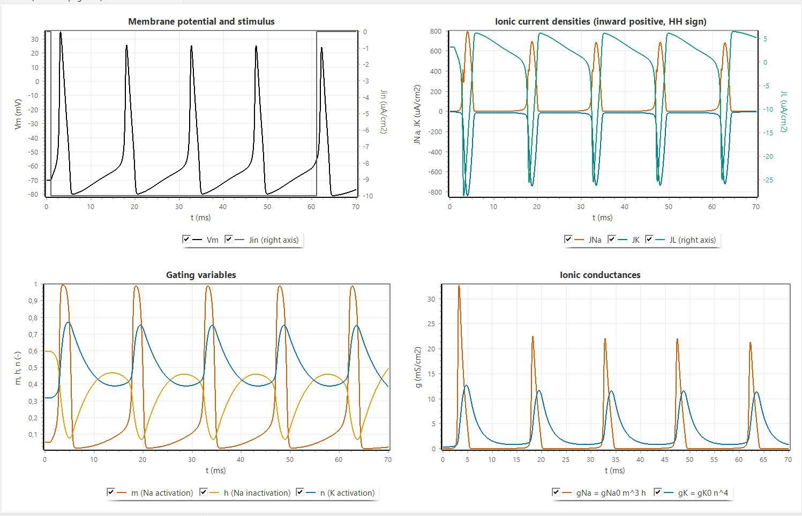
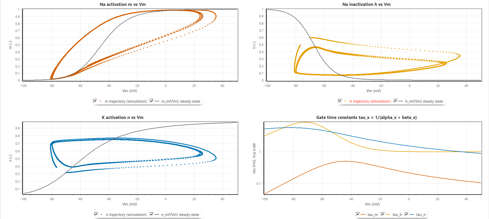
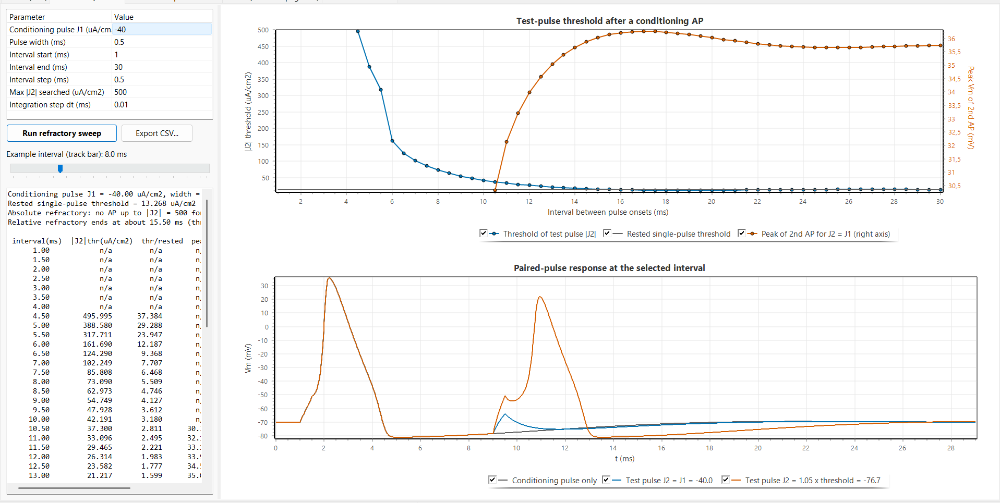
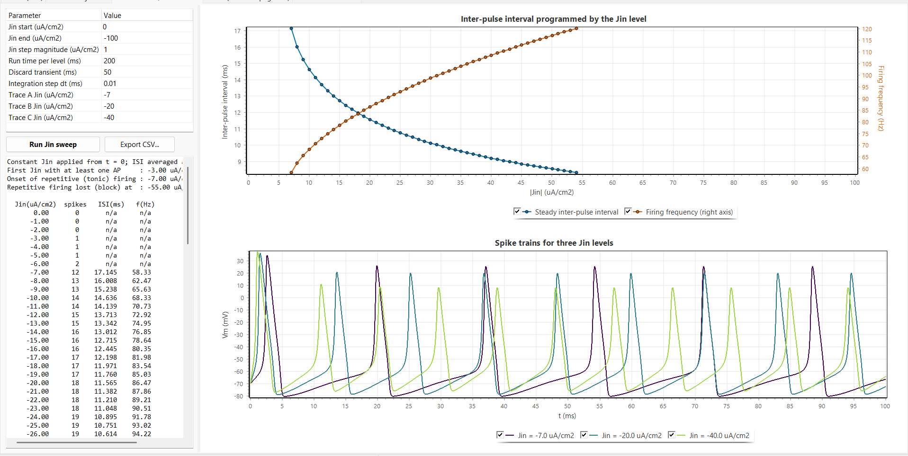
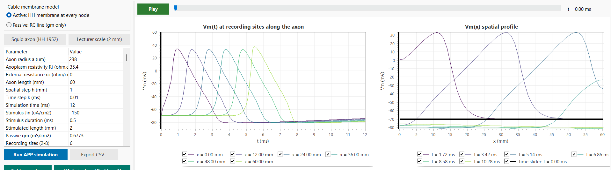
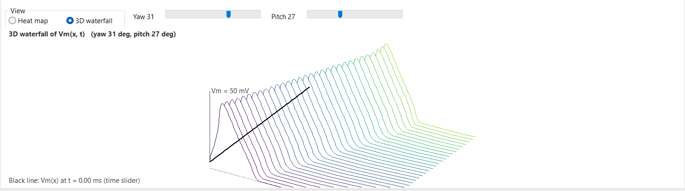
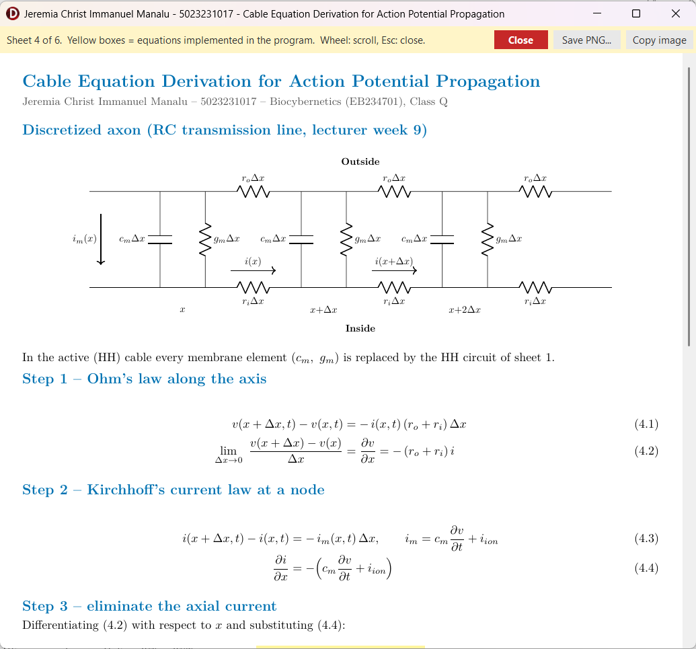

## 2.3 Execution Analysis

### 2.3.1 Action Potential Generation and Output Alignment

Figure 2.3 shows tab 1 for the default step protocol, $J_{in}=-10$ µA/cm² from 1 ms to 61 ms, integrated with the coupled RK4 at $\Delta t=0.01$ ms. Before the step the membrane stays exactly at $V_m=-70$ mV: the exported data of the program give $J_{Na}=1.220$, $J_K=-4.400$ and $J_L=3.184$ µA/cm² at rest, whose sum is zero to within $4\times10^{-3}$ µA/cm², with $m_\infty=0.0529$, $h_\infty=0.5961$ and $n_\infty=0.3177$, which confirms that the initial condition is a true equilibrium. After the onset the membrane fires repetitively. Each action potential rises from about $-60$ mV to a peak of about $+35$ mV, falls below rest to an after-hyperpolarization of about $-80$ mV, close to the potassium reversal potential of $-82$ mV, and then depolarizes slowly toward the next threshold. Thanks to the alignment of Eq. (2.2) the trace has the shape and the voltage range of a physiological recording, whereas the raw variable $v$ of the model would show downward spikes from 0 to about $-105$ mV. The current chart shows the inward sodium current as a short, large pulse at the upstroke followed by the slower outward potassium current, and the gate and conductance charts show $m$ rising almost instantly from 0.05 to nearly 1 while $h$ falls and $n$ rises with a delay, exactly the separation of time scales described in Section 1.2.

::: {custom-style="Figure"}
{width=16cm}
:::

::: {custom-style="Caption Text"}
**Figure 2.3.** Tab 1 for a step of $J_{in}=-10$ µA/cm²: membrane voltage and stimulus, ionic currents (HH sign, inward positive), gating variables and conductances.
:::

The response to different constant levels is summarized in Table 2.2, obtained from 100 ms runs with the step starting at 1 ms. Levels of $-2$ µA/cm² or weaker remain subthreshold; $-3$ to $-5$ µA/cm² give a single action potential followed by a stable depolarized state, and repetitive firing starts between $-6$ and $-7$ µA/cm². Stronger inputs shorten the interval and raise the first peak slightly, until at $-100$ µA/cm² only one spike occurs and the membrane remains depolarized (depolarization block). The lecturer's staircase protocol produces action potentials at 3.23, 28.36 and 40.01 ms, one at the onset of each new level: the $-5$ µA/cm² level only elicits a single onset spike (Table 2.2), and the $-10$ and $-20$ µA/cm² levels last only 13 and 12 ms, which is not longer than the interval needed for a second spike at these levels. Selecting the lecturer's sequential RK4 changes the spike times by at most 0.01 ms (for example an interval of 17.15 ms instead of 17.14 ms at $-7$ µA/cm²), so the output of the program agrees with the lecturer's method within the resolution of the plots, and the senior's program, which uses the same equations with a small constant added to the rate denominators, shows qualitatively the same waveforms.

::: {custom-style="Caption Text"}
**Table 2.2.** Response of the space-clamped membrane to constant input levels (coupled RK4, $\Delta t=0.01$ ms, step from 1 ms, 100 ms run).
:::

| $J_{in}$ (µA/cm²) | Action potentials | Last ISI (ms) | First peak $V_m$ (mV) |
| :---------------: | :---------------: | :-----------: | :-------------------: |
|       $-2$        |         0         |       -       |           -           |
|       $-3$        |         1         |       -       |         32.51         |
|       $-5$        |         1         |       -       |         34.05         |
|       $-7$        |         6         |     17.14     |         34.69         |
|       $-10$       |         7         |     14.64     |         35.26         |
|       $-20$       |         9         |     11.56     |         36.30         |
|       $-40$       |        11         |     9.21      |         37.49         |
|      $-100$       |   1, then block   |       -       |         40.00         |

### 2.3.2 Gating Phase Plots

Figure 2.4 shows the trajectories of the three gates against $V_m$ for the same run, drawn over the steady-state curves. The trajectory of $m$ stays close to $m_\infty(V_m)$ during the slow phases and separates from it only during the fast upstroke and downstroke, because $\tau_m$ is shorter than 0.5 ms; the corresponding loop is narrow. The trajectories of $h$ and $n$ form wide loops that lie far from their steady-state curves, because $\tau_h$ and $\tau_n$ are several milliseconds: during the spike $h$ and $n$ cannot follow the voltage, and after it they recover only gradually. The first loop starts from the resting values ($h=0.60$, $n=0.32$) and is different from the following loops, which start from $h\approx0.45$ because recovery between spikes is incomplete under the sustained current; this incomplete recovery is the refractoriness that limits the firing rate. Because the dots are plotted at a constant time step, their spacing shows the speed of the state: the dots are dense during the slow interspike depolarization and sparse on the upstroke, where $V_m$ changes by more than 100 mV within about a millisecond.

::: {custom-style="Figure"}
{width=16cm}
:::

::: {custom-style="Caption Text"}
**Figure 2.4.** Tab 2: trajectories of $m$, $h$ and $n$ against $V_m$ (dots at a constant time step) over the steady states $x_\infty(V_m)$, and the time constants $\tau_x(V_m)$.
:::

### 2.3.3 Refractory Period

Figure 2.5 shows the refractory sweep with a conditioning pulse $J_1=-40$ µA/cm² of 0.5 ms and the test interval varied in steps of 0.5 ms; selected values are listed in Table 2.3. The rested single-pulse threshold is 13.27 µA/cm². For intervals up to 3.5 ms no test pulse up to 500 µA/cm² produces a second action potential, which is the absolute refractory period. At 4.5 ms the threshold is just below the search limit (496 µA/cm²), and it then falls steeply, to 85.8 µA/cm² at 7.5 ms and 37.3 µA/cm² at 10.5 ms, which is the relative refractory period. The threshold returns to within 5 % of the rested value at about 15 ms (13.75 µA/cm² at 15.5 ms). Between about 16.5 and 25 ms the threshold is even lower than at rest, with a minimum of 11.20 µA/cm² at 18.5 ms, about 16 % below the rested value. This supernormal phase is consistent with the gate dynamics: by then $n$ has decayed close to its resting value, while $h$, which recovered quickly during the after-hyperpolarization, is still slightly above its resting value, so that more sodium conductance is available than at rest. The right axis shows that a second action potential elicited late in the relative refractory period is smaller (30.3 mV at 10.5 ms against 36.3 mV at 17.5 ms), because the available sodium conductance is still reduced. The lower chart shows the corresponding paired-pulse responses for the interval chosen with the track bar.

::: {custom-style="Figure"}
{width=16cm}
:::

::: {custom-style="Caption Text"}
**Figure 2.5.** Tab 3: test-pulse threshold and peak of the second action potential against the interval between pulse onsets, and the paired-pulse response at the selected interval.
:::

::: {custom-style="Caption Text"}
**Table 2.3.** Test-pulse threshold after a conditioning action potential ($J_1=-40$ µA/cm², width 0.5 ms; rested threshold 13.27 µA/cm²).
:::

| Interval (ms) | Test threshold $|J_2|_{th}$ (µA/cm²) | Ratio to rested threshold |
|:---:|:---:|:---:|
| 3.5 | none up to 500 | - |
| 4.5 | 496.0 | 37.4 |
| 6.5 | 124.3 | 9.37 |
| 8.5 | 63.0 | 4.75 |
| 10.5 | 37.3 | 2.81 |
| 12.5 | 23.6 | 1.78 |
| 15.5 | 13.75 | 1.04 |
| 18.5 | 11.20 | 0.84 |
| 24.5 | 13.42 | 1.01 |
| 29.5 | 13.52 | 1.02 |

### 2.3.4 How the Jin Level Programs the Inter-Pulse Interval

Figure 2.6 and Table 2.4 show the steady firing obtained in tab 4 for constant levels from 0 to $-68$ µA/cm². Up to $-2$ µA/cm² the membrane is silent, from $-3$ to $-6$ µA/cm² it fires once or twice and then settles, and from $-7$ µA/cm² it fires tonically with an interval of 17.15 ms (58.3 Hz). The interval then decreases monotonically with $|J_{in}|$, steeply at first and more slowly at large inputs: 14.64 ms (68.3 Hz) at $-10$, 11.57 ms (86.5 Hz) at $-20$, 9.21 ms (108.6 Hz) at $-40$ and 8.33 ms (120.1 Hz) at $-54$ µA/cm². At $-55$ µA/cm² and beyond, firing stops after two or three spikes because the membrane stays depolarized and sodium inactivation does not recover (depolarization block). The input level therefore programs the inter-pulse interval within a range of roughly 8 to 17 ms. The saturation at large inputs reflects the refractory period of Section 2.3.3: however fast the membrane is recharged, a new spike cannot occur before $h$ and $n$ have partly recovered. The example traces in the lower chart illustrate the shorter intervals and the slightly smaller spike amplitude at strong inputs.

::: {custom-style="Figure"}
{width=16cm}
:::

::: {custom-style="Caption Text"}
**Figure 2.6.** Tab 4: steady inter-pulse interval and firing frequency against $|J_{in}|$, and spike trains for three input levels.
:::

::: {custom-style="Caption Text"}
**Table 2.4.** Steady inter-pulse interval and firing frequency for selected input levels (program export).
:::

| $J_{in}$ (µA/cm²) | Mean ISI (ms) | Frequency (Hz) |
|:---:|:---:|:---:|
| $-6$ | - (2 spikes, no steady firing) | - |
| $-7$ | 17.15 | 58.3 |
| $-10$ | 14.64 | 68.3 |
| $-15$ | 12.72 | 78.6 |
| $-20$ | 11.57 | 86.5 |
| $-30$ | 10.13 | 98.7 |
| $-40$ | 9.21 | 108.6 |
| $-54$ | 8.33 | 120.1 |
| $-55$ | depolarization block | - |

### 2.3.5 Action Potential Propagation

Figure 2.7 shows tab 5 for the active squid-axon cable. The result memo confirms the cable constants derived in Section 2.2.3 ($r_i=19{,}893$ Ω/cm, $c_m=0.14954$ µF/cm, $D=0.33616$ cm²/ms, $r=0.3362$). The Vm(t) chart shows the same action potential arriving at successive recording sites with a constant delay, and the Vm(x) chart shows the wave as a pulse that moves along the axon with an unchanged shape. The 0 mV crossing times grow linearly with distance, from 0.652 ms at the stimulated end through 1.486 ms at 12 mm and 2.980 ms at 30 mm to 4.476 ms at 48 mm, which gives a conduction velocity of 12.04 m/s at 6.3 °C. The peak voltage is 33.03 mV along the whole middle part of the axon. It is slightly higher at the stimulated end (34.07 mV), where the stimulus adds to the membrane current, and at the sealed far end (37.32 mV), where no axial current can flow onward and the charge accumulates in the last segments. The spatial extent of the action potential, about 2 to 3 cm, is consistent with the product of the velocity and the spike duration.

::: {custom-style="Figure"}
{width=16cm}
:::

::: {custom-style="Caption Text"}
**Figure 2.7.** Tab 5, active cable with the squid-axon preset: parameters, Vm(t) at six recording sites and Vm(x) at six instants.
:::

Table 2.5 summarizes the parameter variations. Halving the spatial step to 0.5 mm (with a smaller time step to keep $r\le0.5$) changes the velocity by less than 2 %, which agrees with the second-order spatial accuracy of the scheme. Raising the temperature to 18.5 °C increases the velocity to 18.2 m/s, against 18.8 m/s calculated and 21.2 m/s measured by Hodgkin and Huxley [1]; the agreement with their calculation is within about 3 %. In the passive mode no action potential appears: the depolarization decays from $-35.2$ mV at the stimulated end to $-68.1$ mV at 15 mm, in line with the computed length constant of 7.0 mm, which demonstrates that propagation requires the regenerative sodium current. The lecturer-scale preset (2 mm fibre of 1 µm radius) propagates at about 0.78 m/s, consistent with $\theta\propto\sqrt{a}$ and with the time scale of the lecturer's plots. A step larger than $k_{max}$ is rejected by the program with the message predicted by Eq. (2.21). Figure 2.8 shows the space-time behaviour in the 3D views, where the propagating action potential appears as a straight ridge in the $(x,t)$ plane whose slope is the inverse of the velocity, and Figure 2.9 shows the derivation window of the cable equation opened from the same tab.

::: {custom-style="Caption Text"}
**Table 2.5.** Propagation results for parameter variations.
:::

| Case                                                    | Result                                                             |
| :------------------------------------------------------ | :----------------------------------------------------------------- |
| Active cable, squid axon, 6.3 °C, $h=1$ mm, $k=0.01$ ms | $\theta=12.04$ m/s, peak 33.03 mV, $r=0.336$                       |
| Active cable, $h=0.5$ mm                                | $\theta=12.25$ m/s                                                 |
| Active cable, 18.5 °C                                   | $\theta=18.2$ m/s (HH 1952: 18.8 calculated, 21.2 measured)        |
| Passive cable, $g_m=0.6773$ mS/cm²                      | no AP; $-35.2$ mV at 0 mm to $-68.1$ mV at 15 mm; $\lambda=7.0$ mm |
| Lecturer scale, $a=1$ µm, 2 mm, $h=0.1$ mm              | $\theta\approx0.78$ m/s, $r=0.14$                                  |

::: {custom-style="Figure"}
{width=15cm}
:::

::: {custom-style="Figure"}
{width=15cm}
:::

::: {custom-style="Caption Text"}
**Figure 2.8.** Space-time views of $V_m(x,t)$ for the active cable: (a) 3D waterfall, (b) 3D mesh; the bold line is the spatial profile at the time-slider position.
:::

::: {custom-style="Figure"}
{width=12cm}
:::

::: {custom-style="Caption Text"}
**Figure 2.9.** Derivation window of the cable equation (sheet 4) opened from the main form; the yellow boxes are the equations used by the cable solver.
:::

Compared with the reference programs, the results differ in two respects that are intended. The senior's propagation program updates the voltage with a pure diffusion term and an arbitrarily chosen coefficient applied to a stored APG trace, without any membrane current, so its signal can only spread and decay; the active cable of this work regenerates the action potential at every node and therefore propagates without decrement, which is what Problem 3 asks the model to exhibit. The lecturer's and the senior's plots use a 2 mm axon, which corresponds to the lecturer-scale preset; the squid-axon default was chosen because its velocity can be checked against the 1952 paper.

## 2.4 Evaluation and Discussion

The results agree with the theoretical baseline of Chapter I in every aspect examined. The voltage equation (1.2) with the currents (1.3) and the kinetics (1.5) to (1.9) reproduces the resting equilibrium exactly and generates action potentials of the expected amplitude and duration once the output is aligned with Eq. (2.2). The phase plots make the separation of time scales of Figure 1.2 directly visible: the fast gate $m$ tracks its steady state, while the slow gates $h$ and $n$ lag behind and recover only gradually, and this lag is the common cause of the two behaviours of Problem 1. It produces the absolute refractory period of about 4 ms and the relative refractory period ending near 15 ms, and it bounds the inter-pulse interval from below, so that the input level can program the interval only between about 17 and 8 ms before depolarization block sets in. The supernormal phase found after the relative refractory period is not an artefact of the threshold search, which is monotone and resolved to 0.008 µA/cm², but a property of the HH kinetics that follows from the different recovery rates of $h$ and $n$.

For propagation, the derivation of Problem 2 and the program of Problem 3 are consistent: the cable constants and the stability number printed by the program equal the hand-calculated values, the velocity converges with second-order behaviour when $h$ is halved, and the comparison of the active and passive modes isolates the regenerative sodium current as the reason why an action potential propagates without decrement while a passive signal decays within a few length constants. The velocity of 18.2 m/s at 18.5 °C is within about 3 % of the value calculated by Hodgkin and Huxley [1]; the remaining difference to their measurement of 21.2 m/s is of the same size as the difference between their own calculation and measurement, and it is expected because only the rate constants are temperature-scaled and the axon is modelled as a uniform cylinder.

Several limitations must be kept in mind. The explicit FTCS scheme is only first-order accurate in time and is stable only for $r\le1/2$, so fine spatial grids require small time steps; an implicit (Crank-Nicolson) scheme would remove this restriction. The sealed-end boundary raises the peak at the far end, and spikes are defined by a 0 mV crossing, so graded responses below 0 mV are not counted. Four discrepancies in the lecture material were identified and handled explicitly: the time step printed as "10 sec" (10 µs), the term $0.1(v+2.5)$ printed in $\alpha_m$ instead of $0.1(v+25)$, the coefficient $(r_o+r_i)C_m^{-1}$ instead of $\left[(r_o+r_i)c_m\right]^{-1}$, and the node index of the leakage term in the transcribed propagation code. In each case the program follows the derivation and the original paper, and offers the lecturer's integration method for direct comparison.

# CHAPTER III. CONCLUSION

A Hodgkin-Huxley neuron simulator was developed in Delphi 13 with a numerical core that is independent of the user interface. The action potential is generated by integrating the four HH equations with the classical RK4 method (and, for comparison, with the lecturer's sequential RK4) at a step of 0.01 ms, and the output is aligned to the membrane voltage with $V_m=-(v+70)$ mV, which turns the downward spikes of the 1952 sign convention into physiological action potentials from $-70$ mV to about $+35$ mV. A paired-pulse threshold search shows an absolute refractory period of about 4 ms and a relative refractory period ending near 15 ms, and a constant input programs the inter-pulse interval from about 17 ms (58 Hz) at $-7$ µA/cm² to about 8 ms (120 Hz) at $-54$ µA/cm², beyond which depolarization block occurs.

The integration of the cable equation was derived with a central difference in space and a forward difference in time, giving the explicit update $v_j^{n+1}=v_j^n+r(v_{j+1}^n-2v_j^n+v_{j-1}^n)+k(J_{in}-J_{ion})/C_m$ with $r=k/[(r_o+r_i)c_mh^2]$ and the stability condition $r\le1/2$. Implemented with an HH membrane at every node, the scheme shows a regenerating action potential that travels at constant amplitude and at 12.0 m/s for the squid axon at 6.3 °C (18.2 m/s at 18.5 °C, close to the 18.8 m/s calculated by Hodgkin and Huxley), whereas the passive cable only produces a decaying depolarization. Propagation is therefore exhibited by the combination of axial current flow and the regenerative sodium current.

The two reviewed papers show the reach of the Hodgkin-Huxley formalism: extended with more than a dozen conductances, it explains the bursting of the respiratory pacemaker, and approximated with base-2 functions, it runs in real time on small FPGAs for neuromorphic and neuroprosthetic applications. All equations used by the program, including the derivation of Problem 2, are available in the program as separate sheets and are highlighted in this report.

# REFERENCES

::: {custom-style="Reference"}
[1] A. L. Hodgkin and A. F. Huxley, "A quantitative description of membrane current and its application to conduction and excitation in nerve," _J. Physiol._, vol. 117, no. 4, pp. 500-544, Aug. 1952, doi: 10.1113/jphysiol.1952.sp004764.

[2] A. Arifin, "Hodgkin-Huxley neuron model," lecture notes, Biocybernetics (EB234701), Dept. Biomed. Eng., Inst. Teknologi Sepuluh Nopember, Surabaya, Indonesia, 2026.

[3] A. Arifin, "Hodgkin-Huxley neuron model simulation," lecture slides and source code, Biocybernetics (EB234701), Dept. Biomed. Eng., Inst. Teknologi Sepuluh Nopember, Surabaya, Indonesia, 2026.

[4] S. C. Chapra and R. P. Canale, _Numerical Methods for Engineers_, 7th ed. New York, NY, USA: McGraw-Hill Education, 2015.

[5] J. Malmivuo and R. Plonsey, _Bioelectromagnetism: Principles and Applications of Bioelectric and Biomagnetic Fields_. New York, NY, USA: Oxford Univ. Press, 1995.

[6] K. W. Morton and D. F. Mayers, _Numerical Solution of Partial Differential Equations: An Introduction_, 2nd ed. Cambridge, U.K.: Cambridge Univ. Press, 2005.

[7] B. Amini, A. Bidani, J. B. Zwischenberger, and J. W. Clark, Jr., "A model of the pacemaking neuron of the respiratory central pattern generator," _IEEE Trans. Neural Syst. Rehabil. Eng._, vol. 13, no. 2, pp. 120-124, Jun. 2005, doi: 10.1109/TNSRE.2005.847379.

[8] S. Haghiri, A. Naderi, B. Ghanbari, and A. Ahmadi, "High speed and low digital resources implementation of Hodgkin-Huxley neuronal model using base-2 functions," _IEEE Trans. Circuits Syst. I, Reg. Papers_, vol. 68, no. 1, pp. 275-287, Jan. 2021, doi: 10.1109/TCSI.2020.3026076.

[9] D. Noble, "A modification of the Hodgkin-Huxley equations applicable to Purkinje fibre action and pace-maker potentials," _J. Physiol._, vol. 160, no. 2, pp. 317-352, Feb. 1962, doi: 10.1113/jphysiol.1962.sp006849.

[10] S. Buccelli _et al._, "A neuromorphic prosthesis to restore communication in neuronal networks," _iScience_, vol. 19, pp. 402-414, Sep. 2019, doi: 10.1016/j.isci.2019.07.046.

[11] T. Levi, P. Bonifazi, P. Massobrio, and M. Chiappalone, "Editorial: Closed-loop systems for next-generation neuroprostheses," _Front. Neurosci._, vol. 12, Art. no. 26, Feb. 2018, doi: 10.3389/fnins.2018.00026.
:::
