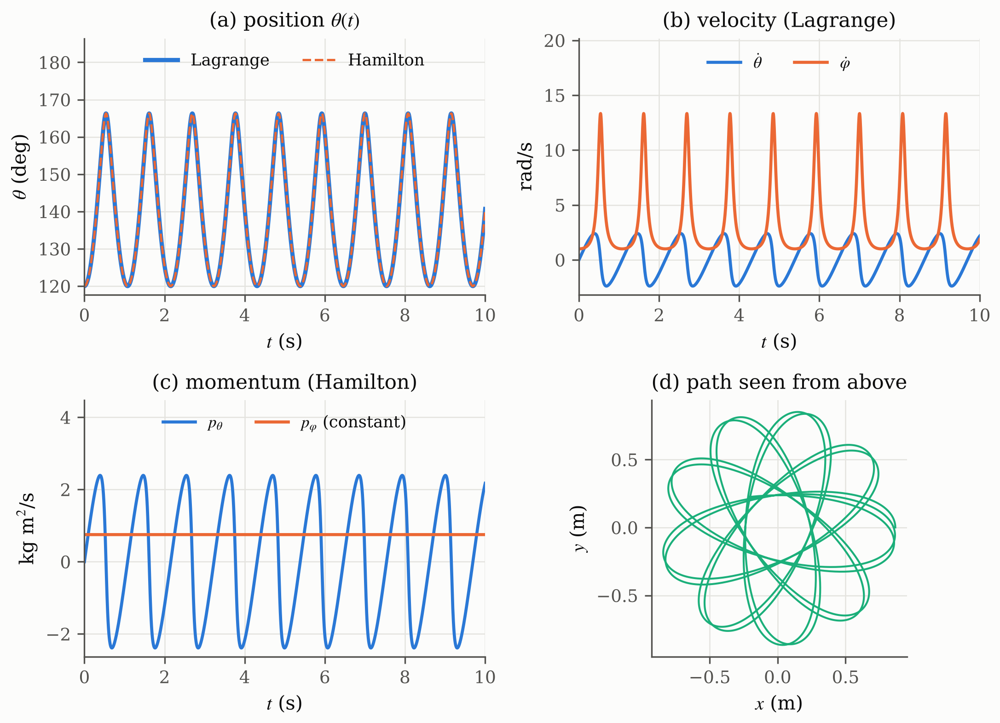
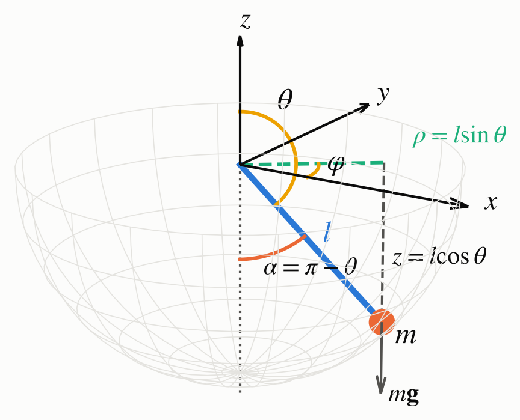

<a id="top"></a>

<div align="center">

# Assignment 2: Lagrangian and Hamiltonian Mechanics

**Hamilton's principle and the 3D pendulum, solved with the Lagrangian and the Hamiltonian method and simulated in Delphi 13**

[](#build-and-run)
[](Program/Unit1.pas)
[](Program/PendulumModel.pas)
[](https://github.com/ZinniXX004/Biocybernetics/actions/workflows/a2-model-regression.yml)
[](Report/)

[Overview](#overview) ·
[Problems](#problems-and-where-i-answer-them) ·
[Problem 1](#problem-1) ·
[Problem 2](#problem-2) ·
[Program](#program) ·
[Results](#results) ·
[Build](#build-and-run) ·
[Notes](#notes-and-issues)

<picture>
  <source media="(prefers-color-scheme: dark)" srcset="docs/img/results-dark.png">
  
</picture>

<sub>The four charts of my program for the general motion (alpha0 = 60 deg, phidot0 = 1 rad/s), plotted from the output of its numerical unit.</sub>

</div>

## Overview

|              |                                                                               |
| ------------ | ----------------------------------------------------------------------------- |
| **Course**   | Biocybernetics (EB234701), Class Q, Department of Biomedical Engineering, ITS |
| **Student**  | Jeremia Christ Immanuel Manalu (5023231017)                                   |
| **Lecturer** | Dr. Achmad Arifin, S.T., M.Eng.                                               |
| **Task**     | Two derivation problems; I added a short simulation program                   |
| **Program**  | `Project1`: four charts, four presets, equation window (F1)                   |

I prove that Hamilton's principle and the Lagrange equation are equivalent, derive the energies and the equations of motion of a pendulum in 3D with both methods, and integrate both sets of equations with RK4 in a Delphi program to obtain the position, velocity and momentum.

<p align="right"><sub><a href="#top">Back to top</a></sub></p>

## Problems and where I answer them

| #   | Problem                                                                              | Report               | Program                     |
| --- | ------------------------------------------------------------------------------------ | -------------------- | --------------------------- |
| 1   | Hamilton's principle and the Lagrange equation; (a) dL/d(thetadot) = p; (b) pdot = F | Section 2.2.1        | Equation window             |
| 2a  | Kinetic and potential energy of the pendulum in 3D                                   | Section 2.2.2        | Equation window             |
| 2b  | Motion equations: Lagrange (position, velocity) and Hamilton (position, momentum)    | Sections 2.2.3-2.2.5 | Charts, `PendulumModel.pas` |

<p align="right"><sub><a href="#top">Back to top</a></sub></p>

## Problem 1

Varying the path with fixed end points and integrating by parts once:

```math
\delta S=\epsilon\int_{t_1}^{t_2}\left(\frac{\partial L}{\partial\theta}-\frac{d}{dt}\frac{\partial L}{\partial\dot\theta}\right)\eta\,dt=0\ \ \forall\eta
\quad\Longleftrightarrow\quad
\frac{d}{dt}\frac{\partial L}{\partial\dot\theta}=\frac{\partial L}{\partial\theta}
```

With $T=\tfrac12M\dot\theta^2$, where $M=m$ if $\theta$ is a distance (as $x$ in the lecture) and $M=I$ (moment of inertia) if $\theta$ is an angle:

```math
p=\frac{\partial L}{\partial\dot\theta}=M\dot\theta,\qquad
\dot p=\frac{\partial L}{\partial\theta}=-\frac{\partial V}{\partial\theta}=F
\qquad(F=m\ddot x\ \text{or}\ \tau=I\ddot\theta)
```

<p align="right"><sub><a href="#top">Back to top</a></sub></p>

## Problem 2

<table>
  <tr>
    <td width="40%"><picture><source media="(prefers-color-scheme: dark)" srcset="docs/img/coordinates-dark.png"></picture></td>
    <td>I use the coordinates of the assignment figure: $\theta$ from the <b>upward</b> $z$ axis (so the bob hangs at $\theta=\pi$) and the azimuth $\varphi$. The link is rigid, so $r=l$ and $\dot r=0$; only $\theta$ and $\varphi$ change, and no equation for $r$ is needed.</td>
  </tr>
</table>

**Energies**

```math
T=\tfrac12 ml^2\left(\dot\theta^2+\sin^2\theta\,\dot\varphi^2\right),\qquad V=mgl\cos\theta
```

**Lagrangian method** (position and velocity)

```math
\ddot\theta=\sin\theta\cos\theta\,\dot\varphi^2+\frac{g}{l}\sin\theta,\qquad
\ddot\varphi=-2\cot\theta\,\dot\theta\dot\varphi
```

**Hamiltonian method** (position and momentum)

```math
H=\frac{p_\theta^2}{2ml^2}+\frac{p_\varphi^2}{2ml^2\sin^2\theta}+mgl\cos\theta,\qquad
\dot\theta=\frac{p_\theta}{ml^2},\quad
\dot\varphi=\frac{p_\varphi}{ml^2\sin^2\theta},\quad
\dot p_\theta=\frac{p_\varphi^2\cos\theta}{ml^2\sin^3\theta}+mgl\sin\theta,\quad
\dot p_\varphi=0
```

Both methods give accelerations or rates, not the position itself; I obtain $\theta(t)$ and $\varphi(t)$ by integrating them in time with RK4.

<p align="right"><sub><a href="#top">Back to top</a></sub></p>

## Program

| Unit                                                                     | Role                                                                                   |
| ------------------------------------------------------------------------ | -------------------------------------------------------------------------------------- |
| [`PendulumModel.pas`](Program/PendulumModel.pas)                         | Numerical unit without UI: Lagrange and Hamilton right-hand sides, RK4, energy, checks |
| [`Unit1.pas`](Program/Unit1.pas) / `.dfm`                                | Main form: preset box, parameter table, result memo, four charts designed in the form  |
| [`Unit2.pas`](Program/Unit2.pas) / `.dfm`                                | Equation window (LaTeX sheet stored in the form, used equations in yellow)             |
| [`Verification/TestPendulum.dpr`](Program/Verification/TestPendulum.dpr) | FPC test of the numerical unit, run by CI                                              |

Presets: general 3D motion, planar swing at 10 deg and 90 deg, conical pendulum. Keys: F5 runs, F1 opens the equations, Esc closes them.

<p align="right"><sub><a href="#top">Back to top</a></sub></p>

## Results

$m=1$ kg, $l=1$ m, $g=9.81$ m/s², RK4 step 1 ms.

| Case                     | Program                            | Expected               |
| ------------------------ | ---------------------------------- | ---------------------- |
| Planar, alpha0 = 10 deg  | period 2.00989 s                   | 2.00989 s (exact)      |
| Planar, alpha0 = 90 deg  | period 2.36784 s                   | 2.36784 s (exact)      |
| Length 0.5 m and 2 m     | 1.42121 s and 2.84242 s            | ratio 2                |
| Conical, alpha0 = 30 deg | alpha constant                     | alpha constant         |
| General, alpha0 = 60 deg | alpha between 13.72 deg and 60 deg | same (energy equation) |
| Lagrange vs Hamilton     | difference of theta 2.3e-9 rad     | 0                      |

<p align="right"><sub><a href="#top">Back to top</a></sub></p>

## Build and run

1. Open [`Program/Project1.dproj`](Program/Project1.dproj) in RAD Studio Delphi 13 Florence (Community Edition is enough).
2. Check that `PendulumModel.pas`, `Unit1.pas` and `Unit2.pas` are in the Project Manager.
3. Build and run (Win32 or Win64). TeeChart Standard ships with Delphi.

The CI test can be repeated with Free Pascal:

```bash
cd "Assignment 2_Lagrangian and Hamiltonian Mechanics/Program/Verification"
fpc -O2 -Fu.. -FU. -FE. TestPendulum.dpr
./TestPendulum > actual.txt && diff -u --strip-trailing-cr TestPendulum_output.txt actual.txt
```

<p align="right"><sub><a href="#top">Back to top</a></sub></p>

## Notes and issues

I compared my derivations with the lecture slides and, as references only, with a senior student's report of the same assignment and the senior Final Project programs. The findings are ISS-036 to ISS-048 in the [issue log](../ISSUES.md); the changes are in the [changelog](../CHANGELOG.md). The report sources and the scripts that build the Word file and the figures are in [`Report/source`](Report/source/).

<p align="right"><sub><a href="#top">Back to top</a></sub></p>
