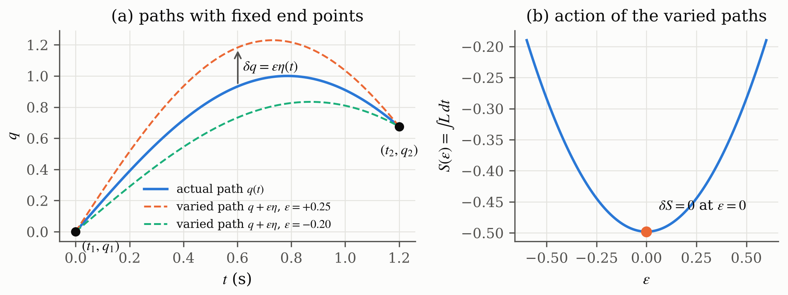
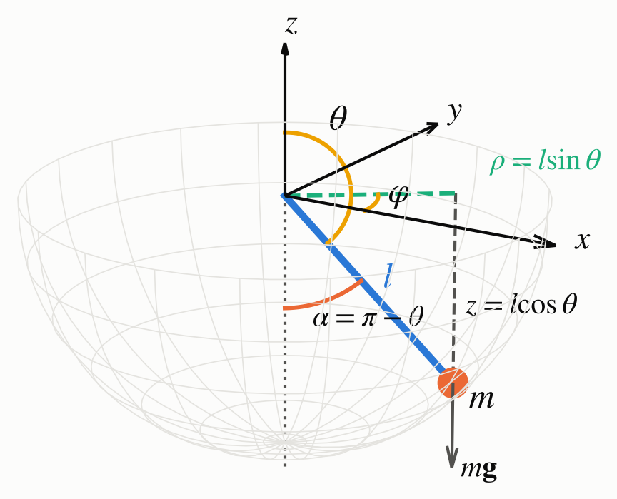

# CHAPTER I. FUNDAMENTAL THEORY

## 1.1 Lagrangian and Hamilton's Principle

Lagrangian mechanics describes a system with generalized coordinates $q$ (distances or angles) instead of force vectors. The Lagrange function is the kinetic energy minus the potential energy, Equation (1.1) [1][2]. Hamilton's principle states that between two fixed instants $t_1$ and $t_2$ the system follows the path for which the action $S$, the time integral of $L$, is stationary. A small change $\delta q(t)$ of the path that keeps both end points fixed does not change $S$ to first order, as written in Equation (1.2) and shown in Figure 1.1 [2][3].

::: {custom-style="Highlighted Equation"}
$$L=T-V \qquad\qquad (1.1)$$
:::

$$S=\int_{t_1}^{t_2}L\left(q,\dot q,t\right)dt,\qquad \delta S=0\ \ \text{with}\ \ \delta q(t_1)=\delta q(t_2)=0 \qquad\qquad (1.2)$$

::: {custom-style="Figure"}
{width=14cm}
:::

::: {custom-style="Caption Text"}
**Figure 1.1.** Hamilton's principle, with (a) the actual path and two varied paths with the same end points and (b) the action, which is stationary for the actual path $\epsilon=0$ (computed by the author).
:::

## 1.2 Euler-Lagrange Equation, Momentum and Force

Hamilton's principle leads to one Euler-Lagrange equation per coordinate, Equation (1.3), and the proof of this step is the answer to Problem 1. An external (non-conservative) force or torque $\tau$, for example a muscle torque, appears on the right-hand side, which is the motion equation of the lecture [1]. The derivative of $L$ with respect to a velocity is the generalized momentum, Equation (1.4). The lecture shows the simplest case $L=\tfrac12m\dot x^2-V(x)$, where $p=m\dot x$ and Equation (1.3) becomes Newton's law $m\ddot x=-\partial V/\partial x$ [1]. If a coordinate does not appear in $L$, its momentum is constant.

::: {custom-style="Highlighted Equation"}
$$\frac{d}{dt}\frac{\partial L}{\partial\dot q}-\frac{\partial L}{\partial q}=\tau\qquad(\tau=0\ \text{without external force}) \qquad\qquad (1.3)$$
:::

::: {custom-style="Highlighted Equation"}
$$p=\frac{\partial L}{\partial\dot q} \qquad\qquad (1.4)$$
:::

## 1.3 Hamiltonian Mechanics

The Hamiltonian replaces the velocity by the momentum, Equation (1.5). For a pendulum it is the total energy $T+V$ and it stays constant [1]. Strictly, this holds because the link does not change with time and $L$ does not contain $t$ explicitly [2]. Hamilton's equations, Equation (1.6), are first-order equations in position and momentum. Table 1.1 summarizes the comparison given in the lecture.

::: {custom-style="Highlighted Equation"}
$$H=\sum p\,\dot q-L=T+V \qquad\qquad (1.5)$$
:::

::: {custom-style="Highlighted Equation"}
$$\dot q=\frac{\partial H}{\partial p},\qquad \dot p=-\frac{\partial H}{\partial q} \qquad\qquad (1.6)$$
:::

::: {custom-style="Caption Text"}
**Table 1.1.** Lagrangian and Hamiltonian mechanics (after the lecture [1])
:::

|           | Lagrangian mechanics                     | Hamiltonian mechanics                    |
| --------- | ---------------------------------------- | ---------------------------------------- |
| Function  | $L=T-V$                                  | $H=T+V$                                  |
| Variables | position and velocity                    | position and momentum                    |
| Equations | one second-order equation per coordinate | two first-order equations per coordinate |
| Conserved | $L$ is not constant                      | $H$ is constant                          |

## 1.4 Coordinates of the Pendulum

Problem 2 uses the coordinates of the assignment figure, redrawn in Figure 1.2. The pivot is the origin, $z$ points up, $\theta$ is measured from the $+z$ axis, $\varphi$ is the angle in the horizontal $xy$ plane and $\rho$ is the projection of the link on that plane, Equation (1.7) [3]. Because $\theta$ is measured from the upward axis, the bob hangs at $\theta=\pi$, and the angle from the downward vertical is $\alpha=\pi-\theta$. The link is rigid, so the distance $r=l$ is constant and only $\theta$ and $\varphi$ can change.

$$x=r\sin\theta\cos\varphi,\quad y=r\sin\theta\sin\varphi,\quad z=r\cos\theta,\qquad \rho=r\sin\theta \qquad\qquad (1.7)$$

::: {custom-style="Figure"}
{width=8cm}
:::

::: {custom-style="Caption Text"}
**Figure 1.2.** Coordinates of the pendulum as in the assignment figure, where $\alpha=\pi-\theta$ is the angle from the downward vertical (rendered by the author).
:::

## 1.5 Numerical Integration

The equations of motion give accelerations (Lagrange) or rates of change (Hamilton), not the position itself. The position is obtained by integrating them in time. For the 3D pendulum this has no closed-form solution, so the program uses the fourth-order Runge-Kutta method (RK4) of Assignment 1, Equation (1.8), on a state vector $\mathbf y$ of first-order equations [4].

::: {custom-style="Highlighted Equation"}
$$\mathbf y_{k+1}=\mathbf y_k+\frac{\Delta t}{6}\left(\mathbf K_1+2\mathbf K_2+2\mathbf K_3+\mathbf K_4\right) \qquad\qquad (1.8)$$
:::

$$\mathbf K_1=\mathbf f(\mathbf y_k),\quad \mathbf K_2=\mathbf f\!\left(\mathbf y_k+\tfrac{\Delta t}{2}\mathbf K_1\right),\quad \mathbf K_3=\mathbf f\!\left(\mathbf y_k+\tfrac{\Delta t}{2}\mathbf K_2\right),\quad \mathbf K_4=\mathbf f(\mathbf y_k+\Delta t\,\mathbf K_3)$$
