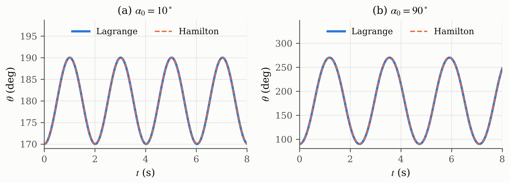
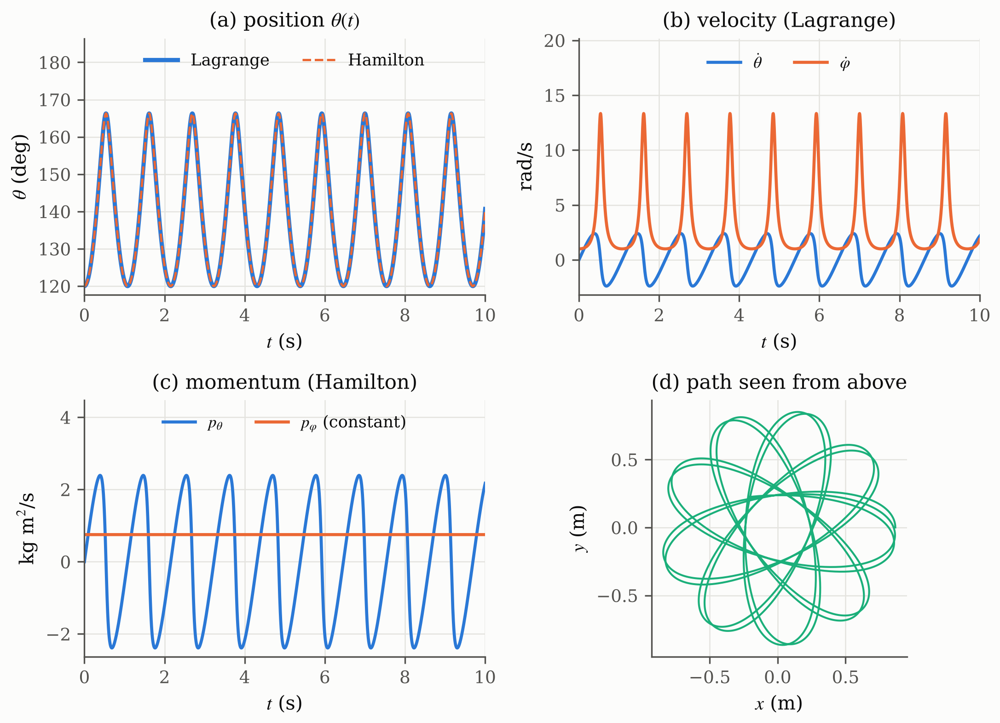

## 2.3 Execution Analysis

The program integrates the Lagrange system (2.14) and the Hamilton system (2.21) side by side from the same initial state ($m=1$ kg, $l=1$ m, $g=9.81$ m/s², $\Delta t=1$ ms). The four presets are a small and a large planar swing, a conical pendulum and a general 3D motion. Figures 2.1 and 2.2 are drawn from the output of the program's numerical unit, with the same charts as the main window.

::: {custom-style="Figure"}
{width=15.5cm}
:::

::: {custom-style="Caption Text"}
**Figure 2.1.** Planar swing ($\dot\varphi_0=0$) started at (a) $\alpha_0=10^\circ$ and (b) $\alpha_0=90^\circ$, where the Lagrange (solid) and Hamilton (dashed) results lie on top of each other.
:::

For the planar swing the motion stays in one vertical plane and Equation (2.12) reduces to the simple pendulum. The angle $\theta$ swings around $180^\circ$ (the lowest point), and values above $180^\circ$ mean that the bob has passed to the other side. The period of the program is 2.00989 s at $10^\circ$, almost the small-angle value $2\pi\sqrt{l/g}=2.00607$ s, and 2.36784 s at $90^\circ$, 18 % longer, because the small-angle formula of Equation (2.24) only holds for small swings. Both values equal the exact pendulum period. A link four times longer (0.5 m to 2 m) doubles the period (1.42121 s to 2.84242 s), as expected from $T\propto\sqrt{l}$.

::: {custom-style="Figure"}
{width=15.5cm}
:::

::: {custom-style="Caption Text"}
**Figure 2.2.** General motion ($\alpha_0=60^\circ$, $\dot\varphi_0=1$ rad/s), shown in the four charts of the program, namely (a) position $\theta$ from both methods, (b) velocity from the Lagrange method, (c) momentum from the Hamilton method, (d) path of the bob seen from above.
:::

In the general case the bob does not stay in a plane. It swings between $\alpha=60^\circ$ and $13.7^\circ$ while it turns around the vertical axis, so the path seen from above is a rosette, Figure 2.2(d). When the bob comes close to the axis, $\dot\varphi$ rises from 1 to about 13 rad/s, Figure 2.2(b), while $p_\varphi$ stays at 0.75 kg m²/s, Figure 2.2(c). This shows the practical difference between the two methods. The Lagrange velocity changes strongly, whereas the Hamilton momentum shows the conservation law directly. For the conical preset, started with the rate $\Omega$ of Equation (2.24), $\alpha$ stays at $30^\circ$ and the bob moves on a circle. Table 2.1 collects the results.

::: {custom-style="Caption Text"}
**Table 2.1.** Program results compared with the expected values
:::

| Case                         | Result of the program                                               | Expected                                   |
| ---------------------------- | ------------------------------------------------------------------- | ------------------------------------------ |
| Planar, $\alpha_0=10^\circ$  | period 2.00989 s                                                    | 2.00989 s (exact), 2.00607 s (small angle) |
| Planar, $\alpha_0=90^\circ$  | period 2.36784 s                                                    | 2.36784 s (exact)                          |
| Length 0.5 m and 2 m         | periods 1.42121 s and 2.84242 s                                     | ratio 2                                    |
| Conical, $\alpha_0=30^\circ$ | $\alpha$ constant, $\Omega=3.3657$ rad/s                            | $\alpha$ constant                          |
| General, $\alpha_0=60^\circ$ | $\alpha$ between 13.72° and 60°                                     | 13.72° and 60° (energy equation)           |
| Lagrange vs Hamilton         | largest difference of $\theta$ is $2.3\times10^{-9}$ rad              | 0                                          |
| Energy $H$ and $p_\varphi$   | $H$ within $4\times10^{-10}\,mgl$, $p_\varphi$ within $8\times10^{-10}$ kg m²/s | constant                                   |

## 2.4 Evaluation and Discussion

The results agree with Chapter I. Problem 1 shows that Hamilton's principle and the Lagrange equation are the same law, and that $\partial L/\partial\dot\theta$ is the momentum and $\dot p=F$ is Newton's law, in the linear form ($m$, $F=ma$) or in the rotational form ($I$, torque). The difference to the senior report is therefore not a different law but the inertia of the coordinate. The mass $m$ is correct for a distance, while an angle needs the moment of inertia.

For Problem 2 the Lagrangian method gives two second-order equations (position and velocity) and the Hamiltonian method four first-order equations (position and momentum), as stated in Table 1.1. The program confirms that both give the same motion, to $2.3\times10^{-9}$ rad after 20 s, and that $H=T+V$ and $p_\varphi$ stay constant. The equations themselves give accelerations or rates, so the position always requires an integration in time, which here is done with RK4. One limitation is the vertical axis ($\sin\theta=0$), where $\varphi$ is undefined. The program therefore accepts start angles between 0° and 180° only. This matters for the Final Project, where the arm hangs on this axis at rest.

# CHAPTER III. CONCLUSION

Hamilton's principle $\delta\int(T-V)\,dt=0$ and the Lagrange equation $\frac{d}{dt}\partial L/\partial\dot\theta=\partial L/\partial\theta$ were shown to be equivalent by varying the path with fixed end points and integrating by parts. With $T=\tfrac12M\dot\theta^2$, $\partial L/\partial\dot\theta=M\dot\theta=p$, and the Lagrange equation becomes $\dot p=F=-\partial V/\partial\theta$, which is $F=m\ddot x$ for a distance and $\tau=I\ddot\theta$ for an angle.

For the pendulum of the assignment figure, with $r=l$ fixed, $T=\tfrac12ml^2(\dot\theta^2+\sin^2\theta\,\dot\varphi^2)$ and $V=mgl\cos\theta$. The Lagrangian method gives $\ddot\theta=\sin\theta\cos\theta\,\dot\varphi^2+(g/l)\sin\theta$ and $\ddot\varphi=-2\cot\theta\,\dot\theta\dot\varphi$. The Hamiltonian method gives $H=T+V$ and four first-order equations in $\theta$, $\varphi$, $p_\theta$ and $p_\varphi$, with $p_\varphi$ constant.

The Delphi program integrates both sets of equations with RK4 to obtain the position, velocity and momentum. Both methods give the same motion, the periods match the exact pendulum, and the energy and $p_\varphi$ remain constant.

# REFERENCES

::: {custom-style="Reference"}
[1] A. Arifin, "Lagrangian and Hamiltonian mechanics," lecture slides, Biocybernetics (EB234701), Dept. Biomed. Eng., Inst. Teknologi Sepuluh Nopember, Surabaya, Indonesia, 2026.

[2] H. Goldstein, C. Poole, and J. Safko, _Classical Mechanics_, 3rd ed. San Francisco, CA, USA: Addison-Wesley, 2002.

[3] T. W. B. Kibble and F. H. Berkshire, _Classical Mechanics_, 5th ed. London, U.K.: Imperial College Press, 2004.

[4] S. C. Chapra and R. P. Canale, _Numerical Methods for Engineers_, 7th ed. New York, NY, USA: McGraw-Hill Education, 2015.
:::
