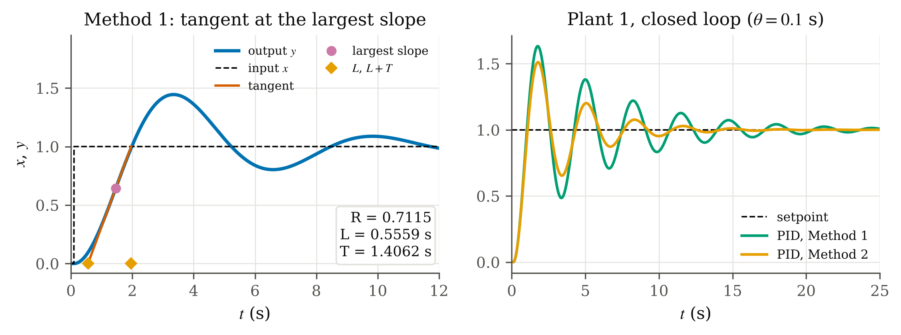
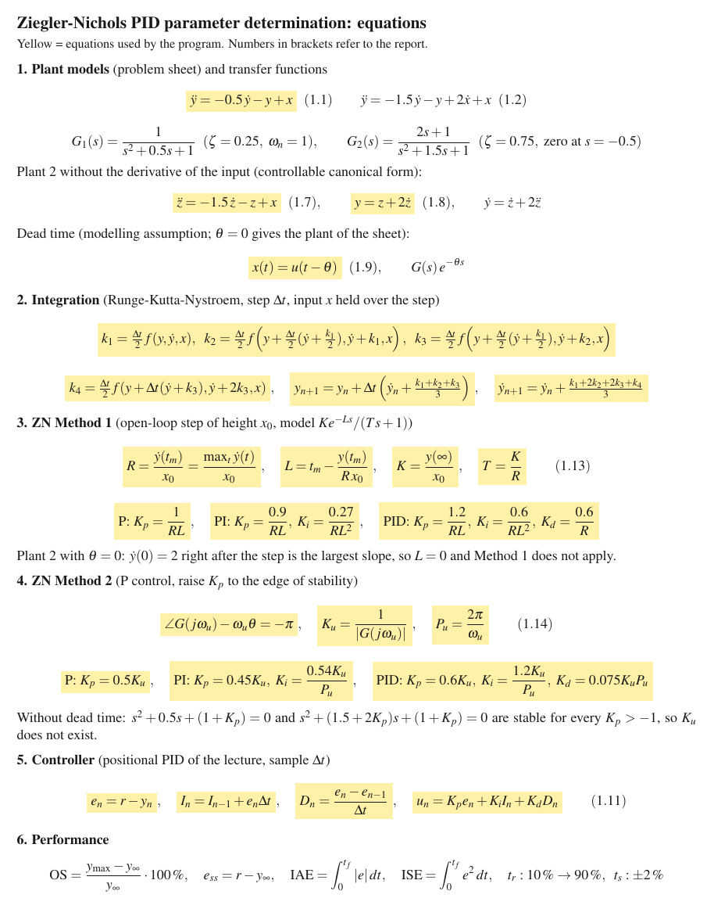

<a id="top"></a>

<div align="center">

# Assignment 3: Ziegler-Nichols PID Parameter Determination

**Preliminary assignment: two second-order plants, RK4 integration and PID tuning with Ziegler-Nichols Method 1 and Method 2, simulated in Delphi 13**

[](#build-and-run)
[](Program/Unit1.pas)
[](Program/ZNModel.pas)
[](https://github.com/ZinniXX004/Biocybernetics/actions/workflows/a3-model-regression.yml)
[](Report/)

[Overview](#overview) ·
[Problems](#problems-and-where-i-answer-them) ·
[Plants](#the-plants) ·
[Findings](#what-i-found) ·
[Program](#program) ·
[Results](#results) ·
[Build](#build-and-run) ·
[Notes](#notes-and-issues)

<picture>
  <source media="(prefers-color-scheme: dark)" srcset="docs/img/zn-overview-dark.png">
  
</picture>

<sub>Plant 1 with a dead time of 0.1 s: the tangent of Method 1 (left) and the closed loop with the PID gains of both methods (right), plotted from the output of the numerical unit of my program.</sub>

</div>

## Overview

|              |                                                                               |
| ------------ | ----------------------------------------------------------------------------- |
| **Course**   | Biocybernetics (EB234701), Class Q, Department of Biomedical Engineering, ITS |
| **Student**  | Jeremia Christ Immanuel Manalu (5023231017)                                   |
| **Lecturer** | Course lecturer                                                               |
| **Task**     | Plant functions, an RK4 function and a ZN tuning program for two plants       |
| **Program**  | `Project1`: three tabs (plant model, ZN Method 1, ZN Method 2), editable gains |

I model both plants as second-order differential equations, integrate them with the fourth-order Runge-Kutta(-Nystrom) method of the lecture, determine the P, PI and PID parameters with Ziegler-Nichols Method 1 (reaction curve) and Method 2 (critical gain), and test every controller in a closed-loop simulation.

<p align="right"><sub><a href="#top">Back to top</a></sub></p>

## Problems and where I answer them

| #   | Problem                                                      | Report                | Code                                                    |
| --- | ------------------------------------------------------------ | --------------------- | ------------------------------------------------------- |
| 1   | Function of the second-order equation of each plant          | Section 2.2.1         | `Plant1Accel`, `Plant2Accel`, `PlantOutput`             |
| 2   | Fourth-order Runge-Kutta function                            | Section 2.2.2         | `RK4Step`                                               |
| 3   | Main program for ZN Method 1 and Method 2, outputs and files | Sections 2.2.3 to 2.3 | `ZNMethod1`, `ZNMethod2`, `SimulateClosedLoop`, `Unit1` |

<p align="right"><sub><a href="#top">Back to top</a></sub></p>

## The plants

```math
\ddot y=-0.5\,\dot y-y+x\quad\Rightarrow\quad G_1(s)=\frac{1}{s^2+0.5s+1},\qquad
\ddot y=-1.5\,\dot y-y+2\dot x+x\quad\Rightarrow\quad G_2(s)=\frac{2s+1}{s^2+1.5s+1}
```

Plant 1 is lightly damped (zeta = 0.25, overshoot 44.4 %). Plant 2 contains the derivative of the input, so I integrate it in controllable canonical form, which never needs that derivative:

```math
\ddot z=-1.5\,\dot z-z+x,\qquad y=z+2\dot z
```

<p align="right"><sub><a href="#top">Back to top</a></sub></p>

## What I found

Before writing code I checked whether the two ZN experiments can work on these plants at all.

| Question                       | Plant 1                                              | Plant 2                                               |
| ------------------------------ | ---------------------------------------------------- | ----------------------------------------------------- |
| Method 1: tangent, L and T     | R = 0.7115 1/s, L = 0.4559 s, T = 1.4054 s           | largest slope at t = 0, so L = 0: rule not applicable |
| Method 2: critical gain with P | none, `s^2 + 0.5s + (1+Kp)` is always stable         | none, `s^2 + (1.5+2Kp)s + (1+Kp)` is always stable    |
| "Ku" found by simulation       | about 1/dt (1000 at dt = 1 ms): a numerical artefact | about 1/dt: a numerical artefact                      |

I therefore added an adjustable dead time theta at the plant input (default 0.1 s), which stands for the delay between a stimulation command and muscle force in FES. With it both methods apply, and the analytic critical gain from the phase crossover agrees with the simulated one within 0.5 %. Setting theta = 0 shows the plants exactly as given, and the program then explains why each method does not apply.

<p align="right"><sub><a href="#top">Back to top</a></sub></p>

## Program

| Unit                                                         | Role                                                                                           |
| ------------------------------------------------------------ | ---------------------------------------------------------------------------------------------- |
| [`ZNModel.pas`](Program/ZNModel.pas)                         | Numerical unit without UI: plants, RK4, dead time, ZN Method 1 and 2, closed loop, measures    |
| [`Unit1.pas`](Program/Unit1.pas) / `.dfm` | Main form: three tabs, editable R, L, Ku, Pu, Kp, Ki, Kd, separate charts, message log |
| [`Unit2.pas`](Program/Unit2.pas) / `.dfm`                    | Equation window (LaTeX sheet stored in the form, used equations in yellow)                     |
| [`Verification/TestZN.dpr`](Program/Verification/TestZN.dpr) | FPC test of the numerical unit, run by CI (exit code = failed checks)                          |

| Tab | Buttons | Charts | Values (editable in bold) |
| --- | --- | --- | --- |
| Plant Model and RK4 (Problems 1, 2) | Impulse Response and Step Response, each for Plant 1 and Plant 2 | Runge Kutta Output (impulse response and its peak), step response (y, tangent, L and L + T, MP) | R, L, T, K, MP, %MP |
| ZN Method 1 (Problem 3) | Plant 1, Plant 2, Gains from R and L, Run closed loop | step response with tangent, PID Output ZN1 (y), control signal u | **R, L, Kp, Ki, Kd**, rise time, overshoot, max value, settling time, error, IAE, ISE |
| ZN Method 2 (Problem 3) | Plant 1, Plant 2, Test Ku, Gains from Ku and Pu, Run closed loop | P loop at Ku with its peaks, PID Output ZN2 (y), control signal u | **Ku, Pu, Kp, Ki, Kd**, the same measures |

The controller (P, PI or PID) is chosen with radio buttons. Buttons and panel headers are painted with gradients, buttons react to hover and click, and the colour of a panel header shows its role (blue actions, green editable inputs, red to orange messages, teal results, slate help, indigo performance); CLEAR resets every output and EXIT closes the program. Over a chart the wheel zooms at the cursor (Shift: time axis only), a drag to the lower right zooms into a box, a right drag pans and a double click restores the full view. Every input is checked: errors stop a run with a message, and warnings (no dead time, an unstable loop, a Pu of a few time steps, very large gains, a response that has not settled) are shown and kept in the message log. Warnings are shown in orange and errors in red in the log. F1 opens the equations (wheel or touchpad to scroll, drag to move, Ctrl + wheel or pinch to zoom), Esc closes them.

<p align="center"></p>

<p align="right"><sub><a href="#top">Back to top</a></sub></p>

## Results

theta = 0.1 s, dt = 1 ms, run 30 s, unit setpoint.

| Plant | Method 1                 | Method 2                   | PID gains (Kp, Ki, Kd), Method 1 | PID gains, Method 2  | Closed loop                                  |
| ----- | ------------------------ | -------------------------- | -------------------------------- | -------------------- | -------------------------------------------- |
| 1     | R = 0.7115, L = 0.5559 s | Ku = 5.0495, Pu = 2.5865 s | 3.034, 2.729, 0.843              | 3.030, 2.343, 0.980  | P and PID stable, PI unstable (both methods) |
| 2     | R = 2.0000, L = 0.1000 s | Ku = 8.1609, Pu = 0.3850 s | 6.000, 30.000, 0.300             | 4.897, 25.439, 0.236 | all stable, PID overshoot 74 % and 61 %      |

The PI result of plant 1 is the main lesson: the plant is lightly damped, PI adds phase lag but no damping, and the derivative term of PID supplies the damping that is missing.

<p align="right"><sub><a href="#top">Back to top</a></sub></p>

## Build and run

1. Open [`Program/Project1.dproj`](Program/Project1.dproj) in RAD Studio Delphi 13 Florence (Community Edition is enough).
2. Check that `ZNModel.pas`, `Unit1.pas` and `Unit2.pas` are in the Project Manager.
3. Build and run (Win32 or Win64). TeeChart Standard ships with Delphi.

The CI test can be repeated with Free Pascal:

```bash
cd "Assignment 3_Preliminary/Program/Verification"
fpc -O2 -Fu.. -FU. -FE. TestZN.dpr
./TestZN > actual.txt && diff -u --strip-trailing-cr TestZN_output.txt actual.txt
```

`./TestZN --csv <folder>` also writes the responses that [`Report/source/figs.py`](Report/source/figs.py) plots for the report.

<p align="right"><sub><a href="#top">Back to top</a></sub></p>

## Notes and issues

I checked the formulas against the lecture slides and, as references only, against earlier student programs of this course. The findings are ISS-049 to ISS-061, ISS-069 to ISS-072 and ISS-076 in the [issue log](../ISSUES.md); the changes are in the [changelog](../CHANGELOG.md). The report sources and the scripts that build the Word file and the figures are in [`Report/source`](Report/source/).

<p align="right"><sub><a href="#top">Back to top</a></sub></p>
