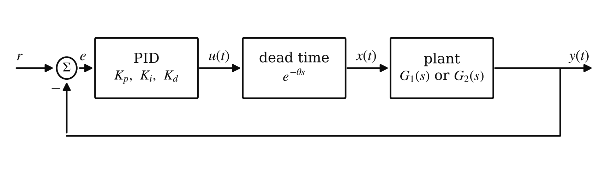
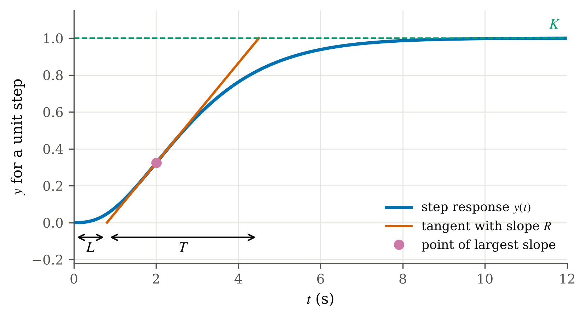

# CHAPTER I. FUNDAMENTAL THEORY

## 1.1 The Two Plants

A plant is the part of a control system that is controlled, for example a joint moved by stimulated muscles. Its input $x$ is the signal sent to it and its output $y$ is the quantity that is measured. The assignment gives two plants as second-order differential equations, Equation 1.1 and Equation 1.2. Each one has a damping term ($\dot y$), a restoring term ($y$) and the input. Plant 2 also contains the rate of change of the input, $2\dot x$, so it reacts to how fast the input changes and not only to its size.

::: {custom-style="Highlighted Equation"}
$$\ddot y=-0.5\,\dot y-y+x \qquad\qquad (1.1)$$
:::

$$\ddot y=-1.5\,\dot y-y+2\dot x+x \qquad\qquad (1.2)$$

With zero initial conditions the Laplace transform turns each equation into a transfer function, the ratio $Y(s)/X(s)$ [@ogata], Equation 1.3 and Equation 1.4. Both denominators have the standard second-order form of Equation 1.5, from which the natural frequency $\omega_n$ and the damping ratio $\zeta$ are read. Plant 1 has $\omega_n=1$ rad/s and $\zeta=0.25$, so it is underdamped and its step response overshoots by the amount of Equation 1.6, 44.4 %. Plant 2 has $\zeta=0.75$, which alone would give an overshoot of only 2.8 %, but its numerator $2s+1$ adds a zero at $s=-0.5$ that makes the response rise much faster and overshoot more.

$$G_1(s)=\frac{Y(s)}{X(s)}=\frac{1}{s^2+0.5s+1} \qquad\qquad (1.3)$$

$$G_2(s)=\frac{Y(s)}{X(s)}=\frac{2s+1}{s^2+1.5s+1} \qquad\qquad (1.4)$$

$$s^2+2\zeta\omega_n s+\omega_n^2,\qquad \omega_{n1}=\omega_{n2}=1\ \text{rad/s},\qquad \zeta_1=\frac{0.5}{2}=0.25,\qquad \zeta_2=\frac{1.5}{2}=0.75 \qquad\qquad (1.5)$$

$$M_p=\exp\!\left(-\frac{\pi\zeta}{\sqrt{1-\zeta^2}}\right)\times100\ \%,\qquad \omega_d=\omega_n\sqrt{1-\zeta^2} \qquad\qquad (1.6)$$

## 1.2 Plant 2 Without the Derivative of the Input

A computer cannot take the derivative of a step input, because a step jumps from 0 to 1 within one sample, so its numerical derivative is a single spike of height $1/\Delta t$. The usual way around this is a state-space realisation in controllable canonical form [@ogata]. An internal variable $z$ is driven by the input through the denominator only, Equation 1.7, and the output is built from $z$ and its rate with the numerator coefficients, Equation 1.8. Section 2.2.1 shows that these two equations give exactly Equation 1.2. Both equations contain only the input itself, never its derivative, so plant 2 can be integrated with the same method as plant 1.

::: {custom-style="Highlighted Equation"}
$$\ddot z=-1.5\,\dot z-z+x \qquad\qquad (1.7)$$
:::

::: {custom-style="Highlighted Equation"}
$$y=z+2\dot z,\qquad \dot y=\dot z+2\ddot z \qquad\qquad (1.8)$$
:::

## 1.3 Dead Time

Dead time (transport delay) means that the plant receives the controller command only after a delay $\theta$, Equation 1.9. In the frequency domain it multiplies the transfer function by $e^{-\theta s}$, which does not change the size of a signal but delays every frequency, so it adds a phase lag that grows with frequency [@ogata][@astrom]. Real biomedical loops always have such a delay. Skeletal muscle starts to produce force about 30 ms to 100 ms after its electrical activation, the electromechanical delay [@emd], and a stimulator adds its own processing time. The lecture reports a delayed response in PID control of the knee joint with functional electrical stimulation (FES) [@ce2]. Figure 1.1 shows the closed loop used in this assignment. The plants of the sheet are the special case $\theta=0$.

::: {custom-style="Highlighted Equation"}
$$x(t)=u(t-\theta),\qquad \frac{X(s)}{U(s)}=e^{-\theta s} \qquad\qquad (1.9)$$
:::

::: {custom-style="Figure"}
{width=15cm}
:::

::: {custom-style="Caption Text"}
**Figure 1.1.** Closed loop of the program, with the PID controller, the dead time $\theta$ and plant 1 or plant 2 (drawn by the author).
:::

## 1.4 PID Controller

The controller compares the setpoint $r$ with the measured output and acts on the error $e=r-y$. The proportional term reacts to the present error and mainly shortens the rise time, the integral term accumulates the past error and removes the steady-state error, and the derivative term reacts to the rate of change of the error and damps overshoot and oscillation [@ce1]. The continuous PID law is Equation 1.10. In the program the controller works at the integration step $\Delta t$, so the integral becomes a running sum and the derivative a difference quotient, as in the tracking-control code of the lecture, Equation 1.11 [@ce1].

$$u(t)=K_pe(t)+K_i\int_0^te(\tau)\,d\tau+K_d\frac{de(t)}{dt},\qquad \frac{U(s)}{E(s)}=K_p+\frac{K_i}{s}+K_ds \qquad\qquad (1.10)$$

::: {custom-style="Highlighted Equation"}
$$e_n=r-y_n,\qquad I_n=I_{n-1}+e_n\Delta t,\qquad D_n=\frac{e_n-e_{n-1}}{\Delta t},\qquad u_n=K_pe_n+K_iI_n+K_dD_n \qquad\qquad (1.11)$$
:::

## 1.5 Ziegler-Nichols Method 1 (Reaction Curve)

Ziegler and Nichols proposed two experiments that give PID settings without a detailed model of the plant [@zn42]. The first one uses the open-loop response to a step of height $x_0$. Many industrial processes give an S-shaped curve that is described well by a first-order lag with a dead time, Equation 1.12 [@zns][@astrom]. A tangent is drawn at the time $t_m$ where the curve rises fastest (the inflection point). Its slope is $R$, it crosses the time axis at the apparent dead time $L$ and reaches the final value $K$ after a further time $T$, Equation 1.13 and Figure 1.2. Table 1.1 gives the controller settings of the lecture [@zns]. In the usual notation they are $K_p=1.2T/(KL)$, $T_i=2L$ and $T_d=0.5L$ for the PID controller, with $K_i=K_p/T_i$ and $K_d=K_pT_d$ [@astrom][@zn42]. The rule needs $L>0$, because every gain contains $1/L$.

$$G(s)\approx\frac{K\,e^{-Ls}}{Ts+1},\qquad R=\frac{K}{T} \qquad\qquad (1.12)$$

::: {custom-style="Highlighted Equation"}
$$R=\frac{1}{x_0}\max_t\dot y(t),\qquad L=t_m-\frac{y(t_m)}{R\,x_0},\qquad K=\frac{y(\infty)}{x_0},\qquad T=\frac{K}{R} \qquad\qquad (1.13)$$
:::

::: {custom-style="Figure"}
{width=12cm}
:::

::: {custom-style="Caption Text"}
**Figure 1.2.** Reaction curve of Method 1 for an S-shaped process, with the tangent at the point of largest slope, the apparent dead time $L$, the time constant $T$ and the static gain $K$ (computed by the author for $1/(s+1)^3$).
:::

::: {custom-style="Caption Text"}
**Table 1.1.** Controller settings of ZN Method 1 [@zns].
:::

| Controller | $K_p$      | $K_i$         | $K_d$   |
| ---------- | ---------- | ------------- | ------- |
| P          | $1/(RL)$   | 0             | 0       |
| PI         | $0.9/(RL)$ | $0.27/(RL^2)$ | 0       |
| PID        | $1.2/(RL)$ | $0.6/(RL^2)$  | $0.6/R$ |

## 1.6 Ziegler-Nichols Method 2 (Critical Gain)

The second experiment uses the closed loop with a proportional controller only. The gain is raised until the output oscillates with a constant amplitude, which is the edge of stability. This gain is the critical (ultimate) gain $K_u$ and the period of the oscillation is $P_u$ [@zns][@zn42]. At this point the loop gain is exactly one and the phase lag of the plant is exactly 180°, Equation 1.14, so $K_u$ and $P_u$ can also be computed from the transfer function [@ogata]. Table 1.2 gives the settings of the lecture [@zns]. A second-order plant without dead time never reaches a phase lag of 180°, so for it the oscillation never appears. This is shown in Section 2.2.4.

::: {custom-style="Highlighted Equation"}
$$\angle G(j\omega_u)-\omega_u\theta=-\pi,\qquad K_u=\frac{1}{|G(j\omega_u)|},\qquad P_u=\frac{2\pi}{\omega_u} \qquad\qquad (1.14)$$
:::

::: {custom-style="Caption Text"}
**Table 1.2.** Controller settings of ZN Method 2 [@zns].
:::

| Controller | $K_p$     | $K_i$         | $K_d$         |
| ---------- | --------- | ------------- | ------------- |
| P          | $0.5K_u$  | 0             | 0             |
| PI         | $0.45K_u$ | $0.54K_u/P_u$ | 0             |
| PID        | $0.6K_u$  | $1.2K_u/P_u$  | $0.075K_uP_u$ |

## 1.7 Runge-Kutta Integration

The equations of motion give the acceleration, not the output itself, so the output is found by integrating twice in time. The lecture uses the fourth-order Runge-Kutta method in the Nyström form, which works directly on $\ddot y=f(y,\dot y,x)$ and updates the position and the velocity together [@ce1][@krey], Equation 1.15 and Equation 1.16. The local error is of the order $\Delta t^5$, so a step of 1 ms gives results that agree with the exact solution to about $10^{-14}$ (Section 2.2.2).

::: {custom-style="Highlighted Equation"}
$$\begin{array}{l}k_1=\tfrac{\Delta t}{2}f(y,\dot y,x),\qquad k_2=\tfrac{\Delta t}{2}f\!\left(y+\tfrac{\Delta t}{2}\left(\dot y+\tfrac{k_1}{2}\right),\ \dot y+k_1,\ x\right)\\k_3=\tfrac{\Delta t}{2}f\!\left(y+\tfrac{\Delta t}{2}\left(\dot y+\tfrac{k_1}{2}\right),\ \dot y+k_2,\ x\right),\qquad k_4=\tfrac{\Delta t}{2}f\!\left(y+\Delta t\left(\dot y+k_3\right),\ \dot y+2k_3,\ x\right)\end{array}\qquad\qquad (1.15)$$
:::

::: {custom-style="Highlighted Equation"}
$$y_{n+1}=y_n+\Delta t\left(\dot y_n+\frac{k_1+k_2+k_3}{3}\right),\qquad \dot y_{n+1}=\dot y_n+\frac{k_1+2k_2+2k_3+k_4}{3} \qquad\qquad (1.16)$$
:::

## 1.8 Performance Measures

The closed-loop step responses are compared with the measures of Equation 1.17 [@ogata][@astrom]. The overshoot $OS$ and the settling time $t_s$ (last time outside a band of ±2 % around the final value) describe how calm the response is, the rise time $t_r$ (from 10 % to 90 % of the final value) how fast it is, the steady-state error $e_{ss}$ how accurate it is, and the integrals of the absolute error (IAE) and of the squared error (ISE) summarise the whole response in one number.

::: {custom-style="Highlighted Equation"}
$$OS=\frac{y_{\max}-y_\infty}{y_\infty}\times100\ \%,\qquad e_{ss}=r-y_\infty,\qquad IAE=\int_0^{t_f}|e|\,dt,\qquad ISE=\int_0^{t_f}e^2\,dt \qquad\qquad (1.17)$$
:::
