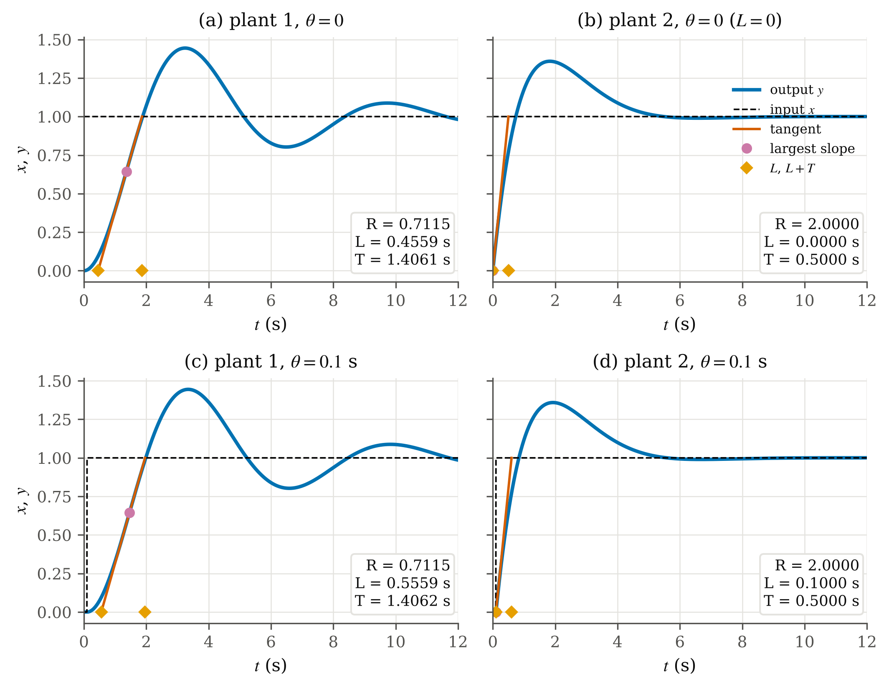
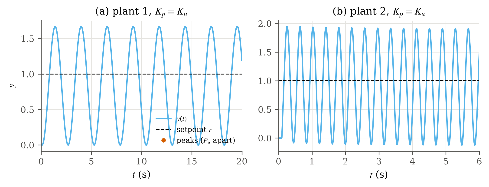
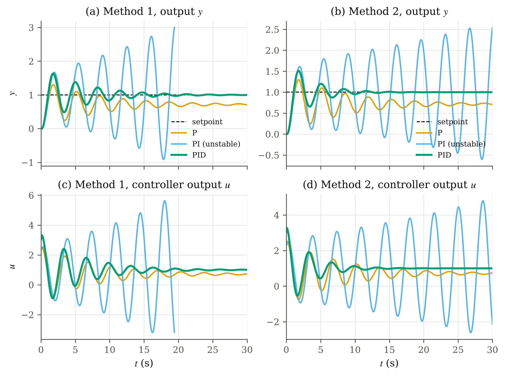
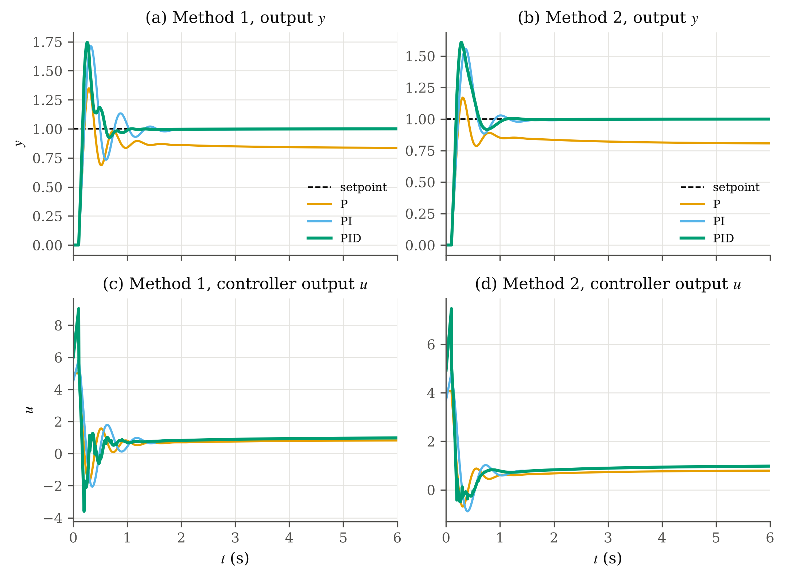

## 2.3 Execution Analysis

### 2.3.1 Program Output

The window has a header with the Equations, Export CSV, Export PNG, CLEAR and EXIT buttons, the simulation settings and a message log on the left, and three tabs, Figure 2.1. The colour of a panel header shows its role (Section 2.2.5). The first tab answers Problems 1 and 2. Its Impulse Response and Step Response buttons integrate plant 1 or plant 2 with the RK4 step. The impulse response and its peak are drawn in the Runge Kutta Output chart and the step response with the tangent in the chart below it, and the step response fills R, L, T, K, MP and %MP, Figure 2.2 for plant 1 and Figure 2.3 for plant 2. Every chart can be zoomed with the mouse wheel at the cursor or with a drag box, panned with the right button and restored with a double click. The second and third tabs answer Problem 3. The buttons Plant 1 and Plant 2 identify the plant, compute $K_p$, $K_i$ and $K_d$ for the controller chosen with the radio buttons (P, PI or PID) and draw the identification chart, the closed-loop output (PID Output ZN1 or ZN2) and the controller output in three separate charts, Figure 2.4 to Figure 2.7. R, L, $K_u$, $P_u$ and the three gains can be edited and the loop rerun, and Test Ku repeats the experiment of the slides for a typed gain. The performance panel shows the rise time, the overshoot, the maximum value, the settling time, the steady-state error, IAE and ISE, and whether the loop is stable.

Every input is checked before a run. A text that is not a number, a time step outside 0 to 0.05 s, a negative dead time or gain, or R, L, $K_u$ or $P_u$ not above zero give an error message and nothing is simulated. Situations that are allowed but need attention give a warning, for example Method 1 or Method 2 without dead time, an unstable closed loop, a period $P_u$ of only a few time steps, a very large gain or a response that has not settled, Figure 2.8. Every message is also written to the log with its time. The output files are a CSV file with every point of the charts of the active tab and a PNG image of those charts. The equation window, Figure 2.9, lists the equations of Chapter I with the implemented ones highlighted, and it can be scrolled, dragged and zoomed with the mouse or the touchpad. Warnings appear in orange and errors in red in the log, and an unexpected error is also written to a log file next to the program.

::: {custom-style="Figure"}
**[SCREENSHOT PLACEHOLDER, Figure 2.1]** Delphi 13 Form Designer with `Unit1.dfm` open on the tab Plant Model and RK4 (header buttons, settings, message log, buttons, the Runge Kutta Output chart and the step response chart visible).
:::

::: {custom-style="Caption Text"}
**Figure 2.1.** Main form of the program in the Delphi 13 Form Designer.
:::

::: {custom-style="Figure"}
**[SCREENSHOT PLACEHOLDER, Figure 2.2]** Running program, tab Plant Model and RK4, default settings ($\theta=0.1$ s): press Impulse Response, Plant 1, then Step Response, Plant 1, so that the upper chart shows the impulse response with its peak, the lower chart the step response with the tangent, and the fields R, L, T, K, MP and %MP are filled.
:::

::: {custom-style="Caption Text"}
**Figure 2.2.** Impulse response (upper chart) and step response with the tangent of Method 1 (lower chart) of plant 1 (Problems 1 and 2).
:::

::: {custom-style="Figure"}
**[SCREENSHOT PLACEHOLDER, Figure 2.3]** The same as Figure 2.2 for Plant 2 (Impulse Response, Plant 2, then Step Response, Plant 2).
:::

::: {custom-style="Caption Text"}
**Figure 2.3.** Impulse response (upper chart) and step response with the tangent of Method 1 (lower chart) of plant 2 (Problems 1 and 2).
:::

::: {custom-style="Figure"}
**[SCREENSHOT PLACEHOLDER, Figure 2.4]** Tab ZN Method 1, PID Control selected, button Plant 1, default settings (three charts, R and L, the gains and the Performance panel visible).
:::

::: {custom-style="Caption Text"}
**Figure 2.4.** ZN Method 1, plant 1 with the PID controller.
:::

::: {custom-style="Figure"}
**[SCREENSHOT PLACEHOLDER, Figure 2.5]** Tab ZN Method 1, PID Control, button Plant 2, default settings.
:::

::: {custom-style="Caption Text"}
**Figure 2.5.** ZN Method 1, plant 2 with the PID controller.
:::

::: {custom-style="Figure"}
**[SCREENSHOT PLACEHOLDER, Figure 2.6]** Tab ZN Method 2, PID Control, button Plant 1, default settings.
:::

::: {custom-style="Caption Text"}
**Figure 2.6.** ZN Method 2, plant 1 with the PID controller.
:::

::: {custom-style="Figure"}
**[SCREENSHOT PLACEHOLDER, Figure 2.7]** Tab ZN Method 2, PID Control, button Plant 2, default settings.
:::

::: {custom-style="Caption Text"}
**Figure 2.7.** ZN Method 2, plant 2 with the PID controller.
:::

::: {custom-style="Figure"}
**[SCREENSHOT PLACEHOLDER, Figure 2.8]** Warning window: settings with dead time theta = 0, tab ZN Method 2, button Plant 2 (message "No phase crossover without dead time ..."), with the message log and its orange WARNING line visible behind it.
:::

::: {custom-style="Caption Text"}
**Figure 2.8.** Warning shown when Method 2 is used without dead time.
:::

::: {custom-style="Figure"}
**[SCREENSHOT PLACEHOLDER, Figure 2.9]** Equation window (Equations button or F1) at zoom 100 %, top part with Sections 1 to 3 and the help line at the bottom.
:::

::: {custom-style="Caption Text"}
**Figure 2.9.** Equation window of the program, with the equations used by the program highlighted in yellow.
:::

### 2.3.2 Identification Results

Table 2.1 collects the values found by both methods. Without dead time the program reproduces the analytic tangent of plant 1 to four digits ($R=0.7115$, $L=0.4559$ s), and $T$ differs only in the fourth digit because the response has not fully settled after 30 s ($K=1.0005$). Plant 2 gives the slope 2 at $t=0$ predicted by Equation 2.11 and is rejected by Method 1. Neither plant has a critical gain without dead time. With $\theta=0.1$ s the simulated critical gains agree with Equation 2.14 and Equation 2.15 within 0.5 %, and the periods within 0.5 %. The simulated values are slightly lower because a loop just below $K_u$ decays so slowly that the growth test cannot separate it from a constant oscillation within 40 s. The table of gains therefore uses the analytic values. Figure 2.10 shows the four reaction curves with their tangents and Figure 2.11 the oscillation at $K_p=K_u$. The impulse responses agree with the step responses. The peak of the impulse response of plant 1 is 0.7115 at $t=1.362$ s, which is exactly the slope $R$ and the time $t_m$ of the tangent, because the impulse response is the derivative of the step response. The impulse response of plant 2 starts at its peak 2, the initial slope $\dot y(0)$ of its step response in Equation 2.11.

::: {custom-style="Caption Text"}
**Table 2.1.** Values identified by ZN Method 1 and Method 2 ($\Delta t=1$ ms, run 30 s).
:::

| Plant, $\theta$ | $R$ (1/s) | $L$ (s)            | $T$ (s) | $K_u$ analytic | $P_u$ analytic (s) | $K_u$ simulated  | $P_u$ simulated (s) |
| --------------- | --------- | ------------------ | ------- | -------------- | ------------------ | ---------------- | ------------------- |
| plant 1, 0      | 0.7115    | 0.4559             | 1.4061  | none           | none               | (1000, artefact) |                     |
| plant 2, 0      | 2.0000    | 0 (not applicable) | 0.5000  | none           | none               | (1000, artefact) |                     |
| plant 1, 0.1 s  | 0.7115    | 0.5559             | 1.4062  | 5.0495         | 2.5865             | 5.0274           | 2.5914              |
| plant 2, 0.1 s  | 2.0000    | 0.1000             | 0.5000  | 8.1609         | 0.3850             | 8.1218           | 0.3868              |

::: {custom-style="Figure"}
{width=15cm}
:::

::: {custom-style="Caption Text"}
**Figure 2.10.** Open-loop step responses with the tangent of Method 1 for (a) plant 1 and (b) plant 2 without dead time, and (c, d) with $\theta=0.1$ s (computed by the author with `ZNModel.pas`).
:::

::: {custom-style="Figure"}
{width=15cm}
:::

::: {custom-style="Caption Text"}
**Figure 2.11.** P control at the simulated critical gain with $\theta=0.1$ s, where the peaks are $P_u$ apart (computed by the author with `ZNModel.pas`).
:::

### 2.3.3 Controller Parameters and Closed-Loop Responses

Table 2.2 lists the gains of Table 1.1 and Table 1.2 for $\theta=0.1$ s and the measures of each closed loop. Both methods give almost the same P gain for each plant (2.53 for plant 1, 5.00 and 4.08 for plant 2). A P controller alone always leaves the steady-state error $1/(1+K_p)$, which is 0.17 and 0.20 for plant 2. For plant 1 the P loop is still oscillating after 30 s, so its measured error (0.27) is a little below the final value 0.28.

The most important result is that the PI controller of both methods makes plant 1 unstable. Its oscillation grows steadily, Figure 2.12, and the program stops drawing it at three times the setpoint. The PID controller of both methods is stable. The Method 2 PID is clearly better (overshoot 51 %, settling 12.1 s, IAE 2.12) than the Method 1 PID (64 %, 21.7 s, 3.46), because its derivative gain is larger and its integral gain smaller. For plant 2 every controller is stable and fast (settling in 1 s to 3 s, Figure 2.13), but the overshoot is high (56 % to 74 % with integral action). Method 2 gives the lower overshoot for every controller, and Method 1 the lower IAE for P and PID.

::: {custom-style="Caption Text"}
**Table 2.2.** ZN gains and closed-loop measures for $\theta=0.1$ s (M1 and M2 = Method 1 and Method 2, setpoint 1, run 30 s, "not settled" means still outside the 2 % band at the end of the run).
:::

| Plant, method, controller | $K_p$ | $K_i$ | $K_d$ | OS (%) | $t_s$ (s) | $e_{ss}$ | IAE | Loop |
|---|---|---|---|---|---|---|---|---|
| 1, M1, P | 2.528 | 0 | 0 | 78.8 | not settled | 0.273 | 9.172 | stable |
| 1, M1, PI | 2.275 | 1.228 | 0 |  |  |  |  | unstable |
| 1, M1, PID | 3.034 | 2.729 | 0.843 | 63.9 | 21.66 | 0.004 | 3.460 | stable |
| 1, M2, P | 2.525 | 0 | 0 | 78.7 | not settled | 0.273 | 9.178 | stable |
| 1, M2, PI | 2.272 | 1.054 | 0 |  |  |  |  | unstable |
| 1, M2, PID | 3.030 | 2.343 | 0.980 | 51.1 | 12.07 | 0.000 | 2.121 | stable |
| 2, M1, P | 5.000 | 0 | 0 | 61.8 | 2.87 | 0.167 | 5.030 | stable |
| 2, M1, PI | 4.500 | 13.500 | 0 | 71.1 | 1.74 | 0.000 | 0.387 | stable |
| 2, M1, PID | 6.000 | 30.000 | 0.300 | 74.4 | 0.98 | 0.000 | 0.292 | stable |
| 2, M2, P | 4.080 | 0 | 0 | 45.6 | 3.19 | 0.197 | 5.879 | stable |
| 2, M2, PI | 3.672 | 11.448 | 0 | 55.8 | 1.40 | 0.000 | 0.342 | stable |
| 2, M2, PID | 4.897 | 25.439 | 0.236 | 60.8 | 1.01 | 0.000 | 0.320 | stable |

::: {custom-style="Figure"}
{width=15cm}
:::

::: {custom-style="Caption Text"}
**Figure 2.12.** Closed loop of plant 1 with $\theta=0.1$ s, output (a, b) and controller output (c, d) for the gains of Method 1 and Method 2 (computed by the author with `ZNModel.pas`).
:::

::: {custom-style="Figure"}
{width=15cm}
:::

::: {custom-style="Caption Text"}
**Figure 2.13.** Closed loop of plant 2 with $\theta=0.1$ s, output (a, b) and controller output (c, d) for the gains of Method 1 and Method 2 (computed by the author with `ZNModel.pas`).
:::

### 2.3.4 Parameter Variation

Table 2.3 repeats the identification for three dead times. A longer delay increases $L$ by the same amount and lowers $K_u$ (roughly in proportion to $1/\theta$ for plant 2), so all gains become smaller. For plant 2 this reduces the PID overshoot from 84 % to 60 % (Method 1). For plant 1 the Method 2 PID improves strongly with a longer delay (overshoot 65 %, 51 % and 30 %), while the Method 1 PID stays near 63 % and settles more slowly. The ranking of the two methods therefore depends on $\theta$, which is the main parameter added in this work.

::: {custom-style="Caption Text"}
**Table 2.3.** Effect of the dead time on the identified values and on the PID loop (overshoot and settling time).
:::

| Plant | $\theta$ (s) | $L$ (s) | $K_u$   | $P_u$ (s) | PID Method 1    | PID Method 2    |
| ----- | ------------ | ------- | ------- | --------- | --------------- | --------------- |
| 1     | 0.05         | 0.5059  | 10.0456 | 1.9023    | 62.5 %, 19.32 s | 65.1 %, 11.38 s |
| 1     | 0.10         | 0.5559  | 5.0495  | 2.5865    | 63.9 %, 21.66 s | 51.1 %, 12.07 s |
| 1     | 0.20         | 0.6559  | 2.5573  | 3.4145    | 62.5 %, 28.01 s | 29.9 %, 13.16 s |
| 2     | 0.05         | 0.0500  | 16.0202 | 0.1961    | 83.6 %, 0.49 s  | 66.3 %, 0.51 s  |
| 2     | 0.10         | 0.1000  | 8.1609  | 0.3850    | 74.4 %, 0.98 s  | 60.8 %, 1.01 s  |
| 2     | 0.20         | 0.2000  | 4.2250  | 0.7436    | 59.7 %, 1.97 s  | 52.1 %, 2.04 s  |

Table 2.4 shows what happens when Method 2 is simulated without dead time. The search finds a "critical gain" for both plants, but it is ten times larger when $\Delta t$ is ten times smaller ($K_u\Delta t\approx1$), and for plant 2 the period is exactly two steps. A plant property cannot depend on the step of the computer, so these values only show the limit of the step-by-step controller update and confirm Equation 2.13.

::: {custom-style="Caption Text"}
**Table 2.4.** Critical gain found by simulation without dead time for two integration steps.
:::

| Plant | $K_u$, $\Delta t=1$ ms | $K_u$, $\Delta t=10$ ms | $K_u\Delta t$  | $P_u$, 1 ms (s) | $P_u$, 10 ms (s) |
| ----- | ---------------------- | ----------------------- | -------------- | --------------- | ---------------- |
| 1     | 1000.48                | 100.12                  | 1.0005, 1.0012 | 0.1986          | 0.6253           |
| 2     | 1000.00                | 100.00                  | 1.0000, 1.0000 | 0.0020          | 0.0200           |

### 2.3.5 Comparison with the Lecture Program and Earlier Programs

The lecture program uses the same Runge-Kutta-Nyström step and the same tracking-control law [@ce1], so the core of this program agrees with it, apart from the input shift described in Section 2.2.2. Earlier student programs of this course, which I used only for comparison, solve the same problem in a different way, Table 2.5. They take $L$ as the time when the output first exceeds 0.25 and $T$ as the time from there until the output reaches 1, instead of the tangent of the slides. For plant 1 this gives $L=0.771$ s instead of 0.456 s and a PID gain $K_p=1.73$ instead of 3.70. They also set $\dot x=0$ for plant 2 during the whole run, which removes the zero of $G_2(s)$ and simulates $1/(s^2+1.5s+1)$. That plant overshoots by only 2.8 % instead of 35.9 % and has a normal S-shaped curve, which is why Method 1 seemed to work for it. For Method 2 they type $K_u$ by hand and measure $P_u$ from a decaying response, because no constant oscillation appears.

::: {custom-style="Caption Text"}
**Table 2.5.** Comparison with the approach of earlier student programs ($\theta=0$).
:::

| Quantity                       | This program                                               | Earlier programs                               |
| ------------------------------ | ---------------------------------------------------------- | ---------------------------------------------- |
| $L$ of plant 1                 | 0.4559 s (tangent at the inflection point)                 | 0.7710 s (time of $y=0.25$)                    |
| $R$ of plant 1                 | 0.7115 1/s                                                 | 0.8985 1/s (1/$T$, $T$ from $y=0.25$ to $y=1$) |
| PID gains of plant 1, Method 1 | 3.699, 4.057, 0.843                                        | 1.732, 1.123, 0.668                            |
| Plant 2 model                  | $(2s+1)/(s^2+1.5s+1)$, overshoot 35.9 %                    | $\dot x=0$, $1/(s^2+1.5s+1)$, overshoot 2.8 %  |
| $K_u$ and $P_u$                | from Equation 1.14 with dead time, checked by simulation | typed by hand, period of a decaying response   |

## 2.4 Evaluation and Discussion

The two plants of the problem sheet do not fit the assumptions behind the Ziegler-Nichols rules. Method 1 assumes an S-shaped curve like Figure 1.2, but plant 1 overshoots by 44 % (Equation 1.6) and plant 2 has no inflection point at all, Equation 2.11. Method 2 assumes that the P loop reaches the edge of stability, but Equation 2.13 shows that a second-order plant without dead time never does. These are properties of the plants, not errors of the program. The program shows them directly, because it computes the tangent from the slope of the state and compares the simulated critical gain with the analytic one. The "critical gain" that a simulation finds without dead time scales with $1/\Delta t$ (Table 2.4), so it is a numerical effect and was not used.

Adding a short dead time of 0.1 s, as found in FES-driven joints [@emd][@ce2], makes both methods applicable and gives $K_u$ and $P_u$ that the simulation reproduces within 0.5 %. The resulting gains confirm what is known about the rules [@astrom][@zn42]. They aim at a quarter decay ratio and give a fast but strongly oscillating response, so overshoots of 50 % to 75 % with PID are expected and not a fault. The PI result for plant 1 is the clearest lesson of this assignment. Plant 1 is already lightly damped ($\zeta=0.25$). The integral term adds about 90° of phase lag at low frequency but no damping, and with the extra lag of the dead time the oscillating pair of poles crosses into the right half plane. Even without delay the Method 1 PI loop $s^3+0.5s^2+3.774s+1.826$ has roots at $-0.008\pm1.94j$ and is only just stable. The derivative term of PID supplies the missing damping, which is why both PID loops are stable. A P controller keeps the steady-state error $1/(1+K_p)$ of Section 1.4, and the integral term removes it whenever the loop is stable.

Method 2 gave the better PID for plant 1 and the lower overshoot for plant 2. It uses the actual phase behaviour of the loop near the critical frequency, while Method 1 replaces an oscillating response by a first-order model that ignores the oscillation. The results also depend on $\theta$ (Table 2.3), so the dead time must be measured on the real system before these gains are used, and the gains should be treated as a starting point that is then refined by hand. Compared with the earlier programs, using the tangent of the slides and the true plant 2 changes the gains by a factor of two and the plant 2 overshoot by more than ten times (Table 2.5), so the way $L$, $T$ and the input derivative are handled matters more than any numerical detail.

# CHAPTER III. CONCLUSION

I implemented both plants as second-order differential equations, plant 2 in controllable canonical form ($\ddot z=-1.5\dot z-z+x$, $y=z+2\dot z$) so that the derivative of the input is never needed, and integrated them with the Runge-Kutta-Nyström method of the lecture, which agrees with the exact solution to $10^{-14}$. The Delphi program determines the PID parameters with ZN Method 1 (tangent at the point of largest slope, $L$ and $T$) and Method 2 (critical gain $K_u$ and period $P_u$) for both plants and simulates the closed loop with P, PI and PID.

The analysis showed that, as given, neither plant suits the ZN rules. Plant 1 gives $R=0.7115$ 1/s and $L=0.4559$ s but is strongly oscillatory, plant 2 has its largest slope at $t=0$ so $L=0$, and neither has a finite critical gain because a second-order loop with P control is always stable. A dead time of 0.1 s, justified by the electromechanical delay of stimulated muscle, makes both methods applicable ($K_u=5.050$, $P_u=2.587$ s for plant 1 and $K_u=8.161$, $P_u=0.385$ s for plant 2).

With these values all P and PID controllers and the PI controllers of plant 2 are stable, while the PI controllers of plant 1 are unstable for both methods because the lightly damped plant needs the derivative term. Method 2 gave the better PID for plant 1 (overshoot 51 %, settling 12.1 s) and the lower overshoot for plant 2. The high overshoots confirm that ZN gains are a starting point that must be refined for the real system.

# REFERENCES

::: {custom-style="Reference"}
@@REFS@@
:::
