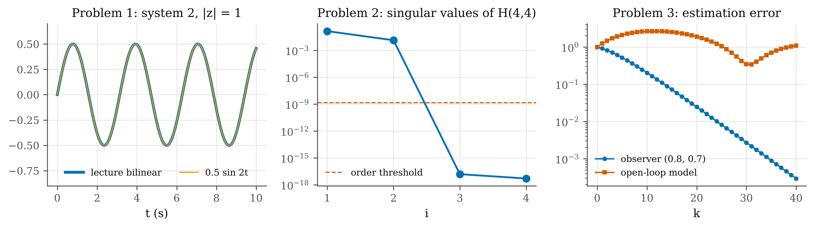
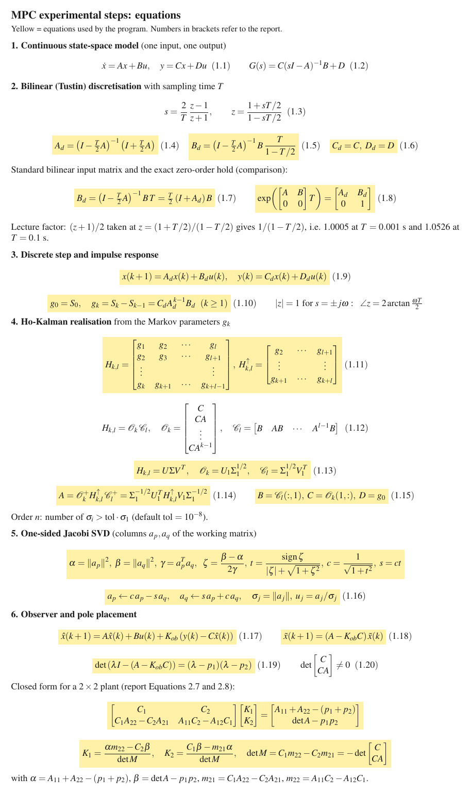

<a id="top"></a>

<div align="center">

# Assignment 4: MPC Experimental Steps

**Bilinear discretisation, Ho-Kalman realisation with my own Jacobi SVD, and observer design by pole placement, programmed in Delphi 13**

[](#build-and-run)
[](Program/Unit1.pas)
[](Program/MPCModel.pas)
[](https://github.com/ZinniXX004/Biocybernetics/actions/workflows/a4-model-regression.yml)
[](Report/)

[Overview](#overview) ·
[Problems](#problems-and-where-i-answer-them) ·
[Equations](#the-equations) ·
[Findings](#what-i-found) ·
[Program](#program) ·
[Results](#results) ·
[Build](#build-and-run) ·
[Notes](#notes-and-issues)

<picture>
  <source media="(prefers-color-scheme: dark)" srcset="docs/img/mpc-overview-dark.png">
  
</picture>

<sub>One panel per problem, plotted from the output of the numerical unit of my program.</sub>

</div>

## Overview

|              |                                                                                   |
| ------------ | --------------------------------------------------------------------------------- |
| **Course**   | Biocybernetics (EB234701), Class Q, Department of Biomedical Engineering, ITS     |
| **Student**  | Jeremia Christ Immanuel Manalu (5023231017)                                       |
| **Lecturer** | Course lecturer                                                                   |
| **Task**     | Three experimental steps towards model predictive control                         |
| **Program**  | `Project1`: one tab per problem, editable models, separate charts, equation sheet |

I discretise two continuous state-space models with the bilinear formula of the lecture, identify a state-space model from discrete step data with the Ho-Kalman method, and design a state observer by pole placement. The three problems turned out to be one chain, since the model that Problem 2 identifies is the plant of Problem 3.

<p align="right"><sub><a href="#top">Back to top</a></sub></p>

## Problems and where I answer them

| #   | Problem                                                                                         | Report                   | Code                                                |
| --- | ----------------------------------------------------------------------------------------------- | ------------------------ | --------------------------------------------------- |
| 1   | Bilinear discretisation (T = 0.001 s), check against the sheet, second system, step and impulse | Sections 2.2.1 and 2.3.1 | `Discretise`, `Simulate`, `Eigenvalues`             |
| 2   | Ho-Kalman method with the SVD for A, B, C, D from step data (T = 0.1 s), saved process data     | Sections 2.2.2 and 2.3.2 | `MarkovFromStep`, `Hankel`, `SVDJacobi`, `HoKalman` |
| 3   | General observer gain of a 2 x 2 plant and a program for the given plant                        | Sections 2.2.3 and 2.3.3 | `ObserverGain2`, `SimulateObserver`                 |

<p align="right"><sub><a href="#top">Back to top</a></sub></p>

## The equations

The lecture form of the bilinear transformation, with the factor T / (1 - T/2) in the input matrix that reproduces the sheet:

```math
A_d=\left(I-\tfrac{T}{2}A\right)^{-1}\left(I+\tfrac{T}{2}A\right),\qquad
B_d=\left(I-\tfrac{T}{2}A\right)^{-1}B\,\frac{T}{1-T/2},\qquad C_d=C,\quad D_d=D
```

The Ho-Kalman realisation from the Markov parameters g(k) = S(k) - S(k-1), the Hankel matrix H, its shifted copy H↑ and the SVD H = U Σ Vᵀ, truncated to the order n:

```math
A=\Sigma_1^{-1/2}U_1^{\mathsf T}H^{\uparrow}V_1\Sigma_1^{-1/2},\qquad
B=\text{first column of }\Sigma_1^{1/2}V_1^{\mathsf T},\qquad
C=\text{first row of }U_1\Sigma_1^{1/2},\qquad D=g(0)
```

The observer gain of a 2 x 2 plant with one output, from matching det(λI - A + K C) with (λ - p1)(λ - p2):

```math
K_1=\frac{\alpha m_{22}-C_2\beta}{\det M},\quad
K_2=\frac{C_1\beta-m_{21}\alpha}{\det M},\quad
\alpha=A_{11}+A_{22}-(p_1+p_2),\quad
\beta=\det A-p_1p_2
```

```math
m_{21}=C_1A_{22}-C_2A_{21},\qquad m_{22}=A_{11}C_2-A_{12}C_1,\qquad \det M=C_1m_{22}-C_2m_{21}=-\det\begin{bmatrix}C\\CA\end{bmatrix}
```

<p align="right"><sub><a href="#top">Back to top</a></sub></p>

## What I found

| Finding                                               | Detail                                                                                                                                                                                                                     |
| ----------------------------------------------------- | -------------------------------------------------------------------------------------------------------------------------------------------------------------------------------------------------------------------------- |
| The input matrix of the lecture carries T / (1 - T/2) | This form reproduces every printed digit of the sheet, the standard form with T alone misses it by T/2. The factor comes from (z + 1)/2 taken at the image of s = 1 rad/s and raises the input gain by 5.3 % at T = 0.1 s. |
| Problem 3 uses the result of Problem 2                | Lecture-formula data at T = 0.1 s, a 4 x 4 Hankel matrix and the balanced SVD split give A11 = 1.2009, A12 = -0.2486, A21 = 0.2486 and A22 = 0.7407, the plant of Problem 3 to three decimals.                                                    |
| The SVD of the lecture material is unsorted           | I wrote a one-sided Jacobi SVD that sorts the singular values and matches the lecturer's `svdku1.dat` to six decimals.                                                                                                     |
| The observer gain has a closed form                   | Both coefficient equations are linear in K1 and K2, and their determinant is minus the determinant of the observability matrix.                                                                                            |

<p align="right"><sub><a href="#top">Back to top</a></sub></p>

## Program

| Unit                                                           | Role                                                                                                         |
| -------------------------------------------------------------- | ------------------------------------------------------------------------------------------------------------ |
| [`MPCModel.pas`](Program/MPCModel.pas)                         | Numerical unit without UI: matrices, discretisation, responses, eigenvalues, Jacobi SVD, Ho-Kalman, observer |
| [`Unit1.pas`](Program/Unit1.pas) / `.dfm`                      | Main form: three tabs, editable model tables, separate charts, result panels, message log                    |
| [`Unit2.pas`](Program/Unit2.pas) / `.dfm`                      | Equation window (LaTeX sheet stored in the form, used equations in yellow)                                   |
| [`Verification/TestMPC.dpr`](Program/Verification/TestMPC.dpr) | FPC test of the numerical unit, run by CI (exit code = failed checks)                                        |

| Tab       | Buttons                                                               | Charts and panels                                                                                                                                  |
| --------- | --------------------------------------------------------------------- | -------------------------------------------------------------------------------------------------------------------------------------------------- |
| Problem 1 | Discretise, Step and impulse, Reset model                             | Ad, Bd, Cd, Dd with the check against the sheet, eigenvalues of Ad in the z plane, step and impulse response against the exact continuous response |
| Problem 2 | Generate step data, Ho-Kalman (SVD), Save .dat file, Use in Problem 3 | step data with the identified model, Markov parameters, log10 of the singular values with the order threshold, all matrices of the process         |
| Problem 3 | Compute Kob, Simulate observer                                        | alpha, beta, det O and Kob, estimation error of the observer and of the open-loop model, both states                                               |

The system, the discretisation method (lecture formula, standard bilinear form, zero-order hold), the data source and the plant preset are chosen with radio buttons, and every matrix is an editable row of numbers in a table. Buttons and panel headers are painted with gradients and react to hover and click, CLEAR (green) asks before it resets every output and EXIT (red) closes the program. Over a chart the nearest point shows its values, the wheel zooms at the cursor, a drag zooms into a box, a right drag pans, a double click restores the full view and the legend check boxes hide or show a line. Wrong inputs stop with a message (wrong row lengths, a singular I - T/2 A, too few samples for the Hankel matrix, an unobservable plant), and warnings such as an unstable pole stay in the message log. F1 opens the equations. Every tab can be saved as CSV (all chart data) and PNG, and Problem 2 also writes the whole Ho-Kalman process (data, Hankel matrices, U, Σ, V and the model) into one .dat file. My exports of the three tabs are in [`Data/`](Data/).

<p align="center"></p>

<p align="right"><sub><a href="#top">Back to top</a></sub></p>

## Results

| Problem     | Result                                                                                                                                        |
| ----------- | --------------------------------------------------------------------------------------------------------------------------------------------- |
| 1, system 1 | Ad and Bd equal to the sheet in all 12 entries (relative difference 2e-15), eigenvalues of Ad 1.002002, 1 and 0.998002, so the responses grow |
| 1, system 2 | poles on the unit circle (abs(z) - 1 = -1e-16), step response 0.5 sin 2t with a peak of 0.50025, impulse response cos 2t                      |
| 2           | singular values 0.1379, 0.0132, 1.5e-17, 4.9e-18, order 2, model reproduces the data within 2e-13, eigenvalues 0.9708 +/- 0.0942j             |
| 3           | det O = -0.010081, K1 = -2.4926 and K2 = -1.7150, error poles 0.8 and 0.7, error below 1 % after 25 samples                                        |

<p align="right"><sub><a href="#top">Back to top</a></sub></p>

## Build and run

1. Open [`Program/Project1.dproj`](Program/Project1.dproj) in RAD Studio Delphi 13 Florence (Community Edition is enough).
2. Check that `MPCModel.pas`, `Unit1.pas` and `Unit2.pas` are in the Project Manager.
3. Build and run (Win32 or Win64). TeeChart Standard ships with Delphi.

The CI test can be repeated with Free Pascal:

```bash
cd "Assignment 4_MPC Experimental Step/Program/Verification"
fpc -O2 -Fu.. -FU. -FE. TestMPC.dpr
./TestMPC > actual.txt && diff -u --strip-trailing-cr TestMPC_output.txt actual.txt
```

`./TestMPC --csv <folder>` also writes the responses and the Ho-Kalman process data that [`Report/source/figs.py`](Report/source/figs.py) plots for the report.

<p align="right"><sub><a href="#top">Back to top</a></sub></p>

## Notes and issues

I checked the formulas against the lecture slides and the lecturer's data files and, as references only, against an earlier student program of this course. The lecturer's simulator in the course material is an empty file, so I compared with its output files instead. The findings are ISS-079 to ISS-084 and the fixes after my first tests in Delphi are ISS-085 to ISS-088 in the [issue log](../ISSUES.md). The changes are in the [changelog](../CHANGELOG.md). The report sources and the scripts that build the Word file and the figures are in [`Report/source`](Report/source/).

<p align="right"><sub><a href="#top">Back to top</a></sub></p>
