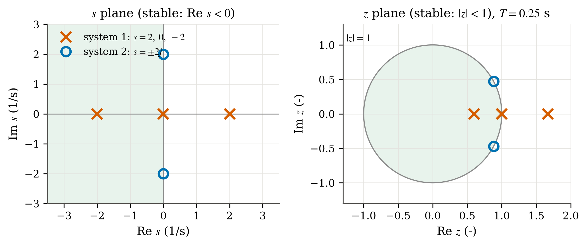
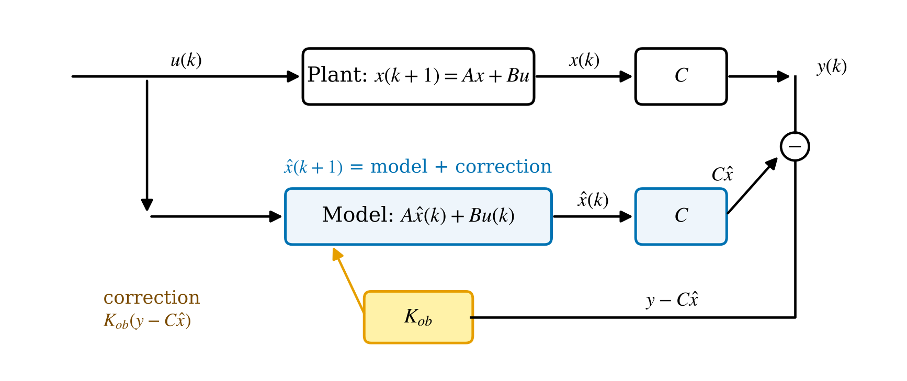

# CHAPTER I. FUNDAMENTAL THEORY

## 1.1 State-Space Model and Transfer Function

A state-space model describes a dynamic system by a small set of internal variables, the states, which together with the input determine its future behaviour [@mpc]. For a system with one input $u$ and one output $y$ the model is the pair of matrix equations of Equation 1.1, where $x$ is the state vector of length $n$, $A$ is the $n\times n$ system matrix, $B$ the input column, $C$ the output row and $D$ the direct feedthrough. A differential equation of order $n$ is brought into this form by taking the output and its first $n-1$ derivatives as states. The Laplace transform with zero initial conditions turns Equation 1.1 into the transfer function of Equation 1.2, whose poles are the eigenvalues of $A$. A pole with a positive real part makes the response grow, a pair on the imaginary axis gives an undamped oscillation and poles in the left half plane give a response that settles [@ogata].

$$\dot x(t)=Ax(t)+Bu(t),\qquad y(t)=Cx(t)+Du(t) \qquad\qquad (1.1)$$

$$G(s)=\frac{Y(s)}{U(s)}=C\left(sI-A\right)^{-1}B+D \qquad\qquad (1.2)$$

## 1.2 Bilinear Discretisation

A digital controller works with samples taken every $T$ seconds, so the continuous model is replaced by a discrete one. The exact relation between the two complex planes is $z=e^{sT}$. The bilinear (Tustin) transformation approximates it by the ratio of the first terms of the two exponential series, $z=e^{sT/2}/e^{-sT/2}\approx(1+sT/2)/(1-sT/2)$, which is inverted to the substitution of Equation 1.3 [@mpc][@ogata]. The map sends the whole left half of the $s$ plane into the unit disc and the imaginary axis onto the unit circle, so a stable continuous model stays stable and an undamped one stays undamped (Figure 1.1).

$$s=\frac{2}{T}\,\frac{z-1}{z+1},\qquad z=\frac{1+sT/2}{1-sT/2} \qquad\qquad (1.3)$$

{width=16cm}

::: {custom-style="Caption Text"}
Figure 1.1. Poles of the two systems of Problem 1 and their images under the bilinear map (Equation 1.3). The sampling time is exaggerated to 0.25 s so that the images can be told apart.
:::

Inserting Equation 1.3 into the Laplace form $sX=AX+BU$ and collecting the terms in $zX$ and $X$ gives the discrete matrices of the lecture, Equation 1.4 to Equation 1.6 [@mpc]. The derivation is repeated step by step in Section 2.2.1, because the input term of the lecture slides carries the factor $T/(1-T/2)$ instead of $T$.

::: {custom-style="Highlighted Equation"}
$$A_d=\left(I-\frac{T}{2}A\right)^{-1}\left(I+\frac{T}{2}A\right) \qquad\qquad (1.4)$$
:::

::: {custom-style="Highlighted Equation"}
$$B_d=\left(I-\frac{T}{2}A\right)^{-1}B\,\frac{T}{1-\frac{T}{2}} \qquad\qquad (1.5)$$
:::

::: {custom-style="Highlighted Equation"}
$$C_d=C,\qquad D_d=D \qquad\qquad (1.6)$$
:::

The common textbook form keeps $T$ alone in the input matrix, Equation 1.7, and with Equation 1.4 it can also be written as $\tfrac{T}{2}(I+A_d)B$, since $I+A_d=2\left(I-\tfrac{T}{2}A\right)^{-1}$ [@ogata]. For comparison the program also offers the zero-order hold, which is exact for an input that is constant between samples. Its matrices follow from one matrix exponential of an augmented matrix, Equation 1.8, computed by scaling and squaring of a Taylor series [@moler].

::: {custom-style="Highlighted Equation"}
$$B_d=\left(I-\frac{T}{2}A\right)^{-1}B\,T=\frac{T}{2}\left(I+A_d\right)B \qquad\qquad (1.7)$$
:::

::: {custom-style="Highlighted Equation"}
$$\exp\!\left(\begin{bmatrix}A&B\\0&0\end{bmatrix}T\right)=\begin{bmatrix}A_d&B_d\\0&1\end{bmatrix} \qquad\qquad (1.8)$$
:::

## 1.3 Discrete Step and Impulse Response

The discrete model advances the state from one sample to the next with Equation 1.9. A unit step holds $u(k)=1$ for every $k\ge0$, and a unit pulse sets $u(0)=1$ and $u(k)=0$ afterwards. With $x(0)=0$ the pulse response is the sequence of Markov parameters $g_k$, and since a step is a sum of delayed pulses, the step response $S_k$ is their running sum. Each Markov parameter is therefore the difference of two neighbouring step samples, Equation 1.10, which is how the lecture links the step response model of MPC with the impulse response [@mpc]. A pulse of height $1/T$ has unit area and is the discrete counterpart of the Dirac impulse, so its response approaches the continuous impulse response $g(t)=Ce^{At}B$.

::: {custom-style="Highlighted Equation"}
$$x(k+1)=A_dx(k)+B_du(k),\qquad y(k)=C_dx(k)+D_du(k) \qquad\qquad (1.9)$$
:::

::: {custom-style="Highlighted Equation"}
$$g_0=S_0=D,\qquad g_k=S_k-S_{k-1}=C_dA_d^{\,k-1}B_d\quad(k\ge1) \qquad\qquad (1.10)$$
:::

## 1.4 Hankel Matrix and Ho-Kalman Realisation

The Ho-Kalman method recovers $A$, $B$, $C$ and $D$ from the Markov parameters alone [@hokalman][@ssr]. The parameters are arranged in the Hankel matrix $H_{k,l}$ of $k$ rows and $l$ columns, where every anti-diagonal holds the same $g$, and in the matrix $H^{\uparrow}$ shifted by one sample, Equation 1.11. Because $g_{i+j-1}=CA^{i-1}\cdot A^{j-1}B$, the Hankel matrix factors into the observability matrix $\mathcal{O}_k$ and the controllability matrix $\mathcal{C}_l$, Equation 1.12. Its rank is therefore the order $n$ of the smallest model that reproduces the data.

::: {custom-style="Highlighted Equation"}
$$H_{k,l}=\begin{bmatrix}g_1&g_2&\cdots&g_l\\g_2&g_3&\cdots&g_{l+1}\\\vdots&\vdots&\ddots&\vdots\\g_k&g_{k+1}&\cdots&g_{k+l-1}\end{bmatrix},\qquad H^{\uparrow}_{k,l}=\begin{bmatrix}g_2&g_3&\cdots&g_{l+1}\\\vdots&\vdots&\ddots&\vdots\\g_{k+1}&g_{k+2}&\cdots&g_{k+l}\end{bmatrix} \qquad\qquad (1.11)$$
:::

$$H_{k,l}=\mathcal{O}_k\,\mathcal{C}_l,\qquad \mathcal{O}_k=\begin{bmatrix}C\\CA\\\vdots\\CA^{k-1}\end{bmatrix},\qquad \mathcal{C}_l=\begin{bmatrix}B&AB&\cdots&A^{l-1}B\end{bmatrix} \qquad\qquad (1.12)$$

The singular value decomposition $H=U\Sigma V^T$ reveals this rank as the number of singular values that are clearly above rounding noise. Keeping the first $n$ columns $U_1$, $V_1$ and the block $\Sigma_1$, the two factors are split evenly between both sides, Equation 1.13. This balanced split makes the observability and controllability parts equally strong. The shifted matrix equals $\mathcal{O}_kA\,\mathcal{C}_l$, so $A$ follows with the pseudo-inverses of both factors, and because $U_1$ and $V_1$ have orthonormal columns these pseudo-inverses are simple transposes, Equation 1.14. $B$ is the first column of $\mathcal{C}_l$, $C$ the first row of $\mathcal{O}_k$ and $D$ the zeroth Markov parameter, Equation 1.15 [@ssr]. The realisation is unique only up to a change of state coordinates, so its eigenvalues and its Markov parameters can be compared with the analytic model, but not the individual entries of $A$.

::: {custom-style="Highlighted Equation"}
$$H_{k,l}=U\Sigma V^T,\qquad \mathcal{O}_k=U_1\Sigma_1^{1/2},\qquad \mathcal{C}_l=\Sigma_1^{1/2}V_1^T \qquad\qquad (1.13)$$
:::

::: {custom-style="Highlighted Equation"}
$$A=\mathcal{O}_k^{+}\,H^{\uparrow}_{k,l}\,\mathcal{C}_l^{+}=\Sigma_1^{-1/2}U_1^TH^{\uparrow}_{k,l}V_1\Sigma_1^{-1/2} \qquad\qquad (1.14)$$
:::

::: {custom-style="Highlighted Equation"}
$$B=\mathcal{C}_l(:,1),\qquad C=\mathcal{O}_k(1,:),\qquad D=g_0 \qquad\qquad (1.15)$$
:::

## 1.5 Singular Value Decomposition by One-Sided Jacobi Rotations

The one-sided Jacobi method orthogonalises the columns of a working copy $W$ of the matrix by plane rotations [@demmel]. For every pair of columns $a_p$ and $a_q$ it forms their squared lengths $\alpha$ and $\beta$ and their inner product $\gamma$, and chooses the rotation angle that makes the rotated pair orthogonal, Equation 1.16. The same rotations applied to the identity build $V$. Sweeps over all pairs are repeated until no pair needs a rotation. The singular values are then the column lengths and the columns of $U$ are the normalised columns of $W$. The method is short, needs no library and computes small singular values with high relative accuracy, which matters here because the rank decision rests on how small the trailing values are. The lecture material contains the Golub-Reinsch routine `svdcmp` of Numerical Recipes, which returns the singular values unsorted [@nr][@svdlect].

::: {custom-style="Highlighted Equation"}
$$\zeta=\frac{\beta-\alpha}{2\gamma},\quad t=\frac{\operatorname{sign}\zeta}{|\zeta|+\sqrt{1+\zeta^2}},\quad c=\frac{1}{\sqrt{1+t^2}},\quad s=ct,\quad a_p\leftarrow ca_p-sa_q,\quad a_q\leftarrow sa_p+ca_q \qquad\qquad (1.16)$$
:::

## 1.6 State Observer and Pole Placement

In most plants only the output is measured, so the states that a model predictive controller needs must be estimated [@mpc][@wang]. A model run in parallel with the plant gives an open-loop estimate, but its error $\tilde x=x-\hat x$ then decays only as fast as the plant itself and does not decay at all for a pole on or outside the unit circle. The observer adds a correction proportional to the output error, Equation 1.17 and Figure 1.2 [@luenberger]. Subtracting it from the plant equation with $y=Cx$ gives the error dynamics of Equation 1.18, so the gain $K_{ob}$ sets the speed of convergence through the eigenvalues of $A-K_{ob}C$.

::: {custom-style="Highlighted Equation"}
$$\hat x(k+1)=A\hat x(k)+Bu(k)+K_{ob}\left(y(k)-C\hat x(k)\right) \qquad\qquad (1.17)$$
:::

::: {custom-style="Highlighted Equation"}
$$\tilde x(k+1)=\left(A-K_{ob}C\right)\tilde x(k),\qquad \tilde x(k)=\left(A-K_{ob}C\right)^k\tilde x(0) \qquad\qquad (1.18)$$
:::

{width=15cm}

::: {custom-style="Caption Text"}
Figure 1.2. Plant and observer. The observer runs the model and corrects it with the output error weighted by $K_{ob}$ (Equation 1.17).
:::

For a single output the gain is found by pole placement, demanding that the characteristic polynomial of the error system equals the one of the chosen poles, Equation 1.19 [@wang][@ogata]. The poles can be placed anywhere exactly when the plant is observable, which for a second-order plant means a non-zero determinant of the matrix of Equation 1.20.

::: {custom-style="Highlighted Equation"}
$$\det\left(\lambda I-\left(A-K_{ob}C\right)\right)=(\lambda-p_1)(\lambda-p_2) \qquad\qquad (1.19)$$
:::

$$\det\begin{bmatrix}C\\CA\end{bmatrix}=\det\begin{bmatrix}C_1&C_2\\C_1A_{11}+C_2A_{21}&C_1A_{12}+C_2A_{22}\end{bmatrix}\neq0 \qquad\qquad (1.20)$$
