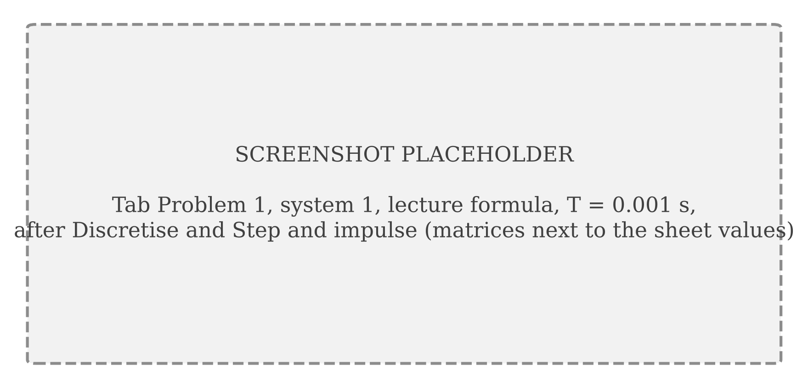
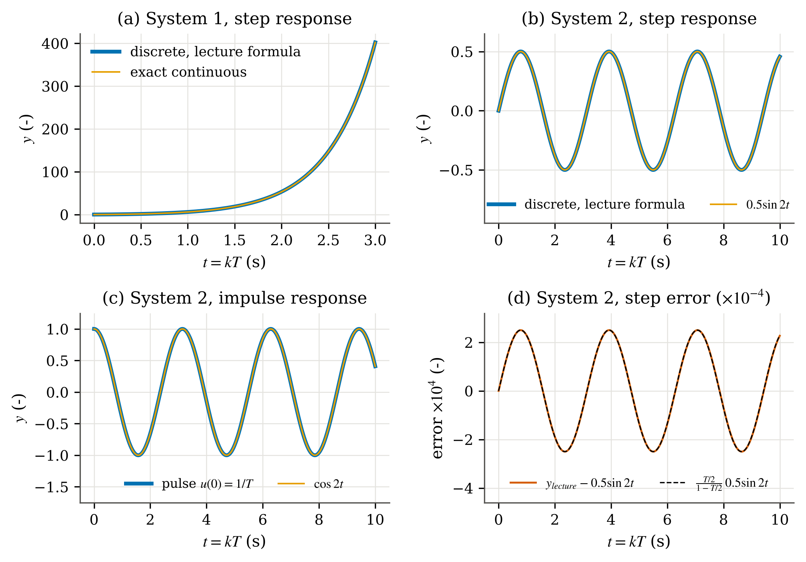
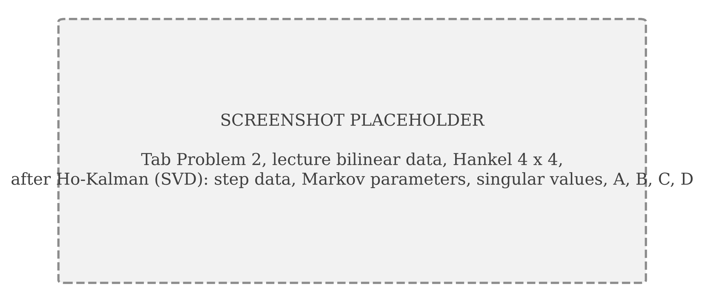
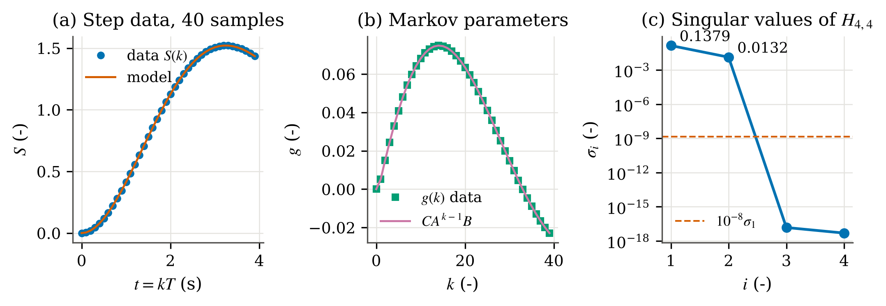
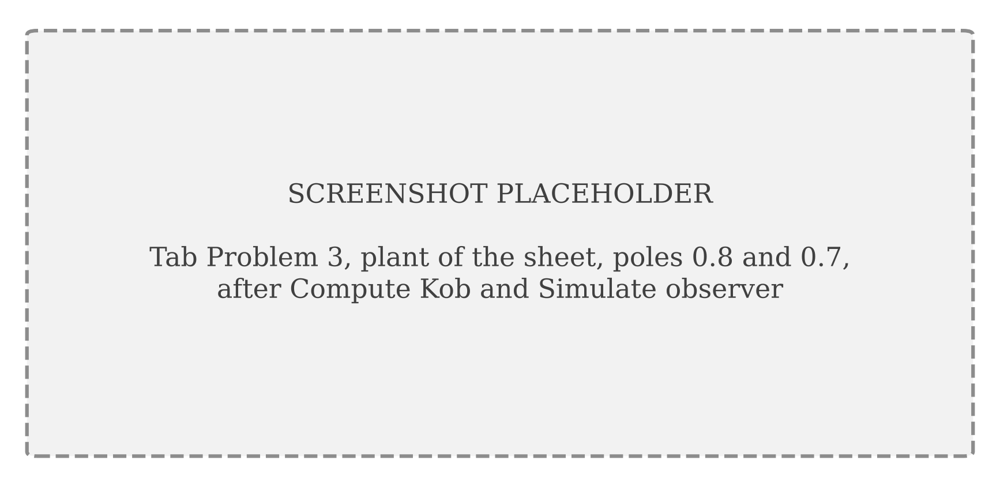
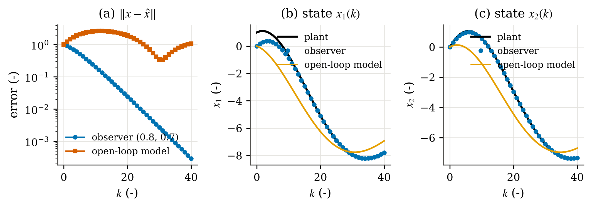

## 2.2 Answer and Code Explanation

The program (Delphi 13, VCL) consists of the numerical unit `MPCModel.pas` without any user-interface code, the main form `Unit1.pas` with one tab per problem and the equation window `Unit2.pas`. The numerical unit is also compiled with Free Pascal and checked by the console test `TestMPC.dpr`, so every number in this report comes from the same code as the program. All matrices are zero-based dynamic arrays. The listings follow the order of the problems and keep the line numbers of the files.

### 2.2.1 Problem 1: Bilinear Discretisation, Step and Impulse Response

The discrete matrices follow from inserting Equation 1.3 into $sX=AX+BU$ and multiplying by $\tfrac{T}{2}(z+1)$. The terms in $zX$ are collected on the left and the terms in $X$ on the right.

$$(z-1)X=\frac{T}{2}A(z+1)X+\frac{T}{2}B(z+1)U\ \Rightarrow\ zX\left(I-\frac{T}{2}A\right)=\left(I+\frac{T}{2}A\right)X+\frac{T}{2}(z+1)BU \qquad\qquad (2.1)$$

Multiplying from the left by $\left(I-\tfrac{T}{2}A\right)^{-1}$ gives the state update. The first term is Equation 1.4. The input term still contains $z+1$, that is the input of two neighbouring samples.

$$zX=\underbrace{\left(I-\frac{T}{2}A\right)^{-1}\left(I+\frac{T}{2}A\right)}_{A_d}X+\left(I-\frac{T}{2}A\right)^{-1}B\,T\,\frac{z+1}{2}\,U \qquad\qquad (2.2)$$

For an input that is constant over the step, $\tfrac{z+1}{2}U$ becomes $U$ and the input matrix is the standard form of Equation 1.7. The lecture slides instead replace $\tfrac{z+1}{2}$ by its value at $z=(1+T/2)/(1-T/2)$, which is the image of $s=1$ rad/s, and obtain Equation 1.5 [@mpc].

$$\frac{z+1}{2}\bigg|_{z=\frac{1+T/2}{1-T/2}}=\frac{1}{1-T/2}\ \Rightarrow\ \frac{B_d^{\text{lecture}}}{B_d^{\text{standard}}}=\frac{1}{1-T/2}=1.0005003\ (T=0.001\ \text{s}),\qquad 1.0526316\ (T=0.1\ \text{s}) \qquad\qquad (2.3)$$

The factor adds the time $T$ to the pure number 1, so it is not dimensionally consistent and scales every input gain by $1/(1-T/2)$. The problem sheet asks for the lecture formula and prints its result, so the program uses Equation 1.5 by default and offers Equation 1.7 and the zero-order hold for comparison (ISS-079). The eigenvalues follow the same map as the poles. With Equation 1.3 an eigenvalue $\lambda$ of $A$ becomes $z=(1+\lambda T/2)/(1-\lambda T/2)$. For system 1 the eigenvalues are $2$, $0$ and $-2$, which give $z=1.002002$, $1$ and $0.998002$. The first lies outside the unit circle, so the responses of system 1 grow without bound. System 2 has $G(s)=C(sI-A)^{-1}B=s/(s^2+4)$ with poles $s=\pm2j$, its step response is $0.5\sin2t$ and its impulse response $\cos2t$, an oscillation that never decays. For $s=j\omega$ the numerator $1+j\omega T/2$ and the denominator $1-j\omega T/2$ of $z$ are complex conjugates of equal length, so $|z|=1$ exactly and the oscillation keeps its amplitude after discretisation. Only the frequency is warped, the angle per sample being $2\arctan(\omega T/2)$ instead of $\omega T$.

`MatInverse` inverts $I-\tfrac{T}{2}A$ by Gauss-Jordan elimination with partial pivoting and reports a singular matrix, which happens when $2/T$ is an eigenvalue of $A$. `Discretise` implements Equation 1.4 to Equation 1.8 for the three methods. `Simulate` runs Equation 1.9 for a step or a pulse, and `Eigenvalues` returns the poles, in closed form for $n\le2$ and from the characteristic polynomial of the shifted and scaled matrix $(A-cI)/s$ for $n>2$, which keeps the three close eigenvalues of system 1 accurate to $10^{-16}$ (ISS-084). `ExactSampled` gives the exact continuous responses for comparison.

@@CODE MPCModel.pas MatInverse@@

@@CODE MPCModel.pas Discretise@@

@@CODE MPCModel.pas Simulate@@

@@CODE MPCModel.pas Eigenvalues@@

@@CODE MPCModel.pas ExactSampled@@

The button Step and impulse of the first tab reads the model table, discretises it and simulates both inputs. With the check box Pulse of area 1 the pulse has the height $1/T$, so the discrete response can be drawn on top of the continuous impulse response.

The check box decides which of the two pulse conventions of Section 1.3 the program applies. Unticked, the input is the unit pulse $u(0)=1$ of the lecture definition, and the response is the sequence of Markov parameters $g_k=C_dA_d^{k-1}B_d$ that Problem 2 identifies and that the earlier student program and the lecturer's data use. Ticked, the pulse has the height $1/T$ and therefore the area 1 of the Dirac impulse, so the response approximates the continuous impulse response $g(t)=Ce^{At}B$, which has the unit 1/s, and can be drawn on top of it. Both responses come from the same linear simulation and differ only by the factor $T$, $y_{1/T}(k)=g_k/T$, so the choice changes the scale of the chart and not the model. Because the lecture formula keeps $C_d=C$ and $D_d=D=0$, the pulse reaches the output one sample after it enters the state, which gives $y(0)=0$ while $g(0)=CB=1$ for both systems.

@@CODE Unit1.pas TForm1.btnP1SimulateClick | ClearChart(chtP1Step); >> btnP1DiscretiseClick(nil); >> clear both charts, add the points of the discrete and the exact series, set the chart title@@

All charts share one hover routine of the `TChart` interposer, which marks the series point nearest to the mouse. It forms the pixel offsets as `Double` and skips every point that lies more than 40 pixels away in $x$ or $y$ before the offsets are squared. The first version squared the `Integer` offsets. On the first tab a point far outside the visible axis range, for example a point of the unit circle while the pole chart of system 1 is scaled close to its poles, lies more than 46341 pixels from the mouse, so its square exceeded $2^{31}-1$ and the overflow check of the Debug build raised `EIntOverflow` (ISS-086).

@@CODE Unit1.pas TChart.MouseMove | for LS := 0 to SeriesCount - 1 do >> if LBestSer <> nil then >> for every active series, bisection on x for series with ascending x and a full scan of the unit circle and pole series, Probe for each candidate index@@

### 2.2.2 Problem 2: Ho-Kalman Realisation with the SVD

The differential equation of the sheet is written in state-space form with $x_1=x$ and $x_2=\dot x$, Equation 2.4. Its poles are $s=-0.25\pm0.968j$ ($\omega_n=1$ rad/s, $\zeta=0.25$) and its static gain is 1.

$$\ddot x=-0.5\dot x-x+u\ \Rightarrow\ \begin{bmatrix}\dot x_1\\\dot x_2\end{bmatrix}=\begin{bmatrix}0&1\\-1&-0.5\end{bmatrix}\begin{bmatrix}x_1\\x_2\end{bmatrix}+\begin{bmatrix}0\\1\end{bmatrix}u,\qquad y=\begin{bmatrix}1&0\end{bmatrix}x \qquad\qquad (2.4)$$

`StepData` discretises Equation 2.4 with $T=0.1$ s and records the unit-step response, by default with the lecture formula of Problem 1. `MarkovFromStep` forms the differences of Equation 1.10 and `Hankel` fills $H_{k,l}$ or, with a shift of one, $H^{\uparrow}$ (Equation 1.11). `SVDJacobi` is the one-sided Jacobi method of Equation 1.16. After the sweeps it sorts the singular values in descending order, completes the columns of $U$ that belong to zero singular values by Gram-Schmidt, and makes the first entry of every column of $U$ negative, the sign convention of the lecturer's output files (ISS-081). `HoKalman` chooses the order from the singular values, builds $\mathcal{O}_k$ and $\mathcal{C}_l$ with Equation 1.13, computes $A$ with Equation 1.14, takes $B$, $C$, $D$ from Equation 1.15 and simulates the identified model on the same step to measure how well it reproduces the data. `HoKalmanText` writes all these intermediate results to the .dat file that the sheet asks for.

@@CODE MPCModel.pas StepData@@

@@CODE MPCModel.pas MarkovFromStep@@

@@CODE MPCModel.pas Hankel@@

@@CODE MPCModel.pas SVDJacobi@@

@@CODE MPCModel.pas HoKalman@@

@@CODE Unit1.pas TForm1.btnP2IdentifyClick | if not (ReadCount(vleP2Hankel >> try >> read k, l, n and the tolerance; refuse k + l + 1 > samples and n > min(k, l) || FP2Header := >> if not LR.Ok then >> header of the .dat file, points of the step data and of the singular values || LSb := TStringList.Create; >> Log('INFO', 'Ho-Kalman: order ' >> result panel: HoKalmanText, eigenvalues of the analytic Ad, difference to the plant of Problem 3@@

### 2.2.3 Problem 3: Observer Gain by Pole Placement

For part (a) the error matrix of a second-order plant with one output is written out element by element, Equation 2.5.

$$A-K_{ob}C=\begin{bmatrix}A_{11}&A_{12}\\A_{21}&A_{22}\end{bmatrix}-\begin{bmatrix}K_1\\K_2\end{bmatrix}\begin{bmatrix}C_1&C_2\end{bmatrix}=\begin{bmatrix}A_{11}-K_1C_1&A_{12}-K_1C_2\\A_{21}-K_2C_1&A_{22}-K_2C_2\end{bmatrix} \qquad\qquad (2.5)$$

Its characteristic polynomial has the trace of Equation 2.5 in the linear term and its determinant as the constant term. In the determinant the products $K_1K_2C_1C_2$ of both diagonals cancel, so both coefficients are linear in $K_1$ and $K_2$.

$$\det\left(\lambda I-(A-K_{ob}C)\right)=\lambda^2-\left(A_{11}+A_{22}-C_1K_1-C_2K_2\right)\lambda+\det A-\left(C_1A_{22}-C_2A_{21}\right)K_1-\left(A_{11}C_2-A_{12}C_1\right)K_2 \qquad\qquad (2.6)$$

Matching the coefficients of Equation 2.6 with $\lambda^2-(p_1+p_2)\lambda+p_1p_2$ from Equation 1.19 gives two linear equations for the two gains, Equation 2.7.

::: {custom-style="Highlighted Equation"}
$$\begin{bmatrix}C_1&C_2\\C_1A_{22}-C_2A_{21}&A_{11}C_2-A_{12}C_1\end{bmatrix}\begin{bmatrix}K_1\\K_2\end{bmatrix}=\begin{bmatrix}\alpha\\\beta\end{bmatrix},\qquad \alpha=A_{11}+A_{22}-(p_1+p_2),\quad \beta=\det A-p_1p_2 \qquad\qquad (2.7)$$
:::

With $m_{21}=C_1A_{22}-C_2A_{21}$ and $m_{22}=A_{11}C_2-A_{12}C_1$, Cramer's rule gives the general expression of the observer gain, Equation 2.8. The determinant of the coefficient matrix is exactly the negative determinant of the observability matrix of Equation 1.20, so the gain exists for every choice of poles precisely when the plant is observable.

::: {custom-style="Highlighted Equation"}
$$K_1=\frac{\alpha\,m_{22}-C_2\,\beta}{\det M},\qquad K_2=\frac{C_1\,\beta-m_{21}\,\alpha}{\det M},\qquad \det M=C_1m_{22}-C_2m_{21}=-\det\begin{bmatrix}C\\CA\end{bmatrix} \qquad\qquad (2.8)$$
:::

For part (b), $A_{11}=1.201$, $A_{12}=-0.249$, $A_{21}=0.249$, $A_{22}=0.74$, $C_1=-0.115$, $C_2=-0.09$ and the poles 0.8 and 0.7 give $\alpha=1.941-1.5=0.441$ and $\beta=0.950741-0.56=0.390741$. The coefficients are $m_{21}=-0.0851+0.02241=-0.06269$ and $m_{22}=-0.10809-0.028635=-0.136725$, so $\det M=(-0.115)(-0.136725)-(-0.09)(-0.06269)=0.010081275$ and the plant is observable. Equation 2.8 then gives $K_1=-2.49264453$ and $K_2=-1.71495421$. `ObserverGain2` evaluates exactly these expressions, checks the observability first and verifies the result with the eigenvalues of $A-K_{ob}C$. `SimulateObserver` runs the plant, the observer of Equation 1.17 and the open-loop model side by side from different initial states.

@@CODE MPCModel.pas ObserverGain2@@

@@CODE MPCModel.pas SimulateObserver@@

@@CODE Unit1.pas TForm1.btnP3GainClick | LSb.Add('det(lambda >> if LG.Ok then >> lines with p1, p2, det O, alpha, beta and det M || LSb.Add('Eigenvalues of A (open >> Log('INFO', 'Kob = [' >> eigenvalues of A and of A - Kob C@@

## 2.3 Execution Analysis

### 2.3.1 Problem 1

Figure 2.1 shows the first tab after Discretise and Step and impulse for system 1. With the lecture formula and $T=0.001$ s all nine entries of $A_d$ and all three entries of $B_d$ are printed with exactly the digits of the problem sheet, and the largest relative differences are $2.2\times10^{-16}$ for $A_d$ and $2.2\times10^{-15}$ for $B_d$ (Table 2.1). The standard form of Equation 1.7 gives the same $A_d$, while its $B_d$ is smaller by exactly $T/2=5\times10^{-4}$ relative to the sheet, which confirms Equation 2.3.

{width=16cm}

::: {custom-style="Caption Text"}
Figure 2.1. Problem 1 tab, system 1, lecture formula, $T=0.001$ s.
:::

::: {custom-style="Caption Text"}
Table 2.1. Discrete input matrix of system 1 ($T=0.001$ s), lecture and standard form against the sheet.
:::

| Entry           | Problem sheet       | Lecture formula (1.5) | Standard form (1.7) |
| --------------- | ------------------- | --------------------- | ------------------- |
| $B_{d,1}$       | 0.00100100200150225 | 0.00100100200150225   | 0.0010005015005015  |
| $B_{d,2}$       | 0.00100350275437819 | 0.00100350275437819   | 0.001003001003001   |
| $B_{d,3}$       | 0.00300200250175238 | 0.00300200250175238   | 0.0030005015005015  |
| max. rel. diff. |                     | $2.2\times10^{-15}$   | $5.0\times10^{-4}$  |

System 1 has the eigenvalue $z=1.002002$ outside the unit circle, and its step response grows to 402.13 after 3 s, close to the exact value 401.93 (Figure 2.2a). For system 2 the program gives $A_d=\begin{bmatrix}0.999998000002&0.000999999000001\\-0.003999996000004&0.999998000002\end{bmatrix}$ and $B_d=\begin{bmatrix}5.00249624812907\times10^{-7}\\0.00100049924962581\end{bmatrix}$. Its eigenvalues are $0.999998000002\pm0.001999998j$ with $|z|-1=-1.1\times10^{-16}$, and the angle per sample is $0.00199999933$ rad against $\omega T=0.002$ rad, which is the warping $2\arctan(\omega T/2)$. The step response oscillates as $0.5\sin2t$ without decay (Figure 2.2b), with a peak of 0.500250 instead of 0.5. Figure 2.2d shows that the whole difference of $2.5\times10^{-4}$ is the factor $1/(1-T/2)$ of Equation 2.3, since the standard form misses $0.5\sin2t$ by only $3.1\times10^{-6}$. The pulse of area 1 reproduces $\cos2t$ within $1.1\times10^{-3}$ after the first sample (Figure 2.2c).

With the check box unticked the same run gives the Markov parameters of the lecture convention. For system 2 they start with $g_0=0$ and $g_1=g_2=1.0005\times10^{-3}$ and oscillate with an amplitude of $1.0005\times10^{-3}$, and for system 1 the last sample at 3 s is 0.806 instead of 806.45, the factor $T=10^{-3}$ in both cases. Numbers that differ from the earlier student program or the lecturer by a factor of 1000 therefore come from the pulse convention and not from the discretisation. The pole chart is scaled to the poles, which lie within 0.003 of $z=1$ for both systems at $T=0.001$ s. On axes only 0.005 wide the unit circle near $z=1$ appears as an almost vertical line, the three real poles of system 1 sit on the real axis and the two poles of system 2 sit on that line at $\mathrm{Im}\,z=\pm0.002$. Shown with the whole circle all poles merge into one dot at $z=1$, which is correct but hides the differences, so a double click switches between both views. In the first version two quick clicks on a legend check box arrived as a double click and reset the axes to the whole circle, which is now ignored (ISS-089).

{width=16cm}

::: {custom-style="Caption Text"}
Figure 2.2. Step and impulse responses of the discrete models (lecture formula, $T=0.001$ s) against the exact continuous responses.
:::

### 2.3.2 Problem 2

With 40 step samples of Equation 2.4 at $T=0.1$ s the Hankel matrix $H_{4,4}$ has the singular values 0.1378980223, 0.01322153037, $1.5\times10^{-17}$ and $4.9\times10^{-18}$ (Figure 2.3 and Figure 2.4c). The third value is fifteen orders of magnitude below the first, so the automatic order is $n=2$, as expected for a second-order plant. The Jacobi SVD needed six sweeps. The identified model is

$$A=\begin{bmatrix}1.200862958&-0.2486111663\\0.2486111663&0.740742881\end{bmatrix},\quad B=\begin{bmatrix}-0.1151844059\\0.09025049903\end{bmatrix},\quad C=\begin{bmatrix}-0.1151844059&-0.09025049903\end{bmatrix},\quad D=0 \qquad\qquad (2.9)$$

It reproduces every step sample within $1.5\times10^{-13}$ (Figure 2.4a and 2.4b), and its eigenvalues $0.970802919708\pm0.0942331714406j$ agree with those of the discretised Equation 2.4 to $4\times10^{-15}$. Rounded to three decimals Equation 2.9 is the plant of Problem 3, so the observer problem uses the model that Problem 2 identifies (ISS-083). $B$ and $C$ have equal first entries, a property of the balanced split of Equation 1.13 for a symmetric Hankel matrix. The data reach the steady value $1/(1-T/2)=1.0526$ instead of 1 because of the factor of Equation 2.3.

{width=16cm}

::: {custom-style="Caption Text"}
Figure 2.3. Problem 2 tab after Ho-Kalman (SVD), lecture data, $H_{4,4}$.
:::

{width=16cm}

::: {custom-style="Caption Text"}
Figure 2.4. Step data and identified model (a), Markov parameters (b) and singular values of $H_{4,4}$ (c).
:::

The size of the Hankel matrix changes the realisation but not the system (Table 2.2). Every size from $2\times2$ to $12\times12$ finds the order 2 and the same eigenvalues to twelve digits, while the entries of $A$, $B$ and $C$ move, because the balanced split weighs a different number of samples. Data from the standard bilinear form give the same $A$ and a $B$ smaller by $\sqrt{1-T/2}=0.9747$, since a gain factor in the data is shared equally by $B$ and $C$. Zero-order-hold data give $B_1=-0.1125$ and the eigenvalues $e^{sT}=0.970742\pm0.094286j$, so only the lecture formula leads to the plant of Problem 3. Forcing the order 3 is refused because $\sigma_3$ is rounding noise, and forcing the order 1 gives a model that misses the data completely.

::: {custom-style="Caption Text"}
Table 2.2. Ho-Kalman models of the lecture data for different Hankel sizes (60 samples, eigenvalues $0.970803\pm0.094233j$ in every case).
:::

| $k=l$ | $\sigma_1$ | $\sigma_2$ | $\sigma_3$          | $A_{11}$, $A_{12}$, $A_{22}$ | $B$               | max. step error     |
| ----- | ---------- | ---------- | ------------------- | ---------------------------- | ----------------- | ------------------- |
| 2     | 0.032635   | 0.003130   | none                | 1.5141, $-0.5514$, 0.4275    | $-0.0868$, 0.0491 | $7.4\times10^{-14}$ |
| 3     | 0.077842   | 0.007446   | $6.7\times10^{-19}$ | 1.2959, $-0.3385$, 0.6457    | $-0.1019$, 0.0726 | $3.6\times10^{-14}$ |
| 4     | 0.137898   | 0.013222   | $1.5\times10^{-17}$ | 1.2009, $-0.2486$, 0.7407    | $-0.1152$, 0.0903 | $1.9\times10^{-13}$ |
| 8     | 0.460501   | 0.051538   | $1.1\times10^{-16}$ | 1.0653, $-0.1335$, 0.8763    | $-0.1574$, 0.1402 | $5.0\times10^{-14}$ |
| 12    | 0.775207   | 0.116884   | $2.5\times10^{-16}$ | 1.0168, $-0.1049$, 0.9248    | $-0.1900$, 0.1760 | $1.3\times10^{-14}$ |

### 2.3.3 Problem 3

For the plant of the sheet the program gives $\det[C;CA]=-0.010081275$, $K_{ob}=\begin{bmatrix}-2.49264453\\-1.71495421\end{bmatrix}$ and the eigenvalues 0.8 and 0.7 of $A-K_{ob}C$ to fifteen digits (Figure 2.5). The plant itself has the eigenvalues $0.9705\pm0.0942j$ with $|z|=0.975$, so an open-loop model converges, but slowly and with an oscillation. Figure 2.6 starts the plant at $x(0)=[1\ 0]^T$ and both estimates at zero with $u=1$. The observer error falls to 0.202 after 10 samples, 0.0244 after 20 and 0.0027 after 30, close to the decay $0.8^k$ of the slower pole. The open-loop error first grows to 2.6 and is still 0.35 after 30 samples. In the state plots the observer joins the plant after about 15 samples, while the open-loop model lags behind throughout.

{width=16cm}

::: {custom-style="Caption Text"}
Figure 2.5. Problem 3 tab, plant of the sheet, observer poles 0.8 and 0.7.
:::

{width=16cm}

::: {custom-style="Caption Text"}
Figure 2.6. Estimation error (a) and the two states (b, c) of the plant, the observer and the open-loop model.
:::

Table 2.3 varies the observer poles. Faster poles need a larger gain, and the poles 0 and 0 give a deadbeat observer whose error is exactly zero after two samples. Poles at 0.95 and 0.9 lie close to the plant poles, the error then decays more slowly than with the plant model alone and even grows to 1.89 at first. For the pendulum example of the lecture slides (poles 0.1 and 0.2) the same routine gives $K_{ob}=[-1.6288\ \ 1.6602]^T$ and the poles 0.2 and 0.1 [@mpc].

::: {custom-style="Caption Text"}
Table 2.3. Observer gain and estimation error for different poles (plant of the sheet, $x(0)=[1\ 0]^T$, $\hat x(0)=0$, $u=1$).
:::

| Poles $p_1$, $p_2$ | $K_1$        | $K_2$       | error at $k=10$    | error at $k=20$     | first $k$ with error < 0.01 |
| ------------------ | ------------ | ----------- | ------------------ | ------------------- | --------------------------- |
| 0.8, 0.7 (sheet)   | $-2.492645$  | $-1.714954$ | 0.202              | 0.0244              | 25                          |
| 0.5, 0.4           | $-7.416129$  | $-2.090502$ | $3.6\times10^{-4}$ | $4.8\times10^{-7}$  | 4                           |
| 0.3, 0.2           | $-11.591196$ | $-1.200138$ | $2.0\times10^{-5}$ | $1.2\times10^{-10}$ | 5                           |
| 0, 0 (deadbeat)    | $-17.836686$ | 1.224654    | 0                  | 0                   | 2                           |
| 0.95, 0.9          | $-0.379445$  | $-0.526265$ | 1.89               | 1.61                | not within 60               |

### 2.3.4 Comparison with the Lecturer's Data and an Earlier Program

The simulator `MPC.exe` of the lecture material is an empty file of 0 bytes, also in its zip archive and in the course download, so the comparison uses the output files of the lecturer instead (ISS-080). Table 2.4 summarises it. `svdku1.dat` holds the SVD of the $3\times3$ example `train1.dat`. My Jacobi SVD gives the same singular values and the same $U$ and $V$ to six decimals up to the sign of a column, only sorted in descending order. `svdku123456.dat` turned out to be the SVD of the $4\times4$ Hankel matrix of Problem 2, printed with two decimals, and its $U$ agrees with mine to $1.8\times10^{-4}$. The remaining gap could not be traced to RK4, Euler or rounded data, so the lecturer's data generator differs slightly from the lecture formula. An earlier student program (Senior A) solved Problem 3 with a formula that takes $K_1$ from the trace equation with a wrong coefficient. Its gain $[-4.631\ \ -7.057]^T$ places the poles at 1.060 and $-0.287$, so that observer diverges. The same program discretised Problem 1 with 0.01 s instead of 0.001 s and filled the Hankel matrix with step samples instead of Markov parameters.

::: {custom-style="Caption Text"}
Table 2.4. Comparison with the lecturer's output files and an earlier program.
:::

| Item                                               | Reference                   | This program                 | Difference           |
| -------------------------------------------------- | --------------------------- | ---------------------------- | -------------------- |
| $\sigma$ of `train1.dat`                           | 0.71, 7.89, 6.57 (unsorted) | 7.891309, 6.574084, 0.713210 | none at two decimals |
| $\lvert U\rvert$, $\lvert V\rvert$ of `train1.dat` | `svdku1.dat`, 6 decimals    | Jacobi SVD                   | $4.6\times10^{-7}$   |
| $U(:,1{:}2)$ of $H_{4,4}$                          | `svdku123456.dat`           | Problem 2, lecture data      | $1.8\times10^{-4}$   |
| plant of Problem 3                                 | sheet, 3 decimals           | Equation 2.9                 | $7.4\times10^{-4}$   |
| observer poles (Senior A formula)                  | 0.8, 0.7                    | 1.060, $-0.287$              | unstable observer    |

## 2.4 Evaluation and Discussion

The three problems form one chain. The lecture formula of Problem 1, used with $T=0.1$ s on the plant of Problem 2, gives step data whose Ho-Kalman model is the plant of Problem 3. This explains why the sheet prints $B$ and $C$ with equal first entries, and it shows that the identified model is ready for state estimation without the original differential equation. The chain also carries the factor $T/(1-T/2)$ of Equation 1.5 into Problems 2 and 3. At $T=0.001$ s the factor changes the gain by 0.05 % and is invisible in the plots, but at $T=0.1$ s it raises the static gain of the data by 5.3 %. In the realisation the factor only scales $B$ and $C$ by $\sqrt{1.0526}$, while the eigenvalues, the order and therefore the observer poles are unaffected. The standard form of Equation 1.7 or the zero-order hold would give a model with the correct static gain.

The bilinear transformation preserved the stability properties of Chapter I exactly. The unstable system 1 stays unstable with $z=1.002$, and the undamped system 2 keeps $|z|=1$ to $10^{-16}$, so its discrete responses oscillate with constant amplitude. The price is a small frequency warping, which at $T=0.001$ s amounts to a relative change of $3.3\times10^{-7}$ and grows to $3.3\times10^{-3}$ at $T=0.1$ s. The responses therefore follow $0.5\sin2t$ and $\cos2t$, and the visible error of the lecture model is the gain factor and not the discretisation itself.

The Ho-Kalman method recovered the order and the eigenvalues of the plant exactly from noise-free data. The gap between $\sigma_2$ and $\sigma_3$ of fifteen decades makes the order decision trivial, which would not hold for measured data, where noise fills the trailing singular values and the tolerance becomes a modelling choice. Writing the SVD myself with one-sided Jacobi rotations gave sorted singular values with a relative accuracy that the rank decision needs, and it reproduces the lecturer's results. The observer gain of Equation 2.8 places the poles exactly and fails only for an unobservable plant, where the program stops with a message. The pole variation shows the trade-off of pole placement. Poles close to the origin converge within a few samples but need gains of 7 to 18, which would amplify measurement noise, while poles near the plant poles give no benefit over the open-loop model. The poles 0.8 and 0.7 of the sheet lie between these extremes.
