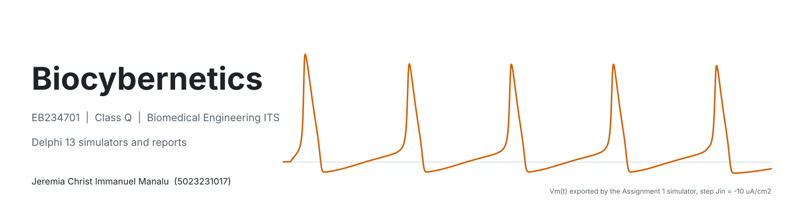
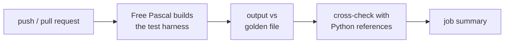
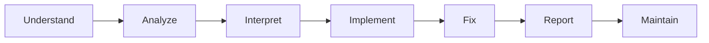

<a id="top"></a>

<div align="center">

<picture>
  <source media="(prefers-color-scheme: dark)" srcset="docs/assets/banner-dark.png">
  
</picture>

[](#about)
[](#about)
[](#tech-stack)
[](https://github.com/ZinniXX004/Biocybernetics/actions/workflows/a1-model-regression.yml)
[](https://github.com/ZinniXX004/Biocybernetics/actions/workflows/a2-model-regression.yml)
[](https://github.com/ZinniXX004/Biocybernetics/actions/workflows/a3-model-regression.yml)
[](https://github.com/ZinniXX004/Biocybernetics/actions/workflows/a4-model-regression.yml)
[](#assignments)

[About](#about) ·
[Assignments](#assignments) ·
[Featured](#featured) ·
[Tech stack](#tech-stack) ·
[Layout](#repository-layout) ·
[CI](#continuous-integration) ·
[Workflow](#working-method) ·
[Tracking](#tracking)

</div>

## About

Simulation programs and reports for **Biocybernetics (EB234701), Class Q**, Department of Biomedical Engineering, Institut Teknologi Sepuluh Nopember. Every assignment is a Windows program written in Object Pascal with RAD Studio Delphi 13 Florence (VCL, TeeChart) together with an English report. The numerical core of each program is kept free of user-interface code so that it can be tested automatically.

|              |                                             |
| ------------ | ------------------------------------------- |
| **Author**   | Jeremia Christ Immanuel Manalu (5023231017) |
| **Lecturer** | Course lecturer                             |
| **Semester** | Odd semester 2026/2027                      |

<p align="right"><sub><a href="#top">Back to top</a></sub></p>

## Assignments

| #   | Topic                                                                                                                                                                        | Program                                       | Report                                      | Status                                                   |
| --- | ---------------------------------------------------------------------------------------------------------------------------------------------------------------------------- | --------------------------------------------- | ------------------------------------------- | -------------------------------------------------------- |
| 1   | [**Hodgkin-Huxley Neuron Model**](Assignment%201_HH%20Model/): action potential generation (RK4), refractory period, C-F converter, cable propagation (FTCS, Crank-Nicolson) | [Program](Assignment%201_HH%20Model/Program/) | [Report](Assignment%201_HH%20Model/Report/) |        |
| 2   | [**Lagrangian and Hamiltonian Mechanics**](Assignment%202_Lagrangian%20and%20Hamiltonian%20Mechanics/): Hamilton's principle, spherical pendulum with the Lagrangian and the Hamiltonian method (RK4) | [Program](Assignment%202_Lagrangian%20and%20Hamiltonian%20Mechanics/Program/) | [Report](Assignment%202_Lagrangian%20and%20Hamiltonian%20Mechanics/Report/) |        |
| 3   | [**Preliminary: PID by Ziegler-Nichols**](Assignment%203_Preliminary/): two second-order plants (RK4), ZN Method 1 (reaction curve) and Method 2 (critical gain), closed-loop P, PI, PID | [Program](Assignment%203_Preliminary/Program/) | [Report](Assignment%203_Preliminary/Report/) |        |
| 4   | [**MPC Experimental Steps**](Assignment%204_MPC%20Experimental%20Step/): bilinear discretisation, Ho-Kalman realisation from step data with my own Jacobi SVD, observer gain by pole placement | [Program](Assignment%204_MPC%20Experimental%20Step/Program/) | [Report](Assignment%204_MPC%20Experimental%20Step/Report/) |        |
| 5   | System identification by model parameter identification                                                                                                                      |                                               |                                             |  |
| FP  | Final project (topic announced later)                                                                                                                                        |                                               |                                             |  |

A folder is added to the repository only when its assignment is finished, because task details may still change before then.

<p align="right"><sub><a href="#top">Back to top</a></sub></p>

## Featured

One highlight per finished assignment. Each assignment README holds the full description, equations, results and screenshots.

### Assignment 1: Hodgkin-Huxley Neuron Model

<table>
  <tr>
    <td width="50%"><a href="Assignment%201_HH%20Model/"></a></td>
    <td width="50%"><a href="Assignment%201_HH%20Model/"></a></td>
  </tr>
  <tr>
    <td><sub><b>Action potential generation</b>: coupled RK4 of the four HH equations, ionic currents, gates and conductances</sub></td>
    <td><sub><b>Action potential propagation</b>: passive 2 mm cable driven by the APG waveform, 3D mesh of Vm(x, t)</sub></td>
  </tr>
</table>

```math
C_m\frac{dv}{dt} = J_{in} - \bar g_{Na}m^{3}h\,(v-V_{Na}) - \bar g_{K}n^{4}\,(v-V_{K}) - \bar g_{L}\,(v-V_{L}),
\qquad
\frac{\partial v}{\partial t} = \frac{1}{(r_o+r_i)\,c_m}\frac{\partial^{2} v}{\partial x^{2}} + \frac{J_{in}-J_{ion}}{C_m}
```

Six tabs, six derivation windows with the implemented equations highlighted, CSV and PNG export, and a CI-checked numerical core. Full description: **[Assignment 1 README](Assignment%201_HH%20Model/README.md)**.

### Assignment 2: Lagrangian and Hamiltonian Mechanics

<table>
  <tr>
    <td width="50%"><a href="Assignment%202_Lagrangian%20and%20Hamiltonian%20Mechanics/"><picture><source media="(prefers-color-scheme: dark)" srcset="Assignment%202_Lagrangian%20and%20Hamiltonian%20Mechanics/docs/img/coordinates-dark.png"></picture></a></td>
    <td width="50%"><a href="Assignment%202_Lagrangian%20and%20Hamiltonian%20Mechanics/"><picture><source media="(prefers-color-scheme: dark)" srcset="Assignment%202_Lagrangian%20and%20Hamiltonian%20Mechanics/docs/img/results-dark.png"></picture></a></td>
  </tr>
  <tr>
    <td><sub><b>Spherical pendulum</b>: polar angle theta and azimuth phi of a mass on a rod</sub></td>
    <td><sub><b>Lagrange vs Hamilton</b>: identical theta(t) from both methods (RK4), velocities, momenta (p_phi constant) and the path seen from above</sub></td>
  </tr>
</table>

```math
T=\tfrac12 ml^2\left(\dot\theta^2+\sin^2\theta\,\dot\varphi^2\right),\qquad V=mgl\cos\theta
```

Lagrange and Hamilton equations of the spherical pendulum, four presets, an equation window with the implemented equations highlighted, and a CI-checked numerical core. Full description: **[Assignment 2 README](Assignment%202_Lagrangian%20and%20Hamiltonian%20Mechanics/README.md)**.

<p align="right"><sub><a href="#top">Back to top</a></sub></p>

### Assignment 3: Preliminary, PID by Ziegler-Nichols

<picture>
  <source media="(prefers-color-scheme: dark)" srcset="Assignment%203_Preliminary/docs/img/zn-overview-dark.png">
  
</picture>

```math
G_1(s)=\frac{1}{s^2+0.5s+1},\qquad G_2(s)=\frac{2s+1}{s^2+1.5s+1},\qquad u_n=K_pe_n+K_i\sum e_k\Delta t+K_d\frac{e_n-e_{n-1}}{\Delta t}
```

Plant 2 in controllable canonical form (no derivative of the input), tangent and critical gain computed from the RK4 state and the phase crossover, an adjustable dead time that makes both ZN methods applicable, one tab per problem with editable R, L, Ku, Pu, Kp, Ki and Kd, P, PI and PID closed loops with stability check, CSV and PNG export. Full description: **[Assignment 3 README](Assignment%203_Preliminary/README.md)**.

<p align="right"><sub><a href="#top">Back to top</a></sub></p>

### Assignment 4: MPC Experimental Steps

<picture>
  <source media="(prefers-color-scheme: dark)" srcset="Assignment%204_MPC%20Experimental%20Step/docs/img/mpc-overview-dark.png">
  
</picture>

```math
B_d=\left(I-\tfrac{T}{2}A\right)^{-1}B\,\frac{T}{1-T/2},\qquad
A=\Sigma_1^{-1/2}U_1^{\mathsf T}H^{\uparrow}V_1\Sigma_1^{-1/2},\qquad
\det\left(\lambda I-A+K_{ob}C\right)=(\lambda-p_1)(\lambda-p_2)
```

The lecture form of the bilinear transformation reproduces every digit of the problem sheet, and the extra factor T / (1 - T/2) in its input matrix is documented. The Ho-Kalman method with a one-sided Jacobi SVD recovers a second-order model from step data, which turns out to be the plant of the observer problem, and the observer gain of a 2 x 2 plant comes out in closed form. One tab per problem with editable matrices, the z plane, the singular values and the estimation error, CSV, PNG and .dat export. Full description: **[Assignment 4 README](Assignment%204_MPC%20Experimental%20Step/README.md)**.

<p align="right"><sub><a href="#top">Back to top</a></sub></p>

## Tech stack

| Layer                     | Tools                                                                                          |
| ------------------------- | ---------------------------------------------------------------------------------------------- |
| Programs                  | RAD Studio Delphi 13 Florence CE, Object Pascal, VCL, TeeChart Standard                        |
| Equations in the programs | LaTeX rendered to PNG, linked as RCDATA resources (A1) or stored in the form file (A2 to A4)  |
| Verification              | Free Pascal 3.2.2 (Delphi mode) for the numerical cores, independent Python references (NumPy) |
| Reports                   | Microsoft Word, IEEE references; figures and code listings generated by Python scripts         |
| Automation                | GitHub Actions                                                                                 |

<p align="right"><sub><a href="#top">Back to top</a></sub></p>

## Repository layout

```
Biocybernetics/
├── .github/workflows/        CI workflows (one per assignment)
├── Assignment 1_HH Model/    program, data, report and README of Assignment 1
├── Assignment 2_Lagrangian and Hamiltonian Mechanics/
│                             program, report and README of Assignment 2
├── Assignment 3_Preliminary/ program, report and README of Assignment 3
├── Assignment 4_MPC Experimental Step/
│                             program, data, report and README of Assignment 4
├── docs/                     images of this README and the script that builds them
├── CHANGELOG.md              dated record of every change
├── ISSUES.md                 problems found and how they were resolved
└── README.md
```

Each assignment folder contains `Program/` (Delphi project and verification), `Data/` (CSV exports), `Report/` (Word report and build scripts) and its own README.

<p align="right"><sub><a href="#top">Back to top</a></sub></p>

## Continuous integration

The VCL programs need Windows and RAD Studio, so CI tests the numerical cores, which contain no UI code.



| Workflow                                                               | Checks                                                                                                |
| ---------------------------------------------------------------------- | ----------------------------------------------------------------------------------------------------- |
| [`a1-model-regression.yml`](.github/workflows/a1-model-regression.yml) | Assignment 1: HH membrane (RK4), refractory sweep, C-F curve, cable (FTCS, Crank-Nicolson, APG drive) |
| [`a2-model-regression.yml`](.github/workflows/a2-model-regression.yml) | Assignment 2: pendulum core (Lagrange vs Hamilton, planar periods, conical pendulum, H and p_phi)     |
| [`a3-model-regression.yml`](.github/workflows/a3-model-regression.yml) | Assignment 3: plants, RK4 vs exact, ZN Method 1 and 2, Ku vs dt, closed-loop stability                |
| [`a4-model-regression.yml`](.github/workflows/a4-model-regression.yml) | Assignment 4: bilinear discretisation vs the sheet, eigenvalues, Jacobi SVD, Ho-Kalman, observer gain |

Run history: [Actions](https://github.com/ZinniXX004/Biocybernetics/actions).

<p align="right"><sub><a href="#top">Back to top</a></sub></p>

## Working method

Every assignment follows the same cycle, and every step leaves a trace in the repository:



Formulas are checked against the lecture material and the original papers before they are coded; discrepancies are recorded in the issue log.

## Tracking

- [CHANGELOG.md](CHANGELOG.md): what changed, when, and why.
- [ISSUES.md](ISSUES.md): problems in references, code and environment, with their resolution and status.

## Not included

Lecture slides, textbooks, journal papers and other students' reports are used only as local references. They are excluded by [`.gitignore`](.gitignore) for copyright reasons.

<p align="right"><sub><a href="#top">Back to top</a></sub></p>
