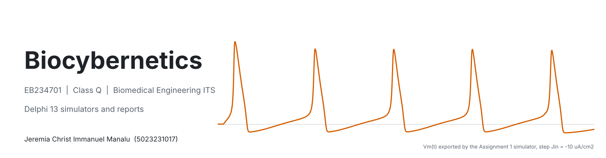
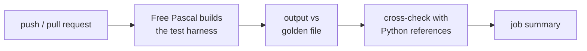
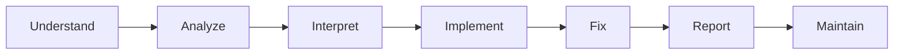

<a id="top"></a>

<div align="center">

<picture>
  <source media="(prefers-color-scheme: dark)" srcset="docs/assets/banner-dark.png">
  
</picture>

[](#about)
[](#about)
[](#tech-stack)
[](https://github.com/ZinniXX004/Biocybernetics/actions/workflows/a1-model-regression.yml)
[](#assignments)

[About](#about) ·
[Assignments](#assignments) ·
[Featured](#featured-assignment-1) ·
[Tech stack](#tech-stack) ·
[Layout](#repository-layout) ·
[CI](#continuous-integration) ·
[Workflow](#working-method) ·
[Tracking](#tracking)

</div>

## About

Simulation programs and reports for **Biocybernetics (EB234701), Class Q**, Department of Biomedical Engineering, Institut Teknologi Sepuluh Nopember. Every assignment is a Windows program written in Object Pascal with RAD Studio Delphi 13 Florence (VCL, TeeChart) together with an English report. The numerical core of each program is kept free of user-interface code so that it can be tested automatically.

|              |                                             |
| ------------ | ------------------------------------------- |
| **Author**   | Jeremia Christ Immanuel Manalu (5023231017) |
| **Lecturer** | Dr. Achmad Arifin, S.T., M.Eng.             |
| **Semester** | Odd semester 2026/2027                      |

<p align="right"><sub><a href="#top">Back to top</a></sub></p>

## Assignments

| #   | Topic                                                                                                                                                                        | Program                                       | Report                                      | Status                                                   |
| --- | ---------------------------------------------------------------------------------------------------------------------------------------------------------------------------- | --------------------------------------------- | ------------------------------------------- | -------------------------------------------------------- |
| 1   | [**Hodgkin-Huxley Neuron Model**](Assignment%201_HH%20Model/): action potential generation (RK4), refractory period, C-F converter, cable propagation (FTCS, Crank-Nicolson) | [Program](Assignment%201_HH%20Model/Program/) | [Report](Assignment%201_HH%20Model/Report/) |   |
| 2   | Lagrangian and Hamiltonian Mechanics                                                                                                                                         |                                               |                                             |  |
| 3   | Preliminary: PID parameter determination (Ziegler-Nichols)                                                                                                                   |                                               |                                             |  |
| 4   | MPC experimental step                                                                                                                                                        |                                               |                                             |  |
| 5   | System identification by model parameter identification                                                                                                                      |                                               |                                             |  |
| FP  | Final project (topic announced later)                                                                                                                                        |                                               |                                             |  |

A folder is added to the repository only when its assignment is finished, because task details may still change before then.

<p align="right"><sub><a href="#top">Back to top</a></sub></p>

## Featured: Assignment 1

<table>
  <tr>
    <td width="50%"><a href="Assignment%201_HH%20Model/"></a></td>
    <td width="50%"><a href="Assignment%201_HH%20Model/"></a></td>
  </tr>
  <tr>
    <td><sub><b>Action potential generation</b>: coupled RK4 of the four HH equations, ionic currents, gates and conductances</sub></td>
    <td><sub><b>Action potential propagation</b>: passive 2 mm cable driven by the APG waveform, 3D mesh of Vm(x, t)</sub></td>
  </tr>
</table>

```math
C_m\frac{dv}{dt} = J_{in} - \bar g_{Na}m^{3}h\,(v-V_{Na}) - \bar g_{K}n^{4}\,(v-V_{K}) - \bar g_{L}\,(v-V_{L}),
\qquad
\frac{\partial v}{\partial t} = \frac{1}{(r_o+r_i)\,c_m}\frac{\partial^{2} v}{\partial x^{2}} + \frac{J_{in}-J_{ion}}{C_m}
```

Six tabs, six derivation windows with the implemented equations highlighted, CSV and PNG export, and a CI-checked numerical core. Full description, equations, results and screenshots: **[Assignment 1 README](Assignment%201_HH%20Model/README.md)**.

<p align="right"><sub><a href="#top">Back to top</a></sub></p>

## Tech stack

| Layer                     | Tools                                                                                          |
| ------------------------- | ---------------------------------------------------------------------------------------------- |
| Programs                  | RAD Studio Delphi 13 Florence CE, Object Pascal, VCL, TeeChart Standard                        |
| Equations in the programs | LaTeX rendered to PNG, linked as RCDATA resources                                              |
| Verification              | Free Pascal 3.2.2 (Delphi mode) for the numerical cores, independent Python references (NumPy) |
| Reports                   | Microsoft Word, IEEE references; figures and code listings generated by Python scripts         |
| Automation                | GitHub Actions                                                                                 |

<p align="right"><sub><a href="#top">Back to top</a></sub></p>

## Repository layout

```
Biocybernetics/
├── .github/workflows/        CI workflows (one per assignment)
├── Assignment 1_HH Model/    program, data, report and README of Assignment 1
├── docs/                     images of this README and the script that builds them
├── CHANGELOG.md              dated record of every change
├── ISSUES.md                 problems found and how they were resolved
└── README.md
```

Each assignment folder contains `Program/` (Delphi project and verification), `Data/` (CSV exports), `Report/` (Word report and build scripts) and its own README.

<p align="right"><sub><a href="#top">Back to top</a></sub></p>

## Continuous integration

The VCL programs need Windows and RAD Studio, so CI tests the numerical cores, which contain no UI code.



| Workflow                                                               | Checks                                                                                                |
| ---------------------------------------------------------------------- | ----------------------------------------------------------------------------------------------------- |
| [`a1-model-regression.yml`](.github/workflows/a1-model-regression.yml) | Assignment 1: HH membrane (RK4), refractory sweep, C-F curve, cable (FTCS, Crank-Nicolson, APG drive) |

Run history: [Actions](https://github.com/ZinniXX004/Biocybernetics/actions).

<p align="right"><sub><a href="#top">Back to top</a></sub></p>

## Working method

Every assignment follows the same cycle, and every step leaves a trace in the repository:



Formulas are checked against the lecture material and the original papers before they are coded; discrepancies are recorded in the issue log.

## Tracking

- [CHANGELOG.md](CHANGELOG.md): what changed, when, and why.
- [ISSUES.md](ISSUES.md): problems in references, code and environment, with their resolution and status.

## Not included

Lecture slides, textbooks, journal papers and other students' reports are used only as local references. They are excluded by [`.gitignore`](.gitignore) for copyright reasons.

<p align="right"><sub><a href="#top">Back to top</a></sub></p>
